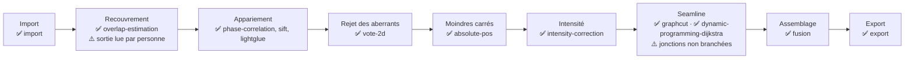

# Carte de l'architecture : KIKIRPA-CPP

Guide pour se repérer dans le code de **`main`**, à jour du 18/11/2026 (`08bd177`, après #150).

Depuis la version précédente de cette carte (07/11, après #80), `main` a reçu :
- **le 09/11** : le step `dynamic-programming-dijkstra` et une nouvelle version de `intensity-correction` (#72), le premier export (#98, #99, #102) et les premières fenêtres Qt (#91, #104) ;
- **le 10/11** : les fenêtres Qt suivantes (#109, #114), les résidus d'`absolute-pos` (#100), le step `vote-2d` (#111), `final-verification` (#116), le writer TIFF par blocs et le contrat `Mosaic` (#118), l'installation d'un poste (#113, #130) ;
- **le 11/11** : OpenCV 4 forcé (#106), un nouvel apport au frontend (#131) et les corrections de GraphCut, qui imposent le nommage `_C<colonne>_R<ligne>` (#86) ;
- **le 15/11** : la liste de noms qui remplace `REGISTERED_STEP_COUNT`, le step `overlap-estimation` (#127), l'assemblage `fusion` (#119) et la ligne de commande avec les chemins UTF-8 (#103) ;
- **le 17/11** : le vrai calcul lancé depuis l'interface (#132), les docs du vote 2D et de RANSAC (#135, #136), l'installation sous Ubuntu 24.04 (#138), un seul identifiant de tuile et la case fixée par `import` (#149), le placement des tuiles sans exigence sur le nom des fichiers (#151) ;
- **le 18/11** : les panneaux de l'interface sur petit écran (#152), la doc de la corrélation de phase (#145), les territoires de `dynamic-programming-dijkstra`, enfin lus par `fusion` (#137), l'aperçu de l'export à la bonne taille et `scale` de `graphcut` à 0,25 par défaut (#150).

**La chaîne va maintenant de l'import à `mosaic.tif`, en ligne de commande comme depuis l'interface.**

Les éléments marqués **🆕** ont changé avec la réorganisation de `core/` et `steps/` (PR #50) ou la migration des algorithmes (#76) : dossiers en minuscules, fichiers en `snake_case`, noms anglais, un namespace par dossier, nouveau format JSON. La correspondance entre anciens et nouveaux noms est dans [MIGRATION_REORGANISATION.md](MIGRATION_REORGANISATION.md) : §12 pour les algorithmes, §14 pour ce qui a changé du 09 au 15/11, §15 pour les 17 et 18/11. Règles de nommage : [CONVENTIONS.md](CONVENTIONS.md).

> **Cette carte doit rester à jour.** Elle est mise à jour, avec [MIGRATION_REORGANISATION.md](MIGRATION_REORGANISATION.md), **après le merge** de chaque PR qui ajoute, déplace, renomme ou supprime un fichier, un step, un type partagé ou un test, dans une PR séparée. L'auteur d'une PR n'a pas à modifier ces deux docs.

Les liens ouvrent les fichiers.

**Sommaire**

- [Carte de l'architecture : KIKIRPA-CPP](#carte-de-larchitecture--kikirpa-cpp)
  - [1. Vue d'ensemble](#1-vue-densemble)
  - [2. Où aller pour…](#2-où-aller-pour)
  - [3. Comment le code est rangé](#3-comment-le-code-est-rangé)
  - [4. Arborescence annotée, fichier par fichier](#4-arborescence-annotée-fichier-par-fichier)
    - [Racine et build](#racine-et-build)
    - [`core/` : le moteur](#core--le-moteur)
    - [`steps/` : les étapes du pipeline](#steps--les-étapes-du-pipeline)
    - [`algorithms/stitching/` : appariement et positionnement 🆕](#algorithmsstitching--appariement-et-positionnement-)
    - [`algorithms/rejection/` : rejet des outliers 🆕](#algorithmsrejection--rejet-des-outliers-)
    - [`algorithms/brightness_equalization/` : égalisation de luminosité 🆕](#algorithmsbrightness_equalization--égalisation-de-luminosité-)
    - [`algorithms/seamline/` : les coutures 🆕](#algorithmsseamline--les-coutures-)
    - [`algorithms/verification/` : vérification finale](#algorithmsverification--vérification-finale)
    - [`frontend/` : interface graphique](#frontend--interface-graphique)
    - [`tests/`](#tests)
    - [`docs/`](#docs)
  - [5. Les données qui circulent](#5-les-données-qui-circulent)
  - [6. Lire un algorithme : l'exemple de la corrélation de phase](#6-lire-un-algorithme--lexemple-de-la-corrélation-de-phase)
  - [7. Pièges de lecture](#7-pièges-de-lecture)
  - [8. Ce qui n'existe qu'en PR](#8-ce-qui-nexiste-quen-pr)

---

## 1. Vue d'ensemble

Le projet a trois couches. Les **algorithmes** sont les plus fournis. L'**orchestration** est en place : un script JSON se construit, se valide, s'exécute et se reprend. La chaîne va de l'import à l'export et se lance en ligne de commande (`stitching --pipeline`) ou depuis l'interface Qt, qui exécute le pipeline dans un thread de travail (`PipelineWorkerClass`, #132).

```txt
┌────────────────────────────────────────────────────────────────────────────┐
│ ENTRÉES              src/main.cpp : stitching --pipeline <script.json>     │
│                      (ligne de commande, reprise --resume) ; sans          │
│                      argument, fenêtre Qt (src/frontend/, calcul réel)     │
├────────────────────────────────────────────────────────────────────────────┤
│ ORCHESTRATION        core/  : script JSON → buildPipeline → PipelineClass  │
│                               → StepClass → DataStoreClass ; reprise :     │
│                               RunState, CheckpointClass                    │
│                      steps/ : une classe par étape du pipeline (StepsNs)   │
├────────────────────────────────────────────────────────────────────────────┤
│ ALGORITHMES          algorithms/ : un dossier par méthode, rangé par étape │
│                      (appelables seuls, sans pipeline)                     │
└────────────────────────────────────────────────────────────────────────────┘
```

**Le pipeline prévu**, avec ce qui existe sur `main` (✅ fait · ⚠️ partiel · ❌ absent) :



Un script complet va de l'import à `mosaic.tif` : `import` → un step d'appariement → `vote-2d` (facultatif) → `absolute-pos` → `intensity-correction` → `graphcut` ou `dynamic-programming-dijkstra` → `fusion` → `export`. `fusion` applique les gains d'`intensity-correction` s'ils existent. Exemple de script : [COMPRENDRE_LE_PROJET.md §3](COMPRENDRE_LE_PROJET.md#3-faire-tourner-le-pipeline-aujourdhui).

Une **étape** (step) lit ses entrées dans le `DataStoreClass` et y écrit ses sorties. Pour faire le calcul, elle appelle un **algorithme**. L'algorithme, lui, ne connaît ni le pipeline ni le JSON : il prend des `cv::Mat` et des structures C++.

**Le chemin d'un run** :

```txt
script.json ──buildPipelineFromFile──► registre (nom → step) ──importConfig──► paramètres validés
            ──contrôle de l'enchaînement (chaque entrée produite plus tôt, même type)──► PipelineClass
PipelineClass::run ──► saute les steps déjà faits (checkpoint valide) et restaure leurs sorties
                   ──► pour chaque step : execute() → DataStoreClass → checkpoint → run.json réécrit
```

---

## 2. Où aller pour…

| Je veux… | Fichier(s) |
|---|---|
| **Comprendre le projet dans son ensemble** | [COMPRENDRE_LE_PROJET.md](COMPRENDRE_LE_PROJET.md) : les étapes et leur état, comment lancer le pipeline, ce que chaque step reçoit et produit, la mémoire, ce qui reste à faire |
| **Installer un poste de développement** | [DEMARRER.md](DEMARRER.md) et [scripts/demarrer.py](../scripts/demarrer.py) |
| **Compiler le projet** (Windows, Linux ou macOS) | [BUILD.md](BUILD.md) (Qt 6 et GoogleTest obligatoires ; sous Windows, Qt binaire via aqt, libtiff et GoogleTest via vcpkg) + [CMakePresets.json](../CMakePresets.json) (`cmake --preset windows-aqt`) |
| **Lancer les tests** | `ctest --preset windows-aqt` (ou `linux`, `macos`) : environ 250 tests GoogleTest, label `unit`, plus `lightglue_model` (label `integration`, vrai modèle ONNX téléchargé à la configuration) et `cli_default_frontend`. ⚠️ Les 8 tests de `tests/frontend/` n'ont pas de label : `ctest -L "unit\|integration"`, comme la CI, ne les lance pas |
| **Lancer un pipeline** | en ligne de commande : `stitching --pipeline <script.json> [--resume]` ([src/main.cpp](../src/main.cpp), [Pipeline.md](core/Pipeline.md#lancer-un-pipeline)) ; depuis le code : `buildPipelineFromFile()` puis `run()` |
| **Comprendre le pipeline en une page** | [Pipeline.md](core/Pipeline.md) : format du script, ligne de commande, contrôles, reprise, steps enregistrés |
| **Savoir ce qu'un step lit et écrit** | la section « Entrées et sorties » de sa fiche ; index : [steps/README.md](steps/README.md) |
| Voir comment un script JSON devient un pipeline | [pipeline_builder.cpp](../src/backend/core/pipeline/pipeline_builder.cpp) : `stepRegistry()`, `buildPipeline()` |
| **Ajouter un step au pipeline** | [AJOUTER_UN_STEP.md](steps/AJOUTER_UN_STEP.md) : exemple complet (en-tête, constructeur, `execute()`, une ligne dans `stepRegistry()` de [pipeline_builder.cpp](../src/backend/core/pipeline/pipeline_builder.cpp), son nom dans la liste `attendus` de [test_pipeline.cpp](../tests/core/test_pipeline.cpp), checkpoint d'un nouveau type, test, fiche) |
| **Comprendre comment le pipeline exécute les étapes** | [pipeline.h](../include/backend/core/pipeline/pipeline.h) → [pipeline.cpp](../src/backend/core/pipeline/pipeline.cpp) (`run()`, avec la reprise) |
| Voir comment un paramètre du JSON est validé et appliqué | [step.cpp](../src/backend/core/step/step.cpp) : `importConfig()` |
| Reprendre un pipeline après un échec ou une pause | [run_state.h](../include/backend/core/pipeline/run_state.h) (champ `"run"`), [pipeline.cpp](../src/backend/core/pipeline/pipeline.cpp) (`resolveStart`, `run`) ; en ligne de commande, `--resume` (`prepareRunState` dans [src/main.cpp](../src/main.cpp)) |
| Voir ce qui est sauvegardé dans un checkpoint | [checkpoint.cpp](../src/backend/core/checkpoint/checkpoint.cpp) (manifest, validité) + [checkpoint_types.cpp](../src/backend/core/checkpoint/checkpoint_types.cpp) (un sérialiseur par type) |
| Voir ce qu'une étape doit implémenter | [step.h](../include/backend/core/step/step.h) (`execute()`, `getParameter()`, `result`, `externalInputsFingerprint()`) 🆕 |
| Voir comment les données passent d'une étape à l'autre | [data_store.h](../include/backend/core/step/data_store.h) (`add` / `replace` / `get<T>("clé")`) 🆕 |
| Voir le format du script JSON du pipeline | [pipeline_config.h](../include/backend/core/config/pipeline_config.h) |
| **Voir tous les types partagés** (paires, matches, positions, territoires, mosaïque…) | [algorithm_types.h](../include/backend/core/data/algorithm_types.h) ← le fichier le plus important à connaître |
| Voir comment une tuile est représentée | [tile.h](../include/backend/core/data/tile.h) (fiche sans pixels, pyramide, voisins) |
| Voir comment les images sont chargées | [import_step.cpp](../src/backend/steps/import_step.cpp) |
| **Ouvrir un fichier dont le chemin n'est pas ASCII** (« œuvre_été ») | [unicode_path.h](../include/backend/core/io/unicode_path.h) (`pathFromUtf8`, `pathToUtf8`, `openTiff`, `readImage`, `writeImage`) et la règle de [CONVENTIONS.md §8](CONVENTIONS.md#8-structure-du-code) |
| Voir le cache TIFF pyramidal créé à l'import | [PyramidalTiff.md](core/PyramidalTiff.md), [pyramidal_tiff_writer.cpp](../src/backend/core/io/pyramidal_tiff_writer.cpp) et [pyramidal_tiff_reader.cpp](../src/backend/core/io/pyramidal_tiff_reader.cpp) |
| Écrire une grande image bloc par bloc | [tiled_tiff_writer.h](../include/backend/core/io/tiled_tiff_writer.h) + [TiledTiffWriter.md](core/TiledTiffWriter.md) |
| **Écrire un nouveau step** : modèle à copier | l'exemple de [AJOUTER_UN_STEP.md](steps/AJOUTER_UN_STEP.md) ; dans le code, [absolute_pos_step.cpp](../src/backend/steps/absolute_pos_step.cpp) ([AbsolutePosStep.md](steps/AbsolutePosStep.md)) pour un step court, [phase_correlation_step.cpp](../src/backend/steps/phase_correlation_step.cpp) ([PhaseCorrelationStep.md](steps/PhaseCorrelationStep.md)) pour un step qui lit des images |
| Écrire un step d'appariement (voisines, lecture, recalage) | [matching_step_utils.h](../include/backend/steps/matching_step_utils.h) (code commun à `sift` et `lightglue`) |
| Recouvrement différent en horizontal et en vertical, marge du rail, recalage du recouvrement annoncé | `overlapForDirection`, `checkOverlaps` et `calibrateOverlap` dans [matching_step_utils.h](../include/backend/steps/matching_step_utils.h) ; le recalage est fait par `phase-correlation` et `overlap-estimation` ([PhaseCorrelationStep.md § Recalage](steps/PhaseCorrelationStep.md#recalage-du-recouvrement-nominal)) |
| Voir les steps SIFT et LightGlue | [sift_step.cpp](../src/backend/steps/sift_step.cpp) + [SiftStep.md](steps/SiftStep.md) ; [lightglue_step.cpp](../src/backend/steps/lightglue_step.cpp) + [LightGlueStep.md](steps/LightGlueStep.md) |
| Rejeter les mauvais appariements dans le pipeline | [vote_2d_step.cpp](../src/backend/steps/vote_2d_step.cpp) + [Vote2DStep.md](steps/Vote2DStep.md) |
| **Passer des appariements aux positions globales** | [absolute_pos_step.cpp](../src/backend/steps/absolute_pos_step.cpp) (step `absolute-pos`, positions et résidus par paire) → [position_solver.h](../include/backend/algorithms/stitching/positioning/position_solver.h) (`solveRelativePositions`, SVD) |
| **Estimer les gains de luminosité dans le pipeline** | [intensity_correction_step.cpp](../src/backend/steps/intensity_correction_step.cpp) + [IntensityCorrectionStep.md](steps/IntensityCorrectionStep.md) ; type `IntensityCorrection` dans [algorithm_types.h](../include/backend/core/data/algorithm_types.h) |
| **Assembler la mosaïque** | [fusion_step.cpp](../src/backend/steps/fusion_step.cpp) + [FusionStep.md](steps/FusionStep.md) ; repère commun : [mosaic_corners.h](../include/backend/core/data/mosaic_corners.h) |
| **Publier la mosaïque** | [export_step.cpp](../src/backend/steps/export_step.cpp) + [ExportStep.md](steps/ExportStep.md) |
| Comparer l'image produite à une référence (dimensions, métadonnées) | [final_verification_step.cpp](../src/backend/steps/final_verification_step.cpp) + [FinalVerificationStep.md](steps/FinalVerificationStep.md) |
| Mesurer la mémoire consommée par un bloc de code | [memory_scope.h](../include/backend/core/memory/memory_scope.h) (`MemoryNs::MemoryScopeClass`, écrit dans un JSON ; utilisé par aucun step pour l'instant) |
| Comprendre l'indicateur de confiance de la corrélation de phase | [EtudeConfiance.md](algorithms/stitching/phase_correlation/EtudeConfiance.md) ; contrôles dans [phase_correlation_step.h](../include/backend/steps/phase_correlation_step.h) (`getResult()["confidence"]`) |
| Mesurer le décalage entre deux tuiles (corrélation de phase) | [phase_correlation_matcher.h](../include/backend/algorithms/stitching/phase_correlation/phase_correlation_matcher.h) + sa [doc](algorithms/stitching/phase_correlation/PhaseCorrelation.md) 🆕 |
| Estimer le recouvrement réel d'une paire (1re passe) | [overlap_estimator.h](../include/backend/algorithms/stitching/overlap_estimation/overlap_estimator.h) + sa [doc](algorithms/stitching/overlap_estimation/OverlapEstimation.md) 🆕 ; dans le pipeline : [overlap_estimation_step.cpp](../src/backend/steps/overlap_estimation_step.cpp) + [OverlapEstimationStep.md](steps/OverlapEstimationStep.md) |
| Voir l'appariement SIFT | [sift_matcher_algorithm.cpp](../src/backend/algorithms/stitching/sift/sift_matcher_algorithm.cpp) (le calcul) ; [sift_matcher.cpp](../src/backend/algorithms/stitching/sift/sift_matcher.cpp) (l'emballage) 🆕 |
| Voir l'appariement LightGlue (ONNX) | [lightglue_matcher.cpp](../src/backend/algorithms/stitching/lightglue/lightglue_matcher.cpp) 🆕 |
| Voir le rejet des mauvais points (vote de Hough 2D) | [vote_rejector.cpp](../src/backend/algorithms/rejection/vote_2d/vote_rejector.cpp) + sa [doc](algorithms/rejection/vote_2d/Vote2D.md) (seule méthode de rejet depuis #63) |
| **Voir l'alignement global** (moindres carrés) | [position_solver.cpp](../src/backend/algorithms/stitching/positioning/position_solver.cpp) : `solveRelativePositions()` |
| **Égaliser la luminosité entre tuiles** | [brightness_equalizer.h](../include/backend/algorithms/brightness_equalization/brightness_equalizer.h) + sa [doc](algorithms/brightness_equalization/BrightnessEqualization.md) 🆕 |
| Voir le calcul des coutures, méthode DP/Dijkstra | [seam_finder.h](../include/backend/algorithms/seamline/dynamic_programming_dijkstra/seam_finder.h) (point d'entrée) puis [solver.h](../include/backend/algorithms/seamline/dynamic_programming_dijkstra/solver.h) 🆕 ; des coutures aux territoires lus par `fusion` : [territory_builder.h](../include/backend/algorithms/seamline/dynamic_programming_dijkstra/territory_builder.h) (#137) |
| Voir le calcul des coutures, méthode GraphCut | [graph_cut_seam_finder.cpp](../src/backend/algorithms/seamline/graph_cut/graph_cut_seam_finder.cpp) + [graph_cut_step.cpp](../src/backend/steps/graph_cut_step.cpp) 🆕 |
| Voir un vrai pipeline tourner depuis un script JSON | [test_command_line.cpp](../tests/cli/test_command_line.cpp) (l'exécutable lancé sur une chaîne complète) ; [test_pipeline.cpp](../tests/core/test_pipeline.cpp) : `testerPipelineReel()` (import → phase-correlation) et `testerRepriseReelle()` |
| **Voir la fenêtre principale** | [mainwindow.h](../include/frontend/mainwindow.h) / [mainwindow.cpp](../src/frontend/mainwindow.cpp) ; tout le dossier : §4 « `frontend/` » |
| Générer le script du pipeline depuis la GUI | [project_setup_model.h](../include/frontend/project_setup_model.h) (`createBackendScript`, assistant « nouveau projet ») ; [PipelineJson.h](../include/frontend/PipelineJson.h) (construction champ par champ) |
| Voir comment le projet est compilé | [CMakeLists.txt](../CMakeLists.txt) + [cmake/](../cmake/) (`clang_tidy`, `dependencies_manager`, `backend`, `frontend`, `tests_runner`, `install`) |
| **Nommer un fichier, une classe, une variable** 🆕 | [CONVENTIONS.md](CONVENTIONS.md) |
| Adapter une branche écrite avant la réorganisation ou avant le 15/11 🆕 | [MIGRATION_REORGANISATION.md](MIGRATION_REORGANISATION.md) (§10 ; §12 pour les algorithmes ; §13 et §14 pour ce qui a changé depuis) |
| Voir ce que fait la CI | [build-test.yml](../.github/workflows/build-test.yml) (Ubuntu) et [build-test-windows.yml](../.github/workflows/build-test-windows.yml) (MSVC), appelés par `ci.yml` et `release.yml` |

---

## 3. Comment le code est rangé

**`include/` et `src/` ont la même arborescence.** Pour un fichier `include/backend/X/y.h`, le `.cpp` est dans `src/backend/X/y.cpp`.

```txt
src/main.cpp         point d'entrée de stitching : ligne de commande (--pipeline) ou fenêtre Qt
include/backend/  ⟷  src/backend/   🆕 en minuscules
    core/           le moteur, un sous-dossier par rôle 🆕 :
        data/           types partagés (algorithm_types.h), fiche d'une tuile (tile.h), repère de la mosaïque,
                        résidus de paire, rapport de vérification
        config/         format du script JSON (pipeline_config.h)
        step/           contrat d'un step (step.h) et données entre steps (data_store.h)
        pipeline/       exécution, registre, état de reprise
        checkpoint/     sauvegarde des sorties de chaque step
        io/             TIFF pyramidal (lecture, écriture), TIFF par blocs, chemins UTF-8, empreinte et remplacement de fichier
        memory/         mesure de la mémoire consommée
    steps/          les étapes concrètes, une classe par étape (<nom>_step.h), 13 au registre 🆕
    algorithms/     les méthodes de calcul, un dossier et un namespace par méthode 🆕
        stitching/      appariement + recouvrement + positionnement global
        rejection/      rejet des outliers
        brightness_equalization/   égalisation de luminosité 🆕
        seamline/       calcul des coutures
        verification/   comparaison des métadonnées de deux images
include/frontend/ ⟷  src/frontend/   interface Qt : fenêtre principale, onglets, grille, assistant, journal, exécution (26 .cpp)
tests/               un dossier par module, en GoogleTest : brightness_equalization/, cli/, core/, frontend/,
                     intensity_correction/, phase_correlation/, seamline/, steps/
docs/                COMPRENDRE_LE_PROJET.md (à lire en premier), algorithms/ (une page par algorithme), core/ (le pipeline),
                     steps/ (entrées et sorties de chaque step, AJOUTER_UN_STEP.md), frontend/, building/,
                     BUILD.md, DEMARRER.md, CONVENTIONS.md 🆕, MIGRATION_REORGANISATION.md 🆕, cette carte
cmake/               un fichier par partie du build
scripts/             demarrer.py : installation et configuration d'un poste ; generer_icones.py : PNG et ICO du logo
Logo/                logo du projet en SVG (source)
resources/           ressources embarquées dans stitching : logo PNG (Qt), ICO et .rc (icône du .exe Windows)
```

**Les includes partent de `include/backend/`** 🆕, jamais de `"../"`. On écrit `#include "core/data/algorithm_types.h"` ou `#include "algorithms/stitching/sift/sift_matcher.h"`.

**Les namespaces** 🆕 : un par dossier, partout. Les algorithmes qualifient eux-mêmes les types partagés (`DataNs::Matches`) ; `algorithms/legacy_type_aliases.h` a été supprimé.

| Dossier | Namespace C++ |
|---|---|
| `core/data/` | `DataNs` 🆕 |
| `core/config/` | `ConfigNs` 🆕 |
| `core/step/` | `StepNs` 🆕 |
| `core/pipeline/` | `PipelineNs` 🆕 |
| `core/checkpoint/` | `CheckpointNs` 🆕 |
| `core/io/` | `IONs` 🆕 |
| `core/memory/` | `MemoryNs` |
| `steps/` | `StepsNs` 🆕 |
| `frontend/` | `FrontendNs` pour `PipelineJson` ; les classes Qt (`MainWindow`, `AssemblyTab`…) sont hors namespace |
| `algorithms/stitching/` (interface `feature_matcher.h`) | `StitchingNs` 🆕 |
| `algorithms/stitching/phase_correlation/` | `PhaseCorrelationNs` 🆕 |
| `algorithms/stitching/overlap_estimation/` | `OverlapEstimationNs` 🆕 |
| `algorithms/stitching/sift/` | `SiftNs` 🆕 |
| `algorithms/stitching/lightglue/` | `LightGlueNs` 🆕 |
| `algorithms/stitching/positioning/` | `PositioningNs` 🆕 |
| `algorithms/rejection/` (interface `outlier_rejector.h`) | `RejectionNs` 🆕 |
| `algorithms/rejection/vote_2d/` | `stitching::rejection` (ancien nom gardé, `NOLINT`), avec des alias dans `RejectionNs` |
| `algorithms/brightness_equalization/` | `BrightnessEqualizationNs` 🆕 |
| `algorithms/seamline/dynamic_programming_dijkstra/` | `DynamicProgrammingDijkstraNs` 🆕 (ancien `seamlib`) |
| `algorithms/seamline/graph_cut/` | `GraphCutNs` 🆕 (ancien `Seamline`) |
| `algorithms/verification/` | `VerificationNs` |

**Le build compile tout seul tout ce qui est dans `src/backend/`.** Il le fait par `GLOB_RECURSE` ([cmake/backend.cmake](../cmake/backend.cmake)), sans liste de fichiers. Un `.cpp` posé ailleurs, par exemple dans `include/`, n'est **pas** compilé. LightGlue est toujours compilé : ONNX Runtime est téléchargé à la configuration s'il n'est pas fourni (`-DONNXRUNTIME_ROOT`). Sous Windows, chaque exécutable de test doit appeler `kikirpa_copy_onnxruntime_dlls(<cible>)` pour trouver les DLL.

---

## 4. Arborescence annotée, fichier par fichier

### Racine et build

| Fichier | Rôle |
|---|---|
| [CMakeLists.txt](../CMakeLists.txt) | Point d'entrée, commenté ligne à ligne : préfixe Homebrew de Qt sous macOS, inclusion des fichiers de `cmake/` dans l'ordre, cible `stitching` (ligne de commande ou interface graphique, nom provisoire), liée à `kikirpa_frontend`, avec `resources/resources.qrc` (AUTORCC) et, sous Windows, `resources/stitching.rc`. |
| [Logo/](../Logo/) | Logo du projet en SVG : sans fond, et avec fond gris clair (`logo polyptyque fond.svg`, source des icônes). |
| [resources/](../resources/) | `logo/logo.png` (256 px, ressource Qt `:/logo/logo.png` : icône des fenêtres, logo en haut à gauche de l'accueil et de l'espace de travail via `FrontendUtils::logoLabel`), `logo/logo.ico` (16 à 256 px) et `stitching.rc` (icône de `stitching.exe` dans l'Explorateur et la barre des tâches). Qt est installé sans le module SVG : d'où des images matricielles. |
| [scripts/generer_icones.py](../scripts/generer_icones.py) | Régénère `resources/logo/logo.png` et `logo.ico` depuis le SVG (rendu par Edge sans fenêtre, coins arrondis par Pillow). À relancer seulement si le logo change. |
| [cmake/clang_tidy.cmake](../cmake/clang_tidy.cmake) | Option `ENABLE_CLANG_TIDY` (désactivée par défaut) : passe chaque fichier dans clang-tidy à la compilation. Règles dans [.clang-tidy](../.clang-tidy). |
| [cmake/dependencies_manager.cmake](../cmake/dependencies_manager.cmake) | OpenCV 4 (version imposée depuis #106), libtiff et **Qt 6 obligatoires** ; nlohmann_json et ONNX Runtime 1.20.1 téléchargés s'ils ne sont pas fournis. |
| [cmake/backend.cmake](../cmake/backend.cmake) | Cible `kikirpa_backend` (lib statique de tout `src/backend`), liaison à ONNX Runtime et `opencv_dnn`, fonction `kikirpa_copy_onnxruntime_dlls`, option `/utf-8` pour MSVC. |
| [cmake/frontend.cmake](../cmake/frontend.cmake) | Cible `kikirpa_frontend` (Qt). |
| [cmake/tests_runner.cmake](../cmake/tests_runner.cmake) | GoogleTest **obligatoire** (sauf `-DBUILD_TESTING=OFF`), un `add_subdirectory` par dossier de `tests/`. Liste des tests lue au lancement de `ctest` (sous Windows, les DLL d'OpenCV ne sont dans le PATH qu'à ce moment-là). |
| [cmake/install.cmake](../cmake/install.cmake) | Installe `stitching` dans `bin/`. |
| [CMakePresets.json](../CMakePresets.json) | Presets `windows-aqt` (Qt via aqt, libtiff et GoogleTest via vcpkg ; variables `KIKIRPA_VCPKG_ROOT`, `OpenCV_DIR` et `QT_ROOT`), `linux`, `macos` (Homebrew) et `linux-clang-tidy`. Build dans `build/<preset>/`. |
| [scripts/demarrer.py](../scripts/demarrer.py) | Installation d'un poste Windows : vérifie et installe les dépendances, configure et compile avec le preset `windows-aqt` (#113, #130). Mode d'emploi : [DEMARRER.md](DEMARRER.md). |
| [README.md](../README.md) | Présentation, état du projet, index de la documentation, compilation en bref et organisation du dépôt. |
| [.github/workflows/](../.github/workflows/) | `ci.yml` (build et tests à chaque push et PR, hors fichiers de documentation, plus clang-tidy sur les fichiers C++ modifiés d'une PR), `release.yml` (tag `v*`, publie des `.zip` de binaires), `build-test.yml` (job commun Ubuntu) et `build-test-windows.yml` (job MSVC). |
| [src/main.cpp](../src/main.cpp) | Point d'entrée de `stitching` (#103). `--pipeline <script.json> [--resume]` exécute un script (chemins relatifs au script, état de reprise dans `<checkpoints>/run.json`, codes de sortie 0 à 3) ; sans argument, ouvre la fenêtre Qt. Voir [Pipeline.md](core/Pipeline.md#lancer-un-pipeline). |

### `core/` : le moteur

| Fichier | Rôle |
|---|---|
| [algorithm_types.h](../include/backend/core/data/algorithm_types.h) | **Les types partagés** (`DataNs`) : `Direction`, `PairContext`, `OverlapEstimate` et `OverlapEstimates`, `TileImage`, `Matches`, `PairMatches`, `Alignment`, `TilePositionData`, `TileTerritory` 🆕, `Seamline` et `Seamlines`, `IntensityCorrection` (`tileGains` dans l'ordre de `tiles`, `fieldStrength`, `isolatedTileIndices`), `CompositeBlock` (un bloc de mosaïque en mémoire, le temps de l'écrire) et `Mosaic` (chemins des trois TIFF de `fusion` et `canvasSize`). |
| [pair_residual.h](../include/backend/core/data/pair_residual.h) | `DataNs::PairResidual` : écart de chaque paire après l'ajustement d'`absolute-pos` (#100). Sérialisé par `registerType` dans `absolute_pos_step.cpp`. |
| [verification_report.h](../include/backend/core/data/verification_report.h) | `DataNs::VerificationReport` : rapport JSON de dimensions et métadonnées de la vérification finale. |
| [mosaic_corners.h](../include/backend/core/data/mosaic_corners.h) / [.cpp](../src/backend/core/data/mosaic_corners.cpp) | `DataNs::computeMosaicCorners` : coin de chaque tuile dans le repère de la mosaïque (minimum des positions soustrait, puis arrondi au pixel). Seule définition de ce repère, utilisée par `graphcut` (territoires) et `fusion` (pixels). |
| [tile.h](../include/backend/core/data/tile.h) / [tile.cpp](../src/backend/core/data/tile.cpp) | `TileClass`, fiche d'une tuile **sans pixels** : id, case (`getGridRow()`, `getGridColumn()`, fixées par `import`), chemins (source et TIFF pyramidal), type OpenCV, 4 niveaux de pyramide (`LEVEL_COUNT`) en blocs de 512 (`BLOCK_SIZE`), voisines gauche/droite/haut/bas. Définit `TileList = vector<shared_ptr<TileClass>>`. |
| [step.h](../include/backend/core/step/step.h) / [step.cpp](../src/backend/core/step/step.cpp) | `StepClass`, classe abstraite d'une étape : `execute()`, sa config JSON (`configJson`), `getParameter("nom")`, `result` (résumé ou erreur), pointeur vers le `dataStore`. `importConfig()` fusionne et valide les paramètres du JSON ; `externalInputsFingerprint()` décrit ce que le step lit hors du pipeline. |
| [data_store.h](../include/backend/core/step/data_store.h) | `DataStoreClass`, sac de données entre steps : `map<string, std::any>`. `add` refuse une clé qui existe, `replace` l'écrase (les steps utilisent `replace`). `get<T>` lève une exception si la clé manque ou si le type ne correspond pas. |
| [pipeline.h](../include/backend/core/pipeline/pipeline.h) / [pipeline.cpp](../src/backend/core/pipeline/pipeline.cpp) | `PipelineClass` : liste ordonnée de steps (`addStep`). `configure(json)` applique un script, `exportConfig()` / `exportScript()` le réécrivent. `run()` les exécute dans l'ordre et s'arrête au premier échec ou à la première exception d'un step. `run()` sait aussi reprendre (`resolveStart`), faire une pause (`requestPause`) et réécrire le script après chaque step (`setScriptPath`). |
| [pipeline_builder.h](../include/backend/core/pipeline/pipeline_builder.h) / [.cpp](../src/backend/core/pipeline/pipeline_builder.cpp) | **Registre des steps** (`stepRegistry()` : nom → classe, 13 steps), `createStep`, `getRegisteredStepNames`, `buildPipeline(json)` (validation + contrôle de l'enchaînement), `buildPipelineFromFile`. |
| [run_state.h](../include/backend/core/pipeline/run_state.h) / [.cpp](../src/backend/core/pipeline/run_state.cpp) | `RunState`, champ `"run"` du script : `status`, `completedSteps`, consignes `skipCompletedSteps` / `startFromStep`, `checkpointDirectory`. `RunState::fromJson` le valide. |
| [pipeline_config.h](../include/backend/core/config/pipeline_config.h) | Structures du script JSON (`StepParameter`, `DataSlot`, `StepConfig`, `PipelineConfig`) et leur (dé)sérialisation 🆕. Types de paramètre autorisés : `string`, `int`, `float`, `bool`. |
| [checkpoint.h](../include/backend/core/checkpoint/checkpoint.h) / [.cpp](../src/backend/core/checkpoint/checkpoint.cpp) | `CheckpointClass` : sauvegarde des sorties de chaque step, un dossier `NN_nom/` par step, `manifest.json` écrit en dernier. Valide si même step, mêmes paramètres et même empreinte des entrées externes (la présence des fichiers produits n'est pas vérifiée). `registerType` pour un nouveau type. |
| [checkpoint_types.h](../include/backend/core/checkpoint/checkpoint_types.h) / [.cpp](../src/backend/core/checkpoint/checkpoint_types.cpp) | (Dé)sérialisation JSON des types du pipeline (`pipelineTypes()`) : `Tiles` (fiches seulement, sans pixels), `PairMatches`, `Positions`, `Seamlines`, `Territories`, `OverlapEstimates`, `IntensityCorrection`, `Mosaic` (chemins seulement). |
| [final_verification_checkpoint.h](../include/backend/core/checkpoint/final_verification_checkpoint.h) / [.cpp](../src/backend/core/checkpoint/final_verification_checkpoint.cpp) | Sérialisation de `VerificationReport`, ajoutée par `registerType`. |
| [memory_scope.h](../include/backend/core/memory/memory_scope.h) / [.cpp](../src/backend/core/memory/memory_scope.cpp) | `MemoryNs::MemoryScopeClass` : mesure la mémoire résidente d'un bloc (avant, pic échantillonné par un thread, après, pic du processus, en Mio) et l'écrit dans un JSON à la destruction. N'affiche rien, ne lève pas d'exception. Utilisé par aucun step pour l'instant. |
| [pyramidal_tiff_writer.h](../include/backend/core/io/pyramidal_tiff_writer.h) / [.cpp](../src/backend/core/io/pyramidal_tiff_writer.cpp) | Écrit un `cv::Mat` en TIFF tuilé 512 px, LZW, 4 niveaux (libtiff). Sert au cache d'import. ⚠️ BGR déclaré RGB, TIFF classique (pas BigTIFF). |
| [pyramidal_tiff_reader.h](../include/backend/core/io/pyramidal_tiff_reader.h) / [.cpp](../src/backend/core/io/pyramidal_tiff_reader.cpp) | `PyramidalTiffReaderClass`, lit une région d'un niveau du TIFF en ne chargeant que les tuiles intersectées (`readRegion`, utilisé par `fusion`) et expose `readMetadata` pour le profil ICC et les résolutions TIFF optionnelles. Voir [PyramidalTiff.md](core/PyramidalTiff.md). |
| [tiled_tiff_writer.h](../include/backend/core/io/tiled_tiff_writer.h) / [.cpp](../src/backend/core/io/tiled_tiff_writer.cpp) | `IONs::TiledTiffWriterClass` (#118) : écrit une image de grande taille bloc par bloc (`open`, `writeBlock`, `close`), TIFF tuilé LZW, BigTIFF choisi d'après une estimation pessimiste de la taille. Utilisé par `fusion`. Voir [TiledTiffWriter.md](core/TiledTiffWriter.md). |
| [unicode_path.h](../include/backend/core/io/unicode_path.h) / [.cpp](../src/backend/core/io/unicode_path.cpp) | Chemins non ASCII (#103) : `pathFromUtf8` / `pathToUtf8` (toute chaîne de chemin est en UTF-8), `openTiff` (`TIFFOpenW` sous Windows), `readImage` / `writeImage` (`cv::imdecode` / `imencode` quand la page de code ne sait pas écrire le chemin). Règle : [CONVENTIONS.md §8](CONVENTIONS.md#8-structure-du-code). |
| [file_fingerprint.h](../include/backend/core/io/file_fingerprint.h) / [.cpp](../src/backend/core/io/file_fingerprint.cpp) | `IONs::computeFileFingerprint` : empreinte (chemin, existence, taille, date) d'un fichier produit par un step, pour `externalInputsFingerprint()`. Utilisée par `fusion` et `export`. |
| [pyramid_cache.h](../include/backend/core/io/pyramid_cache.h) / [.cpp](../src/backend/core/io/pyramid_cache.cpp) | Cache des TIFF pyramidaux d'import, partagé par `import` et l'interface (vignettes, génération en arrière-plan) : nom `<nom>_<empreinte du chemin>_pyramid.tif` (`pyramidCachePath`), provenance `<pyramide>.source.json`, validité par empreinte identique de la source (`isPyramidCacheValid`), réutilisation ou création (`preparePyramidCache`). |
| [file_replacement.h](../include/backend/core/io/file_replacement.h) / [.cpp](../src/backend/core/io/file_replacement.cpp) | `IONs::replaceFile` et `IONs::copyFileReplacing` : écrire sous un nom temporaire puis remplacer la destination, pour qu'une erreur d'écriture ne détruise pas l'ancien fichier. Utilisé par `export`. |

### `steps/` : les étapes du pipeline

| Fichier | Nom JSON | Lit | Écrit | Appelle |
|---|---|---|---|---|
| [ImportStepClass](../src/backend/steps/import_step.cpp) | `import` | paramètres `path`, `tiles` (liste `{ file, row, column }`), `format` (regex : groupe 1 = colonne, groupe 2 = ligne), `columns` (grille remplie dans l'ordre des noms, #151) | `"tiles"` : `Tiles` | `IONs::preparePyramidCache` (cache `<images>/.cache/pyramids/<nom>_<empreinte du chemin>_pyramid.tif`, réutilisé si sa provenance est celle de la source actuelle). Calcule l'`id` de chaque tuile (rang ligne par ligne) et fixe sa case (`getGridRow`, `getGridColumn`, #149). `getResult()["placement"]` : `list`, `fileName` ou `nameOrder` |
| [OverlapEstimationStepClass](../src/backend/steps/overlap_estimation_step.cpp) | `overlap-estimation` | `"tiles"` ; `overlap` et réglages de la corrélation | `"overlapEstimates"` : `OverlapEstimates` | `OverlapEstimationNs::OverlapEstimatorClass` sur chaque paire droite/dessous (#127). **Aucun step ne lit encore cette sortie.** |
| [PhaseCorrelationStepClass](../src/backend/steps/phase_correlation_step.cpp) | `phase-correlation` | `"tiles"` ; 12 paramètres, dont `niveau` (analyse sur un niveau réduit, résultat ramené en pleine résolution) | `"matches"` : `vector<PairMatches>` | `PhaseCorrelationNs::PhaseCorrelationMatcherClass` sur chaque paire droite/dessous, pixels lus par `readPixels()` |
| [SiftStepClass](../src/backend/steps/sift_step.cpp) | `sift` | `"tiles"` ; `overlap`, `maxFeatures`, `loweRatio`, `contrastThreshold`, `claheClipLimit`, `minMatches` | `"matches"` : `vector<PairMatches>` | `SiftNs::SiftMatcherClass` sur les zones communes des voisines droite/bas |
| [LightGlueStepClass](../src/backend/steps/lightglue_step.cpp) | `lightglue` | `"tiles"` ; `modelPath`, `overlap`, `minMatches` | `"matches"` : `vector<PairMatches>` | `LightGlueNs::LightGlueMatcherClass` (modèle ONNX) |
| [Vote2DStepClass](../src/backend/steps/vote_2d_step.cpp) | `vote-2d` | `"matches"` ; `seuil`, `case`, `minMatches`, `minInliers` | `"matches"` (remplacés, aberrants retirés) | `RejectionNs::VoteRejectorClass` (#111). ⚠️ supprime aussi une paire sans points venue de `phase-correlation` |
| [AbsolutePosStepClass](../src/backend/steps/absolute_pos_step.cpp) | `absolute-pos` | `"tiles"`, `"matches"` ; `referenceTileId` (−1 : plus petit identifiant) | `"positions"` : `vector<TilePositionData>`, `"pairResiduals"` : `vector<PairResidual>` | `PositioningNs::solveRelativePositions` (moindres carrés par SVD, translations seules, `rotationRadians` = 0). Une tuile non reliée fait échouer le step |
| [IntensityCorrectionStepClass](../src/backend/steps/intensity_correction_step.cpp) | `intensity-correction` | `"tiles"`, `"matches"` ; `method` (`gain` ou `gain-and-field`), paramètres de l'égalisation | `"intensityCorrection"` : `IntensityCorrection` | `BrightnessEqualizationNs::BrightnessEqualizerClass` (réduction 1/8, pixels lus par `PhaseCorrelationStepClass::readPixels`). Ne modifie aucun pixel : c'est `fusion` qui applique les gains. |
| [GraphCutStepClass](../src/backend/steps/graph_cut_step.cpp) | `graphcut` | `"tiles"`, `"positions"` ; `scale` | `"territories"` : `vector<TileTerritory>` | `GraphCutNs::ImagePretreatmentClass` + `GraphCutNs::GraphCutSeamFinderClass`. `scale` vaut 0,25 par défaut depuis #150 (`DEFAULT_GRAPH_CUT_SCALE` ; c'était 1, trop lent sur de vraies tuiles) |
| [DynamicProgrammingDijkstraStepClass](../src/backend/steps/dynamic_programming_dijkstra_step.cpp) | `dynamic-programming-dijkstra` | `"tiles"`, `"positions"`, `"intensityCorrection"` ; `method`, `costFunction`, `corridorRadius` | `"seamlines"` : `Seamlines`, `"territories"` : `vector<TileTerritory>` (#137) | `DynamicProgrammingDijkstraNs::SeamFinderClass` sur chaque recouvrement droite/dessous, après division par les gains, puis `buildTerritories` (coutures fermées en polygones, pixels attribués bloc par bloc). Positions rangées par `tileId` (`orderTilePositions`). Personne ne lit `seamlines` ; `fusion` lit `territories`. ⚠️ Dans le coin commun à quatre tuiles, l'attribution dépend de l'ordre des tuiles : `junctions` n'est pas branché |
| [FusionStepClass](../src/backend/steps/fusion_step.cpp) | `fusion` | `"tiles"`, `"positions"`, `"territories"` ; `"intensityCorrection"` si elle existe ; `outputDirectory` (vide = `<dossier des images>/.cache/mosaic/`) | `"mosaic"` : `Mosaic` (chemins de trois TIFF tuilés et dimensions) | Assemblage bloc par bloc (#119) : `renderBlock`, `IONs::PyramidalTiffReaderClass::readRegion`, `OutputClass::correctRegion`, `IONs::TiledTiffWriterClass`. Voir [FusionStep.md](steps/FusionStep.md). |
| [ExportStepClass](../src/backend/steps/export_step.cpp) | `export` | `"mosaic"` ; `outputDirectory` (vide = Téléchargements) | rien dans le DataStore ; publie `<outputDirectory>/mosaic.tif` | contrôle l'en-tête du TIFF puis `IONs::copyFileReplacing`. ⚠️ nom fixe, remplace sans prévenir un `mosaic.tif` existant. Voir [ExportStep.md](steps/ExportStep.md). |
| [FinalVerificationStepClass](../src/backend/steps/final_verification_step.cpp) | `final-verification` | chemins des images de référence et reconstruite (`inputImagePath`, `outputImagePath`) | `"verificationReport"` : `VerificationReport` | `VerificationNs::compareImages` : dimensions et métadonnées, sans comparaison des pixels (#116) |

Ces 13 steps sont dans le registre : on peut les mettre dans un script JSON. Depuis #149, aucun step ne relit le nom des fichiers : `import` fixe l'`id` et la case de chaque tuile, et les steps suivants n'utilisent que `TileClass::getId()` (et `getGridRow()` / `getGridColumn()` pour la case). Les noms sont libres (liste `tiles`, ou `columns` depuis #151). Un nouveau step doit ajouter son nom à la liste `attendus` de `testerRegistre()` ([test_pipeline.cpp](../tests/core/test_pipeline.cpp)).

[matching_step_utils.h](../include/backend/steps/matching_step_utils.h) / [.cpp](../src/backend/steps/matching_step_utils.cpp) n'est pas un step : c'est le code commun aux steps d'appariement (`collectPairs`, `readImage`, validation des correspondances, `restoreCoordinates`, mise en forme JSON), et le choix du recouvrement nominal : `overlapForDirection` (paramètre `verticalOverlap` des quatre steps d'appariement et de recouvrement, 0 = comme `overlap`), `checkOverlaps`, et le recalage `calibrateOverlap` (médiane des recouvrements vus par la première passe d'une direction, pics francs hors marge compris, quand une majorité d'au moins deux s'accorde à 2 % près).

`ImportStepClass` fournit aussi `externalInputsFingerprint()` (nom, taille et date des images sources), pour périmer son checkpoint quand une image change. `fusion` et `export` font de même avec les fichiers qu'ils écrivent.

Chaque step a deux modes :

- **dans un pipeline** : les données viennent du `DataStoreClass` ;
- **en appel direct** : on passe une struct `XxxInput` au constructeur. Utile pour tester une étape seule.

### `algorithms/stitching/` : appariement et positionnement 🆕

| Fichier | Rôle |
|---|---|
| [feature_matcher.h](../include/backend/algorithms/stitching/feature_matcher.h) | **Interface** de toute méthode d'appariement : `StitchingNs::FeatureMatcherClass::match(imageA, imageB, context, matches)`. |
| **`phase_correlation/`** (`PhaseCorrelationNs`) | Translation sous-pixel entre deux tuiles, en deux passes, plus des points raffinés localement. Port de `correlation_phase.py`. Voir §6. |
| ↳ [phase_correlation_matcher.h](../include/backend/algorithms/stitching/phase_correlation/phase_correlation_matcher.h) / [.cpp](../src/backend/algorithms/stitching/phase_correlation/phase_correlation_matcher.cpp) | Façade `PhaseCorrelationMatcherClass` : le seul header à inclure. `match()` enchaîne les 3 modules ; `getFailureReason()` explique un échec. Paramètres documentés en tête du header, avec leur nom dans le step. |
| ↳ [phase_correlation_types.h](../include/backend/algorithms/stitching/phase_correlation/phase_correlation_types.h) | Structures internes : `Parameters`, `OrientedPair`, `Strips`, `Measurement`, `Overlap`, `Correspondence`… |
| ↳ [preparation](../src/backend/algorithms/stitching/phase_correlation/preparation.cpp) | `PreparationClass` : tuiles brutes → images de travail (gris en `float64`, NaN = vide), paire ramenée à « B en bas ou à droite », découpe des bandes. |
| ↳ [algorithm](../src/backend/algorithms/stitching/phase_correlation/algorithm.cpp) | `AlgorithmClass` : corrélation de phase globale, affinage par DFT, diagnostic d'échec, points locaux. |
| ↳ [output](../src/backend/algorithms/stitching/phase_correlation/output.cpp) | `OutputClass` : mise au format `DataNs::Matches` dans le repère d'origine, messages d'échec explicites (en anglais). |
| **`overlap_estimation/`** [overlap_estimator](../src/backend/algorithms/stitching/overlap_estimation/overlap_estimator.cpp) | `OverlapEstimationNs::OverlapEstimatorClass` : 1re passe commune à toutes les méthodes, position de B au pixel près et recouvrement réel (`estimate()`). `computeCommonAreas()` donne les rectangles à découper dans A et B. `getOutOfMarginPeak()` : après un échec sur un pic franc hors de la marge du rail, le recouvrement réel qu'il indique (`PhaseCorrelationNs::OutOfMarginPeak`). Appelé par les trois steps d'appariement et par `overlap-estimation` (marge automatique de 10 % au lieu de 5 % : `Parameters::automaticRailMarginFraction`). |
| **`sift/`** [sift_matcher](../src/backend/algorithms/stitching/sift/sift_matcher.cpp) | `SiftNs::SiftMatcherClass` : implémente `FeatureMatcherClass` et délègue à… |
| ↳ [sift_matcher_algorithm](../src/backend/algorithms/stitching/sift/sift_matcher_algorithm.cpp) | …`runSiftMatching()` : passage en 8 bits juste avant le détecteur, SIFT, BFMatcher + test de Lowe, translation médiane. |
| **`lightglue/`** [lightglue_matcher](../src/backend/algorithms/stitching/lightglue/lightglue_matcher.cpp) | `LightGlueNs::LightGlueMatcherClass` : appariement par réseau (ONNX Runtime), chargement du modèle, prétraitement (redimensionnement à un multiple de 32), inférence, remise à l'échelle. Toujours compilé, y compris par la CI (#27). ⚠️ un point à peine hors du cadre fait rejeter toute la paire. |
| **`positioning/`** [position_solver](../src/backend/algorithms/stitching/positioning/position_solver.cpp) | `PositioningNs::solveRelativePositions()` : ajuste toutes les contraintes `B − A` à la fois (SVD, poids égaux), référence en (0, 0). Les tuiles non reliées à la référence sont signalées (`connected = false`). Utilisé par `absolute-pos`. |
| ↳ [tile_positioner](../src/backend/algorithms/stitching/positioning/tile_positioner.cpp) | `PositioningNs::computeTilePositions()` : ancien chemin indépendant du pipeline (refait l'appariement et le vote 2D à partir des **chemins**, puis `solveRelativePositions()`). **Code mort** : appelé par aucun step ni aucun test. |

### `algorithms/rejection/` : rejet des outliers 🆕

| Fichier | Rôle |
|---|---|
| [outlier_rejector.h](../include/backend/algorithms/rejection/outlier_rejector.h) | **Interface** `RejectionNs::OutlierRejectorClass` : `estimate(matches, alignment)`. |
| [vote_rejector](../src/backend/algorithms/rejection/vote_2d/vote_rejector.cpp) | `VoteRejectorClass` (namespace `stitching::rejection`, alias `RejectionNs::VoteRejectorClass`) : vote de Hough 2D + médiane itérative, translation pure. `filterMatches` / `filterPairMatches` retirent les aberrants. Appelé par le step `vote-2d`. Doc : [Vote2D.md](algorithms/rejection/vote_2d/Vote2D.md). |

RANSAC (`algorithms/rejection/ransac/`) a été **supprimé** par #63 : le vote 2D est la seule méthode de rejet.

### `algorithms/brightness_equalization/` : égalisation de luminosité 🆕

Port du notebook `egalisation_gain_champ_final.ipynb`, namespace `BrightnessEqualizationNs`. Même découpage que la corrélation de phase. Le step `intensity-correction` l'appelle pour estimer les gains ; `fusion` applique la correction région par région (`OutputClass::correctRegion`).

| Fichier | Rôle |
|---|---|
| [brightness_equalizer.h](../include/backend/algorithms/brightness_equalization/brightness_equalizer.h) / [.cpp](../src/backend/algorithms/brightness_equalization/brightness_equalizer.cpp) | Façade `BrightnessEqualizerClass` : `reduceTile()` (une tuile à la fois), `estimate()` (gains et champ), `correctTile()` (tuile pleine résolution), `buildPairsFromPositions()`. Méthode A : un gain par tuile ; méthode B : gain + assombrissement vers les bords `exp(c·r²)` commun à toutes les tuiles. |
| [brightness_equalization_types.h](../include/backend/algorithms/brightness_equalization/brightness_equalization_types.h) | `Parameters`, `ReducedTile`, `NeighbourPair`, `PairSamples`, `Solution`, `QualityReport`, `EqualizationResult`, `CorrectionMethod`. |
| [preparation](../src/backend/algorithms/brightness_equalization/preparation.cpp) | `PreparationClass` : tuiles 8 ou 16 bits, gris ou couleur → luminance réduite (1/8) et floutée. |
| [algorithm](../src/backend/algorithms/brightness_equalization/algorithm.cpp) | `AlgorithmClass` : échantillons dans les recouvrements, moindres carrés robustes (IRLS, Huber), bilan avant / A / B. |
| [output](../src/backend/algorithms/brightness_equalization/output.cpp) | `OutputClass` : correction pixel par pixel (sortie 16 bits), `correctRegion` (une région à la fois, pour `fusion`), rapport lisible. |

### `algorithms/seamline/` : les coutures 🆕

**`dynamic_programming_dijkstra/`** (namespace `DynamicProgrammingDijkstraNs`, ancienne bibliothèque `seamlib`) : port du notebook _Projet_KIK_IRPA_Montauban_. Les en-têtes citent la section du notebook correspondante, et les commentaires gardent les noms Python d'origine (`solve_edge`, `w_color`…).

| Fichier | Rôle |
|---|---|
| [seam_finder.h](../include/backend/algorithms/seamline/dynamic_programming_dijkstra/seam_finder.h) / [.cpp](../src/backend/algorithms/seamline/dynamic_programming_dijkstra/seam_finder.cpp) | **Point d'entrée** : `SeamFinderClass::computeSeam(overlapLeft, overlapRight)`, soit carte de coût puis chemin. Travaille sur **un** overlap déjà découpé, en **RGB**. |
| [cost_map](../src/backend/algorithms/seamline/dynamic_programming_dijkstra/cost_map.cpp) | Section 5 : gradients de Sobel, normalisations, termes couleur et gradient → carte de coût (`computeCostMaps`, `CostMapParameters`). |
| [cost_catalog](../src/backend/algorithms/seamline/dynamic_programming_dijkstra/cost_catalog.cpp) | Section 5.0 : catalogue des fonctions de coût (`CostFunction::ColorGradient`…, `computeCost`). |
| [dynamic_programming](../src/backend/algorithms/seamline/dynamic_programming_dijkstra/dynamic_programming.cpp) | Section 6.1 : chemin de coût minimal par programmation dynamique (`findDynamicProgrammingPath`, monotone, rapide). |
| [dijkstra](../src/backend/algorithms/seamline/dynamic_programming_dijkstra/dijkstra.cpp) | Section 6.2 : Dijkstra 8 voisins exact (`findDijkstraPath`) et variante restreinte à un corridor autour du chemin DP. |
| [solver](../src/backend/algorithms/seamline/dynamic_programming_dijkstra/solver.cpp) | Section 6.3 : `solveEdge()`, point d'entrée unique des 3 méthodes (`SolverMethod`), avec mesures de temps et de mémoire. Rayon du corridor par défaut : `DEFAULT_CORRIDOR_RADIUS` (18 px). |
| [junctions](../src/backend/algorithms/seamline/dynamic_programming_dijkstra/junctions.cpp) | Sections 7-8 : points de jonction entre 4 tuiles et réseau global de coutures sur la grille (`H_r_c` / `V_r_c`, `SeamGrid`, `solveGlobalNetwork`). Testé, appelé par aucun step. |
| [overlay](../src/backend/algorithms/seamline/dynamic_programming_dijkstra/overlay.cpp) | Dessin du réseau de coutures sur une mosaïque (`drawSeamNetwork`, illustration). Appelé par aucun code. |
| [territory_builder.h](../include/backend/algorithms/seamline/dynamic_programming_dijkstra/territory_builder.h) / [.cpp](../src/backend/algorithms/seamline/dynamic_programming_dijkstra/territory_builder.cpp) | #137 : `buildTerritories` convertit les coutures en territoires (`DataNs::TileTerritory`), dans le repère de `fusion` (`DataNs::computeMosaicCorners`). Chaque couture est fermée vers le bord gauche ou haut du recouvrement (côté A), les pixels sont attribués par blocs de `BLOCK_SIZE` dans l'ordre des tuiles, puis les contours extraits (`RETR_CCOMP`). `orderTilePositions` range les positions par `tileId`. |

Le step `dynamic-programming-dijkstra` (Nde-Code, arrivé avec la PR #72) appelle `SeamFinderClass::computeSeam` sur chaque recouvrement, après division par les gains de `intensityCorrection`, puis `buildTerritories` (Amory707 et Nde-Code, #137). Voir [dp-dijkstrat.md](steps/dp-dijkstrat.md).

**`graph_cut/`** (namespace `GraphCutNs`, ancien `Seamline`) : coupe de graphe d'OpenCV, paire par paire.

| Fichier | Rôle |
|---|---|
| [image_pretreatment](../src/backend/algorithms/seamline/graph_cut/image_pretreatment.cpp) | `ImagePretreatmentClass` : relit les tuiles depuis le disque (`read16Bit`, `readSmallFloat`), calcule les coins (par `DataNs::computeMosaicCorners`) et les masques réduits. `parseTileName()` extrait colonne et ligne de `..._C<colonne>_R<ligne>.tif` et fabrique l'identifiant `rLL_cCC` ; depuis #149, seul le code mort `computeTilePositions` l'appelle. |
| [graph_cut_seam_finder](../src/backend/algorithms/seamline/graph_cut/graph_cut_seam_finder.cpp) | `GraphCutSeamFinderClass` : `computeSeamline()` (coupe à échelle réduite, carte de provenance pleine résolution), `extractPolygons()` (territoires par tuile, `DataNs::TileTerritory`). ⚠️ la carte de provenance a la taille de la toile entière (1 octet par pixel). |

### `algorithms/verification/` : vérification finale

| Fichier | Rôle |
|---|---|
| [final_verification.h](../include/backend/algorithms/verification/final_verification.h) / [.cpp](../src/backend/algorithms/verification/final_verification.cpp) | `VerificationNs::compareImages` : compare deux images (TIFF ou JPEG) par leurs dimensions, rapports largeur/hauteur et métadonnées lues dans l'en-tête, sans comparer les pixels ni les DPI. Appelé par le step `final-verification`. Docs : [verification.md](algorithms/verification/verification.md), [verification_working.md](algorithms/verification/verification_working.md). |

### `frontend/` : interface graphique

L'interface vient des PR #91, #104, #109, #114 et #131 (09 au 11/11). Elle est compilée dans `kikirpa_frontend` et s'ouvre quand `stitching` est lancé sans argument. Depuis #132 (17/11), **elle exécute le vrai pipeline** dans un `QThread`, avec pause, arrêt et reprise ; `SimulationRunner` est supprimé. Le 18/11, #152 rend les panneaux du bas et de droite redimensionnables sur petit écran, et #150 dessine l'aperçu de l'export à son ratio, centré.

| Fichier(s) | Rôle |
|---|---|
| [mainwindow.h](../include/frontend/mainwindow.h) / [.cpp](../src/frontend/mainwindow.cpp) | `MainWindow` : fenêtre principale, enchaîne la page d'accueil, l'assistant et l'espace de travail ; écrit le script du pipeline et lance (pour l'instant) la simulation. |
| [homepage](../include/frontend/homepage.h), [project_setup_model](../include/frontend/project_setup_model.h), [project_serializer](../include/frontend/project_serializer.h), [projectgrid](../include/frontend/projectgrid.h) | Accueil, assistant « nouveau projet » (`ProjectSetupModelClass`, testable sans Qt, `createBackendScript` produit le script `import` + suite), sauvegarde du projet, grille des tuiles. Scénarios : [SCENARIOS_NOUVEAU_PROJET.md](frontend/SCENARIOS_NOUVEAU_PROJET.md). |
| [workspace_ui](../include/frontend/workspace_ui.h), [workspace_center](../include/frontend/workspace_center.h), [workspace_status_bar](../include/frontend/workspace_status_bar.h), [top_toolbars](../include/frontend/top_toolbars.h), [left_toolbar](../include/frontend/left_toolbar.h), [right_panel](../include/frontend/right_panel.h), [bottom_tabs](../include/frontend/bottom_tabs.h), [menubar_manager](../include/frontend/menubar_manager.h) | Espace de travail : barres d'outils, panneaux, barre d'état, menus. |
| [grid_tab](../include/frontend/grid_tab.h), [alignment_tab](../include/frontend/alignment_tab.h), [masks_tab](../include/frontend/masks_tab.h), [assembly_tab](../include/frontend/assembly_tab.h) | Onglets par étape : grille, alignement, masques, assemblage. |
| [artworkcanvas](../include/frontend/artworkcanvas.h) (+ `artworkcanvas_draw.cpp`) | Dessin de l'œuvre : tuiles, placement, affichage ou non de la seamline (#109) ; en mode export, aperçu de la mosaïque réduit à son ratio et centré (#150). |
| [logpanel](../include/frontend/logpanel.h), [dialog_helpers](../include/frontend/dialog_helpers.h), [frontendutils](../include/frontend/frontendutils.h), `export_mode.cpp` | Journal, boîtes de dialogue, utilitaires, export d'un rapport HTML. |
| [pipeline_runner.h](../include/frontend/pipeline_runner.h) / [.cpp](../src/frontend/pipeline_runner.cpp) | `PipelineRunnerClass` (#132) : façade côté interface. Crée le `QThread` et le worker, relaie l'avancement, le journal et l'aperçu par des signaux Qt, gère pause, reprise et arrêt. |
| [pipeline_worker.h](../include/frontend/pipeline_worker.h) / [.cpp](../src/frontend/pipeline_worker.cpp) | `PipelineWorkerClass` (#132) : vit dans le `QThread`, construit le pipeline depuis le script, écrit l'état dans `<checkpoints>/run.json` et le relit pour reprendre (comme la ligne de commande), produit un aperçu à partir des positions et des images sources lues par `QImage`. |
| [PipelineJson.h](../include/frontend/PipelineJson.h) / [.cpp](../src/frontend/PipelineJson.cpp) | `FrontendNs` : fabrique le JSON du pipeline à partir de champs de formulaire (`makeStep`, `parameterFromText`, `writePipelineJson`). |

### `tests/`

Tous en GoogleTest et lancés par `ctest`, avec le label `unit` : environ 260 tests au 18/11/2026. Exceptions :
- `lightglue_model` (label `integration`) fait une vraie inférence avec un modèle ONNX téléchargé à la configuration, ou fourni par `-DLIGHTGLUE_TEST_MODEL=<modèle.onnx>` ;
- `cli_default_frontend` lance `stitching` sans argument ;
- les 8 tests de `tests/frontend/` **n'ont pas de label**, et la CI ne les lance donc pas.

Les tests n'utilisent pas d'images externes (décision du 02/11/2026) : les tuiles sont générées par les tests.

| Dossier | Tests | Ce qu'ils vérifient |
|---|---|---|
| [core/](../tests/core/) | `PipelineBuilder.*` (5), `Reprise.*` (5), `PyramidalTiffReaderClass.*` (5), `TiledTiffWriterTest.*` (7), `ExportStepTest.*` (6), `MemoryScope.*` (3), `MosaicCornersTest.*` (3), `UnicodePathTest*` (5) | Registre (liste `attendus` des 13 steps), validation du script, fusion des options, aller-retour `exportConfig` → `buildPipeline`, pipeline réel import → phase-correlation sur deux tuiles 16 bits générées, reprise sur checkpoints (échec, paramètres modifiés, `startFromStep`, `skipCompletedSteps`, pause, `run.json`), aller-retour des types sérialisés (`CLES_DES_TYPES`), lecture par région du TIFF pyramidal, écriture par blocs (types, BigTIFF), export, mesure de mémoire, coins de la mosaïque (origine fractionnaire en 0), chemins non ASCII (« œuvre_été », « 作品 »). |
| [brightness_equalization/](../tests/brightness_equalization/) 🆕 | `BrightnessEqualization.*` (3), `RegionCorrectionTest.*` (2) | 6 tuiles générées avec gains et champ connus, gris et couleur, 8 et 16 bits ; cas limites. Correction région par région (`correctRegion`) identique à `correctTile`. |
| [intensity_correction/](../tests/intensity_correction/) | `IntensityCorrectionStepTest.*` (8) | Step `intensity-correction` (version de #72) : enregistrement, gain connu, gains centrés sur 1, méthode inconnue, `matches` absent, identifiant inconnu, paramètre invalide, enchaînement avec `dynamic-programming-dijkstra`. |
| [phase_correlation/](../tests/phase_correlation/) 🆕 | `PhaseCorrelation.*` (3), `PhaseCorrelationConfidence.*` (10) | Paires générées à vérité sous-pixel exacte dans les 4 directions, les deux passes, les cas limites ; contrôles de confiance. `etude_confiance` est compilé mais n'est pas un test (outil de l'étude, voir [EtudeConfiance.md](algorithms/stitching/phase_correlation/EtudeConfiance.md)). |
| [seamline/](../tests/seamline/) | 71 tests DP/Dijkstra, `TerritoryBuilderTest.*` (1), 23 tests GraphCut | `DynamicProgrammingDijkstraNs` : carte de coût, catalogue, DP, Dijkstra, solveur, jonctions, parité avec le notebook ; territoires d'une paire droite sur positions négatives et fractionnaires (#137 : pas encore de paire du dessous, de grille 2×2 ni d'enchaînement DP → `fusion`). GraphCut : erreurs, échelle, polygones, step. |
| [steps/](../tests/steps/) | `ImportStepTest.*` (10, #149 et #151), `SiftStepTest.*` (7), `LightGlueStepTest.*` (5), `OverlapEstimationStepTest.*` (7), `OverlapCalibrationTest.*` (15 : recouvrement vertical, marge, recalage dans `phase-correlation` et `overlap-estimation`, sur une grille 2 × 2 à 27 % en vertical pour 20 % annoncés), `Vote2DStep.*` (7), `AbsolutePosStep.*` et `PositionSolver.*` (17), `FinalVerification*` (14), `FusionStepTest.*` (16), `lightglue_model` | Import : liste `tiles`, case lue dans le nom, ordre des noms avec `columns`, priorité des noms, deux TIFF pyramidaux distincts pour `a.tif` et `a.tiff`. Steps d'appariement (formats 8/16 bits, repères, succès partiels, JSON ; inférence LightGlue remplacée par une fabrique de test), recouvrement, vote 2D, placement global (contraintes, graphe déconnecté, référence, résidus), vérification finale. Assemblage : pixels, provenance et masque autour d'une couture, grille de blocs, trous, gains, dossier de sortie par défaut, empreinte, chaînage `graphcut` → `fusion` → `export`. |
| [cli/](../tests/cli/) | `CommandLineTestClass.*` (12), `cli_default_frontend` | L'exécutable `stitching` lancé comme par un utilisateur : aide, option inconnue, codes de sortie, chemins relatifs au script, reprise avec `--resume`, chaîne complète dans un dossier « œuvre_été_作品 ». Tuiles générées par le test. |
| [frontend/](../tests/frontend/) | `ProjectSetupTestClass.*` (8), **sans label** | L'assistant « nouveau projet » (`ProjectSetupModelClass`) : grille, validation, script produit. |

Pour ajouter des tests : un dossier `tests/<module>/` avec son `CMakeLists.txt` (modèle : [tests/brightness_equalization/CMakeLists.txt](../tests/brightness_equalization/CMakeLists.txt), **avec** `PROPERTIES LABELS "unit"`), et une ligne `add_subdirectory` dans [cmake/tests_runner.cmake](../cmake/tests_runner.cmake) ; l'exécutable de test se lie à `kikirpa_backend`.

### `docs/`

| Fichier | Contenu |
|---|---|
| [COMPRENDRE_LE_PROJET.md](COMPRENDRE_LE_PROJET.md) | **À lire en premier** : vue d'ensemble, lancer le pipeline, entrées et sorties, mémoire, algorithmes, frontend, ce qui reste à faire, lexique. |
| [DEMARRER.md](DEMARRER.md) | Installer un poste et lancer l'application (`scripts/demarrer.py`). |
| [BUILD.md](BUILD.md) | Installer les dépendances et compiler, sous Windows (vcpkg + Qt via aqt), macOS (Homebrew) et Linux. Complément macOS : [building/RunOnMacos.md](building/RunOnMacos.md). |
| [CONVENTIONS.md](CONVENTIONS.md) 🆕 | Règles de code (noms, mise en forme, includes, erreurs, chemins UTF-8 au §8, classes et fonctions, tests), principes de code propre, Git et pull requests. |
| [MIGRATION_REORGANISATION.md](MIGRATION_REORGANISATION.md) 🆕 | Ce que la réorganisation de `core/` et `steps/`, puis la migration des algorithmes (§12), puis les PR suivantes (§13, §14), ont renommé ou supprimé, et comment adapter une branche. |
| [PhaseCorrelation.md](algorithms/stitching/phase_correlation/PhaseCorrelation.md) 🆕 | Méthode, paramètres (avec leur nom dans le step), limites et résultats chiffrés comparés au Python. **La meilleure doc du projet.** |
| [EtudeConfiance.md](algorithms/stitching/phase_correlation/EtudeConfiance.md) | Indicateur de confiance de la corrélation de phase : étude et seuils retenus. |
| [OverlapEstimation.md](algorithms/stitching/overlap_estimation/OverlapEstimation.md) 🆕 | La 1re passe commune. |
| [BrightnessEqualization.md](algorithms/brightness_equalization/BrightnessEqualization.md) 🆕 | Modèle, méthodes A et B, paramètres, vérification. |
| [Vote2D.md](algorithms/rejection/vote_2d/Vote2D.md) (+ [README](algorithms/rejection/vote_2d/README.md)) | Rejet des aberrants par vote de Hough 2D et médiane itérative (complété par #135). |
| [Ransac.md](algorithms/rejection/vote_2d/Ransac.md) | Historique : pourquoi RANSAC a été envisagé, puis remplacé par le vote 2D (#63, #136). |
| [verification.md](algorithms/verification/verification.md), [verification_working.md](algorithms/verification/verification_working.md) | Vérification finale : ce qui est comparé, fonctionnement. |
| [Pipeline.md](core/Pipeline.md) | Le pipeline : format du script, ligne de commande, contrôles, exécution, reprise et checkpoints, steps enregistrés (la table oublie `overlap-estimation` et `vote-2d`). |
| [PyramidalTiff.md](core/PyramidalTiff.md) | Format du cache TIFF pyramidal, écriture et lecture par région. |
| [TiledTiffWriter.md](core/TiledTiffWriter.md) | Écriture d'une grande image bloc par bloc, BigTIFF. |
| [steps/README.md](steps/README.md) | Index des steps : ce que chacun lit et écrit, lien vers sa fiche. Chaque fiche commence par ses **entrées et sorties**. |
| [AJOUTER_UN_STEP.md](steps/AJOUTER_UN_STEP.md) | Ajouter un step : exemple complet compilé (code, registre, nouveau type et checkpoint, test GoogleTest, fiche), liste de contrôle. |
| [ImportStep.md](steps/ImportStep.md), [OverlapEstimationStep.md](steps/OverlapEstimationStep.md), [PhaseCorrelationStep.md](steps/PhaseCorrelationStep.md), [SiftStep.md](steps/SiftStep.md), [LightGlueStep.md](steps/LightGlueStep.md), [Vote2DStep.md](steps/Vote2DStep.md), [AbsolutePosStep.md](steps/AbsolutePosStep.md), [IntensityCorrectionStep.md](steps/IntensityCorrectionStep.md), [GraphCutStep.md](steps/GraphCutStep.md), [dp-dijkstrat.md](steps/dp-dijkstrat.md), [FusionStep.md](steps/FusionStep.md), [ExportStep.md](steps/ExportStep.md), [FinalVerificationStep.md](steps/FinalVerificationStep.md) | Une fiche par step : paramètres, entrées et sorties, conventions, échecs, checkpoint. |
| [SCENARIOS_NOUVEAU_PROJET.md](frontend/SCENARIOS_NOUVEAU_PROJET.md) | Parcours de l'assistant « nouveau projet » dans l'interface. |
| cette carte | Se repérer dans le code. |

---

## 5. Les données qui circulent

Les types sont dans [algorithm_types.h](../include/backend/core/data/algorithm_types.h) (namespace `DataNs`), sauf `TileList` ([tile.h](../include/backend/core/data/tile.h)), `PairResidual` ([pair_residual.h](../include/backend/core/data/pair_residual.h)) et `VerificationReport` ([verification_report.h](../include/backend/core/data/verification_report.h)).

```txt
fichiers .tif ──ImportStepClass──► "tiles" : TileList = vector<shared_ptr<TileClass>>   (fiches, sans pixels)
                                  │
                                  ├──► overlap-estimation ──► "overlapEstimates" (lu par personne)
                                  │
     phase-correlation · sift · lightglue (relisent les .tif sources ; au choix)
                                  ▼
                        "matches" : vector<PairMatches>
                                  │       PairMatches = { tileIdA, tileIdB, direction, featureMatches }
                                  │       Matches     = { pointsInA[], pointsInB[], confidenceScores[],
                                  │                       translationX, translationY }
                                  │
                       vote-2d (facultatif) : "matches" sans les aberrants
                                  │
              ┌───────────────────┴────────────────────┐
              ▼                                        ▼
   AbsolutePosStepClass                    IntensityCorrectionStepClass (relit les .tif)
              ▼                                        ▼
   "positions" : vector<TilePositionData>  "intensityCorrection" : IntensityCorrection
   { tileId (= getId()), position,         { tileGains[], fieldStrength, isolatedTileIndices[] }
     rotationRadians = 0 }                             │
   + "pairResiduals"                                   │
              │                                        │
   GraphCutStepClass (relit les .tif sources)          │
   ou DynamicProgrammingDijkstraStepClass ◄────────────┤ (lit aussi les gains)
              ▼                                        │
   "territories" : vector<TileTerritory>               │
   { tileIndex, polygons, holes } par tuile            │
              └───────────────────┬────────────────────┘
                                  ▼
   FusionStepClass (lit le TIFF pyramidal, bloc par bloc, applique les gains)
                                  ▼
   "mosaic" : Mosaic = { imagePath, provenancePath, maskPath, canvasSize }   (pixels sur disque)
                                  ▼
   ExportStepClass ──► <outputDirectory>/mosaic.tif
```

`dynamic-programming-dijkstra` se met à la place de `graphcut` : il lit `tiles`, `positions` et `intensityCorrection`, et produit `"territories"` (lus par `fusion`, depuis #137) et `"seamlines"`, que personne ne lit.

**Un type C++ par clé** : le registre vérifie l'enchaînement d'après le _nom_ de type déclaré (`"Tiles"`, `"PairMatches"`…). `DataStoreClass::get<T>` exige, lui, le _type C++_ exact. Un nouveau step doit donc réutiliser ces types, sinon `std::bad_any_cast` à l'exécution. Ce sont aussi les types que les checkpoints savent sérialiser :

| Nom (JSON) | Clé | Type C++ |
|---|---|---|
| `Tiles` | `tiles` | `DataNs::TileList` = `vector<shared_ptr<TileClass>>` |
| `OverlapEstimates` | `overlapEstimates` | `DataNs::OverlapEstimates` |
| `PairMatches` | `matches` | `vector<DataNs::PairMatches>` |
| `Positions` | `positions` | `vector<DataNs::TilePositionData>` |
| `PairResiduals` | `pairResiduals` | `vector<DataNs::PairResidual>` (enregistré par `registerType`) |
| `IntensityCorrection` | `intensityCorrection` | `DataNs::IntensityCorrection` |
| `Territories` | `territories` | `vector<DataNs::TileTerritory>` |
| `Seamlines` | `seamlines` | `DataNs::Seamlines` |
| `Mosaic` | `mosaic` | `DataNs::Mosaic` (chemins seulement) |
| `VerificationReport` | `verificationReport` | `DataNs::VerificationReport` (enregistré par `registerType`) |

**Les conventions de repère à connaître :**

- **`Direction`** donne la position de B par rapport à A (`Top`, `Bottom`, `Left`, `Right`). Les anciens alias `LeftRight` et `BottomRight` ont disparu 🆕.
- **`Matches::translationX, translationY`** donnent le coin haut-gauche de B dans le repère de A, soit `pointInA − pointInB`. Toujours en pixels de pleine résolution, même quand `phase-correlation` mesure sur un niveau réduit.
- **`Alignment::transformBToA`** est une matrice 3×3 `CV_64F` qui transforme B vers A.
- **`cv::Point` vaut (x, y) = (colonne, ligne).** Le Python de référence stocke (y, x).
- **L'égalisation** identifie les tuiles par leur **indice** dans un vecteur, pas par `tileId`, et prend la translation d'une paire telle quelle. `IntensityCorrection::tileGains` suit donc l'ordre de `"tiles"`.
- **`absolute-pos`** place la tuile de référence en (0, 0) ; les autres positions peuvent être négatives. `graphcut`, `dynamic-programming-dijkstra` (pour ses territoires) et `fusion` décalent ensuite le tout pour que le coin le plus petit soit en (0, 0) (`computeMosaicCorners`). Les `seamlines` restent dans le repère d'`absolute-pos`.
- **Un seul identifiant de tuile depuis #149** : l'entier `TileClass::getId()` (rang ligne par ligne, calculé par `import`), utilisé par `PairMatches`, `TilePositionData`, `Seamline` et la provenance de la mosaïque. À ne pas confondre avec l'**indice** dans `tiles`, qu'utilisent `TileTerritory::tileIndex` et `tileGains`.

---

## 6. Lire un algorithme : l'exemple de la corrélation de phase

C'est le modèle de découpage que tout nouvel algorithme doit suivre (voir [CONVENTIONS.md](CONVENTIONS.md)). Ordre de lecture conseillé :

1. **[phase_correlation_matcher.h](../include/backend/algorithms/stitching/phase_correlation/phase_correlation_matcher.h)** : ce que fait l'algorithme et ses paramètres, documentés dans l'en-tête.
2. **[phase_correlation_matcher.cpp](../src/backend/algorithms/stitching/phase_correlation/phase_correlation_matcher.cpp)** : l'orchestrateur (`match()`), court. Il dit dans quel ordre les modules sont appelés.
3. **[phase_correlation_types.h](../include/backend/algorithms/stitching/phase_correlation/phase_correlation_types.h)** : les structures échangées entre modules.
4. Les trois modules dans l'ordre d'exécution : **PreparationClass → AlgorithmClass → OutputClass**. Chaque header liste les fonctions publiques, avec un commentaire qui dit _quoi_ ; les fonctions internes sont dans un `namespace { }` anonyme du `.cpp`, qui dit _pourquoi_.
5. **[PhaseCorrelation.md](algorithms/stitching/phase_correlation/PhaseCorrelation.md)** pour la théorie et les résultats.
6. **[test_phase_correlation.cpp](../tests/phase_correlation/test_phase_correlation.cpp)** pour voir l'algorithme utilisé.

L'**égalisation** suit exactement le même schéma (BrightnessEqualizerClass → PreparationClass → AlgorithmClass → OutputClass). SIFT, LightGlue, le vote 2D, `DynamicProgrammingDijkstraNs` et GraphCut ne le suivent pas encore.

---

## 7. Pièges de lecture

| Ce qu'on pourrait croire | La réalité |
|---|---|
| `main.cpp` lance le pipeline | Seulement avec `--pipeline <script.json>` : sans argument, il ouvre l'interface graphique, d'où l'on lance le calcul. (`stitching_run`, l'ancienne ligne de commande, a été retiré par #43.) |
| L'aperçu de l'interface montre la mosaïque produite | Non : `PipelineWorkerClass` le dessine à partir des positions et des images sources lues par `QImage`, pas à partir de `mosaic_image.tif`. Sans lecteur TIFF dans Qt, il peut rester vide. |
| Les `inputs` et `outputs` du JSON définissent les entrées et sorties | Ils sont ignorés à la lecture : c'est le constructeur du step qui les fixe. Seules les **valeurs** des paramètres sont reprises du JSON. |
| Un ancien script JSON (`options`, `type`, `key`) se relit | Non 🆕 : le format a changé avec #50 (`parameters`, `valueType`, `name`). Les anciens checkpoints sont jugés périmés et refaits. |
| Les checkpoints sont actifs par défaut | Non : `checkpointDirectory` est vide par défaut. Il faut le remplir dans `RunState` (champ `run.checkpointDirectory` du script). |
| Un checkpoint de `tiles` contient les images | Non : seulement les fiches. Les pixels restent dans les TIFF source et pyramidaux, qui doivent toujours exister à la reprise. Si l'un d'eux a disparu, la reprise échoue à chaque relance (`cannot restore checkpoint`) : `valid()` ne vérifie pas la présence des fichiers. |
| Les steps lisent les pixels via le TIFF pyramidal | Seul `fusion` le fait (`readRegion`). Les autres relisent les `.tif` sources entiers (`IONs::readImage`, par exemple dans `PhaseCorrelationStepClass::readPixels()`). |
| `overlap-estimation` alimente les steps d'appariement | Non : il publie `overlapEstimates`, mais `phase-correlation`, `sift` et `lightglue` refont cette passe en interne et ne lisent pas cette clé. |
| `dynamic-programming-dijkstra` donne des jonctions continues entre quatre tuiles | Non : ses coutures sont calculées paire par paire, et dans le coin commun à quatre tuiles l'attribution des pixels dépend de l'ordre des tuiles (#137). Le réseau global (`junctions.h`) existe, mais aucun step ne l'appelle. |
| `graphcut` travaille en pleine résolution | Non, plus par défaut : `scale` vaut 0,25 depuis #150. La coupe est calculée sur des images 4 fois plus petites, puis ramenée en pleine résolution ; la mosaïque garde ses pixels d'origine. |
| `computeTilePositions` prend les matches du step d'appariement | Non : il refait tout lui-même à partir des chemins de fichiers, et personne ne l'appelle. Dans le pipeline, c'est `absolute-pos` qui part des matches. |
| RANSAC existe encore | Non : supprimé par #63. Le rejet se fait par vote 2D, step `vote-2d`, facultatif. |
| `absolute-pos` calcule les rotations | Non : `PairMatches` ne porte pas d'angle, `rotationRadians` vaut toujours 0. |
| `intensity-correction` corrige les tuiles | Non : il publie seulement des gains (`IntensityCorrection`). Les pixels sources ne sont jamais modifiés ; `fusion` applique la correction bloc par bloc. |
| Les noms de fichiers doivent finir par `_C<colonne>_R<ligne>.tif` | Plus depuis #149 et #151 : `import` fixe la case (liste `tiles`, `format`, ou ordre des noms avec `columns`) et aucun step suivant ne relit le nom. |
| `TilePositionData::tileId` est un texte `rLL_cCC` | Non, depuis #149 : c'est l'entier `TileClass::getId()`. `rLL_cCC` ne sort plus que de `parseTileName`, appelé par le seul code mort `computeTilePositions`. |
| Les tuiles sont en RGB | OpenCV donne du **BGR**. `DynamicProgrammingDijkstraNs` et la mosaïque de `fusion` sont en **RGB** ; le TIFF pyramidal de l'import stocke du BGR déclaré RGB. |
| Les champs de `PhaseCorrelationNs::Parameters` portent le nom des paramètres du step | Non 🆕 : les champs sont en anglais (`smoothingSigma`, `railMargin`…), le JSON garde `lissage`, `marge`… (correspondance dans [PhaseCorrelation.md §5](algorithms/stitching/phase_correlation/PhaseCorrelation.md#5-paramètres)). |
| Le TIFF pyramidal est la sortie du pipeline | C'est un cache d'import, par tuile. La sortie est `mosaic.tif`, copie par `export` du `mosaic_image.tif` écrit par `fusion`. |
| Exporter deux œuvres donne deux fichiers | Non : `export` écrit toujours `mosaic.tif` et remplace sans prévenir celui qui existe (dossier par défaut : Téléchargements). |
| La mosaïque garde le profil ICC des tuiles | Non : aucun step ne lit ni n'écrit le profil ICC ni la résolution. |
| Qt est facultatif | Plus depuis #43 : sans Qt 6 ni GoogleTest, `cmake` échoue. Sous Windows, Qt s'installe avec aqt et GoogleTest avec vcpkg ([BUILD.md](BUILD.md)). |
| La CI lance tous les tests et analyse `main` | Non : les tests de `tests/frontend/` n'ont pas de label, et clang-tidy ne regarde que les fichiers modifiés d'une PR ; sur un push vers `main`, la comparaison est vide et le job passe sans rien analyser. |
| Tout le code suit déjà les conventions | Presque 🆕 : `core/`, `steps/`, `frontend/` et `algorithms/` ont été migrés. Restent les noms internes des tests (français, ou `snake_case` dans `tests/seamline/`), quelques sorties console et les noms des paramètres JSON gardés pour compatibilité : voir [CONVENTIONS.md §9](CONVENTIONS.md#9-ce-qui-nest-pas-encore-migré). |
| `docs/` couvre tous les algorithmes | Seulement la corrélation de phase (et son indicateur de confiance), le recouvrement, l'égalisation, le vote 2D et la vérification, plus le pipeline, les deux formats TIFF, chaque step et le build. Rien sur les seamlines, SIFT, LightGlue (algorithmes) ni la mesure de mémoire. |

---

## 8. Ce qui n'existe qu'en PR

État au 17/11/2026. Pour savoir où chercher quand une fonctionnalité n'est pas sur `main`. Une branche écrite avant le 15/11 doit suivre [MIGRATION_REORGANISATION.md](MIGRATION_REORGANISATION.md) §14 (et §10, §12, §13 si elle est plus ancienne). **Aucune CI antérieure au 15/11 n'est significative** : rebaser sur `main` avant de demander une review.

**Backend**

| Je cherche… | PR | État au 17/11 |
|---|---|---|
| Corriger des appariements à la main | #101 (`manual-matches`) | En conflit. Nouveau step : son nom devra entrer dans la liste `attendus`. |
| Recadrer la mosaïque (bords noirs en escalier) | #122 | En conflit. Ajoute un step. |
| Exporter un aperçu JPEG, choisir le nom de sortie, ne pas écraser | #133 | À refaire depuis `main` par son auteur : l'ancien export (`CompositeBlocks`) n'existe plus. |
| Rapport d'exécution d'un run archivé | #115 | En conflit. |
| Annotations CI, script d'exemple complet, tableau des contrats `DataStore` | #139 (« Pipeline3 », qui reprend #112, fermée le 17/11) | Ouverte le 17/11. |

**Frontend.** Les fenêtres sont sur `main` ; ces PR les complètent.

| Je cherche… | PR | État au 17/11 |
|---|---|---|
| Afficher l'état sauvegardé | #124 | En conflit. |
| Zoom et déplacement dans la vue | #125 | En conflit. |
| Contours des tuiles, checkpoint d'intensité affiché | #107 | En conflit. |
| Superposition des images avec réglage d'opacité | #128 | Brouillon, en conflit. |
| Ouvrir un projet et reprendre un run | #105 | En conflit, 49 fichiers ; renomme `docs/core/Pipeline.md` en minuscules (casse sous Windows). |

**Documentation**

| Je cherche… | PR | État au 17/11 |
|---|---|---|
| Choix techniques du projet | #117 | Mergeable, *changes requested*. |
| Calage local | #134 | Brouillon. |

Branches anciennes encore sur le dépôt, sans PR, obsolètes : `feature/full-2x2-pipeline`, `RansacStep`, `fe/export` (remplacée par #102 puis #119), `feature/fusion-step` (#69, remplacée par #119), ainsi que les branches de maquettes `Valerie`, `frontendJonas`, `frontendMathias`, `frontend` (reprises dans `main` par #104, #109, #114 et #131).

⚠️ `datasetdetest/` (4 TIFF, environ 167 Mo, commit `5615d48`) a été retiré de `Valerie`, `frontendJonas`, `frontendMathias` et `frontend` le 07/11, et ajouté à leur `.gitignore`. Les fichiers restent dans l'historique de ces branches : ne jamais les merger dans `main` autrement qu'en « Squash and merge ».

Pour voir un fichier d'une PR sans changer de branche :

```bash
git fetch origin pull/132/head:pr132
git show pr132:src/frontend/mainwindow.cpp
```
