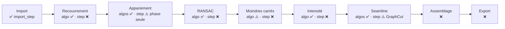

# Carte de l'architecture : KIKIRPA-CPP

Guide pour se repérer dans le code de **`main`**, à jour du 03/11/2026 après la réorganisation de `core/` et `steps/` (PR #50). Les éléments marqués **🆕** ont changé avec cette réorganisation : dossiers en minuscules, fichiers en `snake_case`, noms anglais, un namespace par dossier, nouveau format JSON. Correspondance complète entre anciens et nouveaux noms : [MIGRATION_REORGANISATION.md](MIGRATION_REORGANISATION.md). Règles de nommage : [CONVENTIONS.md](CONVENTIONS.md).

> **Cette carte doit rester à jour.** Toute PR qui ajoute, déplace, renomme ou supprime un fichier, un step, un type partagé ou un test met à jour la section concernée dans la même PR.

Les liens ouvrent les fichiers.

**Sommaire**
1. [Vue d'ensemble](#1-vue-densemble)
2. [Où aller pour…](#2-où-aller-pour)
3. [Comment le code est rangé](#3-comment-le-code-est-rangé)
4. [Arborescence annotée](#4-arborescence-annotée-fichier-par-fichier)
5. [Les données qui circulent](#5-les-données-qui-circulent)
6. [Lire un algorithme : l'exemple de la corrélation de phase](#6-lire-un-algorithme--lexemple-de-la-corrélation-de-phase)
7. [Pièges de lecture](#7-pièges-de-lecture)
8. [Ce qui n'existe qu'en branche](#8-ce-qui-nexiste-quen-branche)

---

## 1. Vue d'ensemble

Le projet a trois couches. Les **algorithmes** sont les plus fournis. L'**orchestration** est en place : un script JSON se construit, se valide, s'exécute et se reprend. Il manque surtout des steps, et un point d'entrée pour l'utilisateur.

```
┌───────────────────────────────────────────────────────────────────────────┐
│ ENTRÉES              src/main.cpp (vide)  ·  src/frontend/ (GUI Qt)        │
│                      pas de ligne de commande : le pipeline se lance       │
│                      depuis le code (GUI à venir, tests)                   │
├───────────────────────────────────────────────────────────────────────────┤
│ ORCHESTRATION        core/  : script JSON → buildPipeline → PipelineClass  │
│                               → StepClass → DataStoreClass ; reprise :     │
│                               RunState, CheckpointClass                    │
│                      steps/ : une classe par étape du pipeline (StepsNs)   │
├───────────────────────────────────────────────────────────────────────────┤
│ ALGORITHMES          algorithms/ : un dossier par méthode, rangé par étape │
│                      (appelables seuls, sans pipeline)                    │
└───────────────────────────────────────────────────────────────────────────┘
```

**Le pipeline prévu**, avec ce qui existe sur `main` (✅ fait · ⚠️ partiel · ❌ absent) :



Une **étape** (step) lit ses entrées dans le `DataStoreClass` et y écrit ses sorties. Pour faire le calcul, elle appelle un **algorithme**. L'algorithme, lui, ne connaît ni le pipeline ni le JSON : il prend des `cv::Mat` et des structures C++.

**Le chemin d'un run** :

```
script.json ──buildPipelineFromFile──► registre (nom → step) ──importConfig──► paramètres validés
            ──contrôle de l'enchaînement (chaque entrée produite plus tôt, même type)──► PipelineClass
PipelineClass::run ──► saute les steps déjà faits (checkpoint valide) et restaure leurs sorties
                   ──► pour chaque step : execute() → DataStoreClass → checkpoint → run.json réécrit
```

---

## 2. Où aller pour…

| Je veux… | Fichier(s) |
|---|---|
| **Compiler le projet** (Windows ou Linux) | [BUILD.md](BUILD.md) (Qt 6 et GoogleTest obligatoires, via vcpkg sous Windows) + [CMakePresets.json](../CMakePresets.json) (`cmake --preset windows-msvc`) |
| **Lancer les tests** | `ctest --preset windows-msvc` (ou `linux`) : 87 tests GoogleTest, tous `unit` |
| **Lancer un pipeline** | depuis le code : `buildPipelineFromFile()` puis `run()`, voir [Pipeline.md](core/Pipeline.md#lancer-un-pipeline). Exemple qui tourne : `testerPipelineReel()` dans [test_pipeline.cpp](../tests/core/test_pipeline.cpp) |
| **Comprendre le pipeline en une page** | [Pipeline.md](core/Pipeline.md) : format du script, contrôles, reprise, steps enregistrés, ajout d'un step |
| Voir comment un script JSON devient un pipeline | [pipeline_builder.cpp](../src/backend/core/pipeline/pipeline_builder.cpp) : `stepRegistry()`, `buildPipeline()` |
| **Ajouter un step au pipeline** | une ligne dans `stepRegistry()` ([pipeline_builder.cpp](../src/backend/core/pipeline/pipeline_builder.cpp)) ; marche à suivre dans [Pipeline.md](core/Pipeline.md#ajouter-un-step) |
| **Comprendre comment le pipeline exécute les étapes** | [pipeline.h](../include/backend/core/pipeline/pipeline.h) → [pipeline.cpp](../src/backend/core/pipeline/pipeline.cpp) (`run()`, avec la reprise) |
| Voir comment un paramètre du JSON est validé et appliqué | [step.cpp](../src/backend/core/step/step.cpp) : `importConfig()` |
| Reprendre un pipeline après un échec ou une pause | [run_state.h](../include/backend/core/pipeline/run_state.h) (champ `"run"`), [pipeline.cpp](../src/backend/core/pipeline/pipeline.cpp) (`resolveStart`, `run`) |
| Voir ce qui est sauvegardé dans un checkpoint | [checkpoint.cpp](../src/backend/core/checkpoint/checkpoint.cpp) (manifest, validité) + [checkpoint_types.cpp](../src/backend/core/checkpoint/checkpoint_types.cpp) (un sérialiseur par type) |
| Voir ce qu'une étape doit implémenter | [step.h](../include/backend/core/step/step.h) (`execute()`, `getParameter()`, `result`, `externalInputsFingerprint()`) 🆕 |
| Voir comment les données passent d'une étape à l'autre | [data_store.h](../include/backend/core/step/data_store.h) (`add` / `replace` / `get<T>("clé")`) 🆕 |
| Voir le format du script JSON du pipeline | [pipeline_config.h](../include/backend/core/config/pipeline_config.h) |
| **Voir tous les types partagés** (paires, matches, positions, territoires…) | [algorithm_types.h](../include/backend/core/data/algorithm_types.h) ← le fichier le plus important à connaître |
| Voir comment une tuile est représentée | [tile.h](../include/backend/core/data/tile.h) (fiche sans pixels, pyramide, voisins) |
| Voir comment les images sont chargées | [import_step.cpp](../src/backend/steps/import_step.cpp) |
| Voir le cache TIFF pyramidal créé à l'import | [pyramidal_tiff_writer.cpp](../src/backend/core/io/pyramidal_tiff_writer.cpp) |
| **Écrire un nouveau step** : modèle à copier | [phase_correlation_step.h](../include/backend/steps/phase_correlation_step.h) / [.cpp](../src/backend/steps/phase_correlation_step.cpp) et sa doc [PhaseCorrelationStep.md](steps/PhaseCorrelationStep.md) (contrat, conventions, échecs) |
| Mesurer le décalage entre deux tuiles (corrélation de phase) | [CorrelationPhase.h](../include/backend/algorithms/stitching/correlation_phase/CorrelationPhase.h) + sa [doc](algorithms/stitching/correlation_phase/CorrelationPhase.md) |
| Estimer le recouvrement réel d'une paire (1re passe) | [EstimationRecouvrement.h](../include/backend/algorithms/stitching/recouvrement/EstimationRecouvrement.h) + sa [doc](algorithms/stitching/recouvrement/EstimationRecouvrement.md) |
| Voir l'appariement SIFT | [SiftMatcherAlgorithm.cpp](../src/backend/algorithms/stitching/sift/SiftMatcherAlgorithm.cpp) (le calcul) ; [SiftMatcher.cpp](../src/backend/algorithms/stitching/sift/SiftMatcher.cpp) (l'emballage) |
| Voir l'appariement LightGlue (ONNX) | [LightGlueMatcher.cpp](../src/backend/algorithms/stitching/lightglue/LightGlueMatcher.cpp) |
| Voir le rejet des mauvais points (RANSAC, vote de Hough) | [RansacRejector.cpp](../src/backend/algorithms/rejection/ransac/RansacRejector.cpp) (contient aussi `VoteRejector`) |
| **Voir l'alignement global** (moindres carrés) | [TilePositioner.cpp](../src/backend/algorithms/stitching/positioning/TilePositioner.cpp) → `solvePositions()` (l. 48) |
| **Égaliser la luminosité entre tuiles** | [Egalisation.h](../include/backend/algorithms/egalisation/Egalisation.h) + sa [doc](algorithms/egalisation/Egalisation.md) |
| Voir le calcul des coutures, méthode DP/Dijkstra | [seam_finder.hpp](../include/backend/algorithms/seamline/dp_dijkstra/seam_finder.hpp) (point d'entrée) puis [solver.hpp](../include/backend/algorithms/seamline/dp_dijkstra/solver.hpp) |
| Voir le calcul des coutures, méthode GraphCut | [GraphCutSeamFinder.cpp](../src/backend/algorithms/seamline/graphcut/GraphCutSeamFinder.cpp) (commenté ligne à ligne) + [graph_cut_step.cpp](../src/backend/steps/graph_cut_step.cpp) |
| Voir un vrai pipeline tourner depuis un script JSON | [test_pipeline.cpp](../tests/core/test_pipeline.cpp) : `testerPipelineReel()` (import → phase-correlation) et `testerRepriseReelle()` |
| Générer le JSON du pipeline depuis la GUI | [PipelineJson.h](../include/frontend/PipelineJson.h) |
| Voir comment le projet est compilé | [CMakeLists.txt](../CMakeLists.txt) + [cmake/](../cmake/) (`Dependencies`, `Backend`, `Frontend`, `Tests`, `Install`) |
| **Nommer un fichier, une classe, une variable** 🆕 | [CONVENTIONS.md](CONVENTIONS.md) |
| Adapter une branche écrite avant la réorganisation 🆕 | [MIGRATION_REORGANISATION.md](MIGRATION_REORGANISATION.md) (§10) |
| Voir ce que fait la CI | [build-test.yml](../.github/workflows/build-test.yml) (appelé par `ci.yml` et `release.yml`) |

---

## 3. Comment le code est rangé

**`include/` et `src/` ont la même arborescence.** Pour un fichier `include/backend/X/y.h`, le `.cpp` est dans `src/backend/X/y.cpp`.

```
include/backend/  ⟷  src/backend/   🆕 en minuscules
    core/           le moteur, un sous-dossier par rôle 🆕 :
        data/           types partagés (algorithm_types.h), fiche d'une tuile (tile.h)
        config/         format du script JSON (pipeline_config.h)
        step/           contrat d'un step (step.h) et données entre steps (data_store.h)
        pipeline/       exécution, registre, état de reprise
        checkpoint/     sauvegarde des sorties de chaque step
        io/             écriture du TIFF pyramidal
    steps/          les étapes concrètes, une classe par étape (<nom>_step.h) 🆕
    algorithms/     les méthodes de calcul
        stitching/      appariement + recouvrement + positionnement global
        rejection/      rejet des outliers
        egalisation/    égalisation de luminosité
        seamline/       calcul des coutures
include/frontend/ ⟷  src/frontend/   GUI Qt (quasi vide sur main)
tests/               un dossier par module, en GoogleTest : core/, correlation_phase/, egalisation/, seamline/
docs/                algorithms/ (une page par algorithme), core/ (le pipeline), steps/ (contrat de chaque step),
                     BUILD.md, CONVENTIONS.md 🆕, MIGRATION_REORGANISATION.md 🆕, cette carte
cmake/               un fichier par partie du build
```

**Les includes partent de `include/backend/`** 🆕, jamais de `"../"`. On écrit `#include "core/data/algorithm_types.h"` ou `#include "algorithms/stitching/sift/SiftMatcher.h"`.

**Les namespaces** 🆕 : un par dossier pour `core/`, `steps/` et `frontend/` ; les algorithmes gardent pour l'instant leurs namespaces d'origine (héritage des branches de recherche, migration prévue, voir [CONVENTIONS.md](CONVENTIONS.md)) :

| Dossier | Namespace C++ |
|---|---|
| `core/data/` | `DataNs` 🆕 |
| `core/config/` | `ConfigNs` 🆕 |
| `core/step/` | `StepNs` 🆕 |
| `core/pipeline/` | `PipelineNs` 🆕 |
| `core/checkpoint/` | `CheckpointNs` 🆕 |
| `core/io/` | `IONs` 🆕 |
| `steps/` | `StepsNs` 🆕 |
| `frontend/` | `FrontendNs` 🆕 |
| `algorithms/stitching/*` | `stitching::matching` (et `stitching::matching::correlation_phase`) |
| `algorithms/stitching/positioning/` | `stitching::positioning` |
| `algorithms/rejection/*` | `stitching::rejection` (et `::ransac`) |
| `algorithms/egalisation/` | `stitching::egalisation` |
| `algorithms/seamline/dp_dijkstra/` | **`seamlib`** (fichiers en `.hpp`, style `snake_case`) |
| `algorithms/seamline/graphcut/` | **`Seamline`** |

**Le build compile tout seul tout ce qui est dans `src/backend/`.** Il le fait par `GLOB_RECURSE` ([cmake/Backend.cmake](../cmake/Backend.cmake)), sans liste de fichiers. Un `.cpp` posé ailleurs, par exemple dans `include/`, n'est **pas** compilé. Seule exception : les sources LightGlue sont retirées si ONNX Runtime ou le module `dnn` d'OpenCV manquent.

---

## 4. Arborescence annotée, fichier par fichier

### Racine et build

| Fichier | Rôle |
|---|---|
| [CMakeLists.txt](../CMakeLists.txt) | Inclut les fichiers de `cmake/` et déclare la cible `stitching` (vide). |
| [cmake/Dependencies.cmake](../cmake/Dependencies.cmake) | OpenCV, libtiff et **Qt 6 obligatoires** ; nlohmann_json téléchargé s'il manque. |
| [cmake/Backend.cmake](../cmake/Backend.cmake) | Cible `stitching_backend` (lib statique de tout `src/backend`), détection d'ONNX Runtime (LightGlue facultatif), option `/utf-8` pour MSVC. |
| [cmake/Frontend.cmake](../cmake/Frontend.cmake) | Cible `stitching_frontend` (Qt). |
| [cmake/Tests.cmake](../cmake/Tests.cmake) | GoogleTest **obligatoire** (sauf `-DBUILD_TESTING=OFF`), un `add_subdirectory` par dossier de `tests/`. Liste des tests lue au lancement de `ctest` (sous Windows, les DLL d'OpenCV ne sont dans le PATH qu'à ce moment-là). |
| [cmake/Install.cmake](../cmake/Install.cmake) | Installe `stitching` dans `bin/`. |
| [CMakePresets.json](../CMakePresets.json) | Presets `windows-msvc` (vcpkg, variables `VCPKG_ROOT` et `OpenCV_DIR`) et `linux`. Build dans `build/<preset>/`. |
| [README.md](../README.md) | Présentation, build générique, renvoi vers [BUILD.md](BUILD.md) pour Windows. |
| [.github/workflows/](../.github/workflows/) | `ci.yml` (chaque push et PR), `release.yml` (tag `v*`), `build-test.yml` (job commun Ubuntu, installe Qt et GoogleTest). |
| [src/main.cpp](../src/main.cpp) | Réservé au frontend : **vide** (`TODO`). |

### `core/` : le moteur

| Fichier | Rôle |
|---|---|
| [algorithm_types.h](../include/backend/core/data/algorithm_types.h) | **Les types partagés** (`DataNs`) : `Direction`, `PairContext`, `OverlapEstimate`, `TileImage`, `Matches`, `PairMatches`, `Alignment`, `TilePositionData`, `TileTerritory` 🆕. |
| [step.h](../include/backend/core/step/step.h) / [step.cpp](../src/backend/core/step/step.cpp) | `StepClass`, classe abstraite d'une étape : `execute()`, sa config JSON (`configJson`), `getParameter("nom")`, `result` (résumé ou erreur), pointeur vers le `dataStore`. `importConfig()` fusionne et valide les paramètres du JSON ; `externalInputsFingerprint()` décrit ce que le step lit hors du pipeline. |
| [pipeline.h](../include/backend/core/pipeline/pipeline.h) / [pipeline.cpp](../src/backend/core/pipeline/pipeline.cpp) | `PipelineClass` : liste ordonnée de steps (`addStep`). `configure(json)` applique un script, `exportConfig()` / `exportScript()` le réécrivent. `run()` les exécute dans l'ordre et s'arrête au premier échec ou à la première exception. `run()` sait aussi reprendre (`resolveStart`), faire une pause (`requestPause`) et réécrire le script après chaque step (`setScriptPath`). |
| [pipeline_builder.h](../include/backend/core/pipeline/pipeline_builder.h) / [.cpp](../src/backend/core/pipeline/pipeline_builder.cpp) | **Registre des steps** (`stepRegistry()` : nom → classe), `createStep`, `getRegisteredStepNames`, `buildPipeline(json)` (validation + contrôle de l'enchaînement), `buildPipelineFromFile`. |
| [run_state.h](../include/backend/core/pipeline/run_state.h) / [.cpp](../src/backend/core/pipeline/run_state.cpp) | `RunState`, champ `"run"` du script : `status`, `completedSteps`, consignes `skipCompletedSteps` / `startFromStep`, `checkpointDirectory`. `RunState::fromJson` le valide. |
| [checkpoint.h](../include/backend/core/checkpoint/checkpoint.h) / [.cpp](../src/backend/core/checkpoint/checkpoint.cpp) | `CheckpointClass` : sauvegarde des sorties de chaque step, un dossier `NN_nom/` par step, `manifest.json` écrit en dernier. Valide si même step, mêmes paramètres et même empreinte des entrées. `registerType` pour un nouveau type. |
| [checkpoint_types.h](../include/backend/core/checkpoint/checkpoint_types.h) / [.cpp](../src/backend/core/checkpoint/checkpoint_types.cpp) | (Dé)sérialisation JSON des types du pipeline : `Tiles` (fiches seulement, sans pixels), `PairMatches`, `Positions`, `Territories`. |
| [data_store.h](../include/backend/core/step/data_store.h) | `DataStoreClass`, sac de données entre steps : `map<string, std::any>`. `add` refuse une clé qui existe, `replace` l'écrase (les steps utilisent `replace`). `get<T>` lève une exception si la clé manque ou si le type ne correspond pas. |
| [pipeline_config.h](../include/backend/core/config/pipeline_config.h) | Structures du script JSON (`StepParameter`, `DataSlot`, `StepConfig`, `PipelineConfig`) et leur (dé)sérialisation 🆕. Types de paramètre autorisés : `string`, `int`, `float`, `bool`. |
| [tile.h](../include/backend/core/data/tile.h) / [tile.cpp](../src/backend/core/data/tile.cpp) | `TileClass`, fiche d'une tuile **sans pixels** : id, chemins (source et TIFF pyramidal), type OpenCV, 4 niveaux de pyramide (`LEVEL_COUNT`) en blocs de 512 (`BLOCK_SIZE`), voisines gauche/droite/haut/bas. Définit `TileList = vector<shared_ptr<TileClass>>`. |
| [pyramidal_tiff_writer.h](../include/backend/core/io/pyramidal_tiff_writer.h) / [.cpp](../src/backend/core/io/pyramidal_tiff_writer.cpp) | Écrit un `cv::Mat` en TIFF tuilé 512 px, LZW, 4 niveaux (libtiff). Sert au cache d'import. ⚠️ BGR déclaré RGB, TIFF classique (pas BigTIFF). |

### `steps/` : les étapes du pipeline

| Fichier | Nom JSON | Lit | Écrit | Appelle |
|---|---|---|---|---|
| [ImportStepClass](../src/backend/steps/import_step.cpp) | `import` | paramètres `path`, `format` (regex col/ligne) | `"tiles"` : `Tiles` | `cv::imread` + `createPyramidalTiledTiff` (cache dans `<images>/.cache/pyramids`) |
| [PhaseCorrelationStepClass](../src/backend/steps/phase_correlation_step.cpp) | `phase-correlation` | `"tiles"` ; 12 paramètres, dont `niveau` (analyse sur un niveau réduit de la pyramide, résultat ramené en pleine résolution) | `"matches"` : `vector<PairMatches>` | `CorrelationPhase` sur chaque paire droite/dessous, pixels lus par `readPixels()` |
| [GraphCutStepClass](../src/backend/steps/graph_cut_step.cpp) | `graphcut` | `"tiles"`, `"positions"` : `vector<TilePositionData>` | `"territories"` : `vector<TileTerritory>` | `ImagePretreatment` + `GraphCut` |

Ces 3 steps sont dans le registre : on peut les mettre dans un script JSON. `graphcut` ne peut pas encore y être utilisé, car aucun step ne produit `positions`, et `buildPipeline` le refuse.

`ImportStepClass` fournit aussi `externalInputsFingerprint()` (nom, taille et date des images sources), pour périmer son checkpoint quand une image change.

Chaque step a deux modes :
- **dans un pipeline** : les données viennent du `DataStoreClass` ;
- **en appel direct** : on passe une struct `XxxInput` au constructeur. Utile pour tester une étape seule.

### `algorithms/stitching/` : appariement et positionnement

| Fichier | Rôle |
|---|---|
| [FeatureMatcher.h](../include/backend/algorithms/stitching/FeatureMatcher.h) | **Interface** de toute méthode d'appariement : `match(a, b, ctx, Matches&)`. |
| **`correlation_phase/`** | Translation sous-pixel entre deux tuiles, en deux passes, plus des points raffinés localement. Port de `correlation_phase.py`. Voir §6. |
| ↳ [CorrelationPhase.h](../include/backend/algorithms/stitching/correlation_phase/CorrelationPhase.h) / [.cpp](../src/backend/algorithms/stitching/correlation_phase/CorrelationPhase.cpp) | Façade : le seul header à inclure. `match()` enchaîne les 3 modules. Paramètres documentés en tête du header. |
| ↳ [Types.h](../include/backend/algorithms/stitching/correlation_phase/Types.h) | Structures internes : `Parametres`, `PaireOrientee`, `Bandes`, `Mesure`, `Correspondance`… |
| ↳ [Preparation](../src/backend/algorithms/stitching/correlation_phase/Preparation.cpp) | Tuiles brutes → images de travail : gris en `float64`, NaN = vide, paire ramenée à « B en bas ou à droite », découpe des bandes. |
| ↳ [Algorithme](../src/backend/algorithms/stitching/correlation_phase/Algorithme.cpp) | Les calculs : corrélation de phase globale, affinage par DFT, diagnostic d'échec, points locaux. |
| ↳ [Sortie](../src/backend/algorithms/stitching/correlation_phase/Sortie.cpp) | Mise au format `Matches` dans le repère d'origine, et messages d'échec explicites. |
| **`recouvrement/`** [EstimationRecouvrement](../src/backend/algorithms/stitching/recouvrement/EstimationRecouvrement.cpp) | 1re passe commune à toutes les méthodes : position de B au pixel près et recouvrement réel. `zonesCommunes()` donne les rectangles à découper dans A et B. |
| **`sift/`** [SiftMatcher](../src/backend/algorithms/stitching/sift/SiftMatcher.cpp) | Implémente `FeatureMatcher` et délègue à… |
| ↳ [SiftMatcherAlgorithm](../src/backend/algorithms/stitching/sift/SiftMatcherAlgorithm.cpp) | …`runSiftMatching()` : passage en 8 bits juste avant le détecteur, SIFT, BFMatcher + test de Lowe, translation médiane. |
| **`lightglue/`** [LightGlueMatcher](../src/backend/algorithms/stitching/lightglue/LightGlueMatcher.cpp) | Appariement par réseau (ONNX Runtime) : chargement du modèle, prétraitement (redimensionnement à un multiple de 32), inférence, remise à l'échelle. Compilé seulement si ONNX Runtime est trouvé. |
| **`positioning/`** [TilePositioner](../src/backend/algorithms/stitching/positioning/TilePositioner.cpp) | `computeTilePositions()` : à partir des **chemins**, refait recouvrement → matcher → rejector sur chaque paire, puis `solvePositions()` (moindres carrés globaux, positions et rotations). Écrit les résidus dans un `ostream`. |

### `algorithms/rejection/` : rejet des outliers

| Fichier | Rôle |
|---|---|
| [OutlierRejector.h](../include/backend/algorithms/rejection/OutlierRejector.h) | **Interface** : `estimate(Matches, Alignment&)`. |
| [RansacRejector](../src/backend/algorithms/rejection/ransac/RansacRejector.cpp) | Façade RANSAC (lit les paramètres JSON). Le **même fichier** contient `VoteRejector` (vote de Hough 2D + médiane itérative, translation pure), utilisé par défaut par `TilePositioner`. |
| [RansacTypes.h](../include/backend/algorithms/rejection/ransac/RansacTypes.h) | `RansacParameters`, `RansacInput`, `RansacPreparedInput`, `RansacOutput`. |
| [RansacPreprocessor](../src/backend/algorithms/rejection/ransac/RansacPreprocessor.cpp) | Contrôle des points : tailles, valeurs finies, minimum de matches. |
| [RansacAlgorithm](../src/backend/algorithms/rejection/ransac/RansacAlgorithm.cpp) | `cv::estimateAffinePartial2D` (similitude B → A), mise en 3×3, masque des inliers. |

### `algorithms/egalisation/` : égalisation de luminosité 🆕

Port du notebook `egalisation_gain_champ_final.ipynb`. Même découpage que la corrélation de phase. Il n'y a pas encore de step : on l'appelle à la main.

| Fichier | Rôle |
|---|---|
| [Egalisation.h](../include/backend/algorithms/egalisation/Egalisation.h) / [.cpp](../src/backend/algorithms/egalisation/Egalisation.cpp) | Façade : `reduire()` (une tuile à la fois), `estimer()` (gains et champ), `corriger()` (tuile pleine résolution), `pairesDepuisPositions()`. Méthode A : un gain par tuile ; méthode B : gain + assombrissement vers les bords `exp(c·r²)` commun à toutes les tuiles. |
| [Types.h](../include/backend/algorithms/egalisation/Types.h) | `Parametres`, `TuileReduite`, `PaireVoisine`, `Echantillons`, `Solution`, `Bilan`, `Resultat`. |
| [Preparation](../src/backend/algorithms/egalisation/Preparation.cpp) | Tuiles 8 ou 16 bits, gris ou couleur → luminance réduite (1/8) et floutée. |
| [Algorithme](../src/backend/algorithms/egalisation/Algorithme.cpp) | Échantillons dans les recouvrements, moindres carrés robustes (IRLS, Huber), bilan avant / A / B. |
| [Sortie](../src/backend/algorithms/egalisation/Sortie.cpp) | Correction pixel par pixel (sortie 16 bits), rapport lisible. |

### `algorithms/seamline/` : les coutures

**`dp_dijkstra/` (bibliothèque `seamlib`)** : port du notebook *Projet_KIK_IRPA_Montauban*. Les en-têtes citent la section du notebook correspondante.

| Fichier | Rôle |
|---|---|
| [seam_finder.hpp](../include/backend/algorithms/seamline/dp_dijkstra/seam_finder.hpp) / [.cpp](../src/backend/algorithms/seamline/dp_dijkstra/seam_finder.cpp) | **Point d'entrée** : `SeamFinder::compute(left, right)`, soit carte de coût puis chemin. Travaille sur **un** overlap déjà découpé, en **RGB**. |
| [cost_map](../src/backend/algorithms/seamline/dp_dijkstra/cost_map.cpp) | Section 5 : gradients de Sobel, normalisations, termes couleur et gradient → carte de coût. |
| [cost_catalog](../src/backend/algorithms/seamline/dp_dijkstra/cost_catalog.cpp) | Section 5.0 : catalogue des fonctions de coût (`CostFunction::ColorGradient`…). |
| [dynamic_programming](../src/backend/algorithms/seamline/dp_dijkstra/dynamic_programming.cpp) | Section 6.1 : chemin de coût minimal par programmation dynamique (monotone, rapide). |
| [dijkstra](../src/backend/algorithms/seamline/dp_dijkstra/dijkstra.cpp) | Section 6.2 : Dijkstra 8 voisins (exact) et variante restreinte à un corridor autour du chemin DP. |
| [solver](../src/backend/algorithms/seamline/dp_dijkstra/solver.cpp) | Section 6.3 : `solve_edge()`, point d'entrée unique des 3 méthodes, avec mesures de temps et de mémoire. |
| [junctions](../src/backend/algorithms/seamline/dp_dijkstra/junctions.cpp) | Sections 7-8 : points de jonction entre 4 tuiles et réseau global de coutures sur la grille (`H_r_c` / `V_r_c`). |
| [overlay](../src/backend/algorithms/seamline/dp_dijkstra/overlay.cpp) | Dessin du réseau de coutures sur une mosaïque (illustration). |
| [export.hpp](../include/backend/algorithms/seamline/dp_dijkstra/export.hpp) | Macro `KIRK_API` (export DLL). Inutile ici : la lib est statique. |

**`graphcut/` (namespace `Seamline`)** : coupe de graphe d'OpenCV, paire par paire.

| Fichier | Rôle |
|---|---|
| [ImagePretreatment](../src/backend/algorithms/seamline/graphcut/ImagePretreatment.cpp) | Relit les tuiles depuis le disque (`read16`, `readSmallFloat`), calcule les coins et les masques réduits. `parseTileName()` extrait ligne et colonne de `..._rLL_cCC.tif`. **Aussi utilisé par `TilePositioner`.** |
| [GraphCutSeamFinder](../src/backend/algorithms/seamline/graphcut/GraphCutSeamFinder.cpp) | `computeSeamline()` : coupe à échelle réduite, carte de provenance pleine résolution, mosaïque 8 bits d'aperçu. `extractPolygons()` produit les territoires par tuile. `verifyTiling()` contrôle le pavage. |

### `frontend/` : interface graphique

| Fichier | Rôle |
|---|---|
| [PipelineJson.h](../include/frontend/PipelineJson.h) / [.cpp](../src/frontend/PipelineJson.cpp) | Fabrique le JSON du pipeline à partir de champs de formulaire (`makeStep`, `parameterFromText`, `writePipelineJson`), namespace `FrontendNs`. La vraie GUI est sur la branche `frontend`. |

### `tests/`

Tous en GoogleTest, avec le label `unit`, et lancés par `ctest`. Il n'y a plus de test d'intégration ni d'outil manuel sur images réelles (décision du 02/11/2026 : uniquement des tests unitaires).

| Dossier | Tests | Ce qu'ils vérifient |
|---|---|---|
| [core/](../tests/core/) | `PipelineBuilder.*` (5), `Reprise.*` (5) | Registre, validation du script, fusion des options, aller-retour `exportConfig` → `buildPipeline`, pipeline réel import → phase-correlation sur deux tuiles 16 bits générées, reprise sur checkpoints (échec, paramètres modifiés, `startFromStep`, `skipCompletedSteps`, pause, `run.json`), aller-retour des 4 types sérialisés. |
| [correlation_phase/](../tests/correlation_phase/) | `CorrelationPhase.*` (3) | Paires générées à vérité sous-pixel exacte dans les 4 directions, les deux passes, les cas limites. |
| [egalisation/](../tests/egalisation/) | `Egalisation.*` (3) | 6 tuiles générées avec gains et champ connus, gris et couleur, 8 et 16 bits ; cas limites. |
| [seamline/](../tests/seamline/) | 71 tests | seamlib : carte de coût, catalogue, DP, Dijkstra, solveur, jonctions, parité avec le notebook. |

Pour ajouter des tests : un dossier `tests/<module>/` avec son `CMakeLists.txt` (modèle : [tests/egalisation/CMakeLists.txt](../tests/egalisation/CMakeLists.txt)), et une ligne `add_subdirectory` dans [cmake/Tests.cmake](../cmake/Tests.cmake).

### `docs/`

| Fichier | Contenu |
|---|---|
| [CorrelationPhase.md](algorithms/stitching/correlation_phase/CorrelationPhase.md) | Méthode, paramètres, limites et résultats chiffrés comparés au Python. **La meilleure doc du projet.** |
| [EstimationRecouvrement.md](algorithms/stitching/recouvrement/EstimationRecouvrement.md) | La 1re passe commune. |
| [Egalisation.md](algorithms/egalisation/Egalisation.md) | Modèle, méthodes A et B, paramètres, vérification. |
| [Pipeline.md](core/Pipeline.md) | Le pipeline : format du script, contrôles, exécution, reprise et checkpoints, steps enregistrés, ajout d'un step. |
| [PhaseCorrelationStep.md](steps/PhaseCorrelationStep.md) | Contrat du step `phase-correlation` : paramètres, conventions d'axes et de signe, résolution réduite, échecs. |
| [BUILD.md](BUILD.md) | Installer les dépendances et compiler, sous Windows (vcpkg) et Linux. |
| [CONVENTIONS.md](CONVENTIONS.md) 🆕 | Règles de code (noms, mise en forme, includes, erreurs, classes et fonctions, tests), principes de code propre, Git et pull requests. |
| [MIGRATION_REORGANISATION.md](MIGRATION_REORGANISATION.md) 🆕 | Ce que la réorganisation de `core/` et `steps/` a renommé, et comment adapter une branche. |
| cette carte | Se repérer dans le code. |

---

## 5. Les données qui circulent

Les types sont dans [algorithm_types.h](../include/backend/core/data/algorithm_types.h) (namespace `DataNs`), sauf `TileList` ([tile.h](../include/backend/core/data/tile.h)). `TileTerritory` y est aussi 🆕 ; `Seamline::TileTerritory` reste un alias.

```
fichiers .tif ──ImportStepClass──► "tiles" : TileList = vector<shared_ptr<TileClass>>   (fiches, sans pixels)
                                  │
                PhaseCorrelationStepClass (relit les .tif sources, éventuellement réduits)
                                  ▼
                        "matches" : vector<PairMatches>
                                  │       PairMatches = { tileIdA, tileIdB, direction, featureMatches }
                                  │       Matches     = { pointsInA[], pointsInB[], confidenceScores[],
                                  │                       translationX, translationY }
                                  ▼
                  (RANSAC → moindres carrés : pas encore de step)
                                  ▼
                       "positions" : vector<TilePositionData>   { tileId "rLL_cCC", position, rotationRadians }
                                  │
                  (égalisation : algorithme prêt, pas encore de step)
                                  │
                GraphCutStepClass (relit les .tif sources)
                                  ▼
                       "territories" : vector<TileTerritory>    { tileIndex, polygons, holes } par tuile
                                  ▼
                       (assemblage → export : à écrire)
```

**Un type C++ par clé** : le registre vérifie l'enchaînement d'après le *nom* de type déclaré (`"Tiles"`, `"PairMatches"`…). `DataStoreClass::get<T>` exige, lui, le *type C++* exact. Un nouveau step doit donc réutiliser ces types, sinon `std::bad_any_cast` à l'exécution. Ce sont aussi ces 4 types que les checkpoints savent sérialiser :

| Nom (JSON) | Clé | Type C++ |
|---|---|---|
| `Tiles` | `tiles` | `DataNs::TileList` = `vector<shared_ptr<TileClass>>` |
| `PairMatches` | `matches` | `vector<DataNs::PairMatches>` |
| `Positions` | `positions` | `vector<DataNs::TilePositionData>` |
| `Territories` | `territories` | `vector<DataNs::TileTerritory>` |

**Les conventions de repère à connaître :**
- **`Direction`** donne la position de B par rapport à A (`Top`, `Bottom`, `Left`, `Right`). Les anciens alias `LeftRight` et `BottomRight` ont disparu 🆕.
- **`Matches::translationX, translationY`** donnent le coin haut-gauche de B dans le repère de A, soit `pointInA − pointInB`. Toujours en pixels de pleine résolution, même quand `phase-correlation` mesure sur un niveau réduit.
- **`Alignment::transformBToA`** est une matrice 3×3 `CV_64F` qui transforme B vers A.
- **`cv::Point` vaut (x, y) = (colonne, ligne).** Le Python de référence stocke (y, x).
- **L'égalisation** identifie les tuiles par leur **indice** dans un vecteur, pas par `tileId`, et prend la translation d'une paire telle quelle.

---

## 6. Lire un algorithme : l'exemple de la corrélation de phase

C'est le modèle de découpage que tout nouvel algorithme doit suivre (noms en anglais pour le nouveau code, voir [CONVENTIONS.md](CONVENTIONS.md)). Les algorithmes existants gardent leurs noms français en attendant leur migration. Ordre de lecture conseillé :

1. **[CorrelationPhase.h](../include/backend/algorithms/stitching/correlation_phase/CorrelationPhase.h)** : ce que fait l'algorithme et ses paramètres, documentés dans l'en-tête.
2. **[CorrelationPhase.cpp](../src/backend/algorithms/stitching/correlation_phase/CorrelationPhase.cpp)** : l'orchestrateur (`match()`), court. Il dit dans quel ordre les modules sont appelés.
3. **[Types.h](../include/backend/algorithms/stitching/correlation_phase/Types.h)** : les structures échangées entre modules.
4. Les trois modules dans l'ordre d'exécution : **Preparation → Algorithme → Sortie**. Chaque header liste toutes les fonctions, publiques et privées, avec un commentaire qui dit *quoi*. Le `.cpp` dit *pourquoi*.
5. **[CorrelationPhase.md](algorithms/stitching/correlation_phase/CorrelationPhase.md)** pour la théorie et les résultats.
6. **[test_correlation_phase.cpp](../tests/correlation_phase/test_correlation_phase.cpp)** pour voir l'algorithme utilisé.

L'**égalisation** suit exactement le même schéma (Egalisation → Preparation → Algorithme → Sortie), et RANSAC à peu près (Preprocessor → Algorithm → Rejector). SIFT, LightGlue, seamlib et GraphCut ne le suivent pas encore.

---

## 7. Pièges de lecture

| Ce qu'on pourrait croire | La réalité |
|---|---|
| `main.cpp` lance le pipeline | Il est vide (réservé au frontend). Il n'y a **plus de ligne de commande** (`stitching_run` a été retiré par #43) : le pipeline se lance depuis le code. |
| Les `inputs` et `outputs` du JSON définissent les entrées et sorties | Ils sont ignorés à la lecture : c'est le constructeur du step qui les fixe. Seules les **valeurs** des paramètres sont reprises du JSON. |
| Un ancien script JSON (`options`, `type`, `key`) se relit | Non 🆕 : le format a changé avec #50 (`parameters`, `valueType`, `name`). Les anciens checkpoints sont jugés périmés et refaits. |
| Les checkpoints sont actifs par défaut | Non : `checkpointDirectory` est vide par défaut. Il faut le remplir dans `RunState` (champ `run.checkpointDirectory` du script). |
| Un checkpoint de `tiles` contient les images | Non : seulement les fiches. Les pixels restent dans les TIFF source et pyramidaux, qui doivent toujours exister à la reprise. |
| Les steps lisent les pixels via `TileClass` | `readRegion` n'existe pas encore : les steps relisent les `.tif` sources avec `cv::imread` (dans `PhaseCorrelationStepClass`, isolé dans `readPixels()`). |
| `TilePositioner` prend les matches du step d'appariement | Non : il refait tout lui-même à partir des chemins de fichiers. |
| `RansacRejector.cpp` ne contient que RANSAC | Il contient aussi `VoteRejector`, le rejet utilisé par défaut. |
| `ImagePretreatment` ne sert qu'à GraphCut | Le positionnement l'utilise aussi (`read16`, `parseTileName`). |
| Les tuiles sont en RGB | OpenCV donne du **BGR**. seamlib attend du **RGB**. |
| Le TIFF pyramidal est la sortie du pipeline | C'est un cache d'import, par tuile. Il n'y a pas encore d'export. |
| Il existe un exemple de la chaîne complète (import → couture → mosaïque) | Plus sur `main` : `test_chaine_paire` a été supprimé avec les tests d'intégration (#43). Il reste dans l'historique : `git show c383a38:tests/algorithms/integration/test_chaine_paire.cpp`. |
| Qt est facultatif | Plus depuis #43 : sans Qt 6 ni GoogleTest, `cmake` échoue. Sous Windows, les installer avec vcpkg ([BUILD.md](BUILD.md)). |
| Tout le code suit déjà les conventions | Non 🆕 : seuls `core/`, `steps/` et `frontend/` ont été migrés. Les algorithmes gardent leurs noms français, leurs namespaces (`stitching::…`, `seamlib`, `Seamline`) et passent par `algorithms/legacy_type_aliases.h` (temporaire). Les tests gardent aussi des noms français. |
| `docs/` couvre tous les algorithmes | Seulement la corrélation de phase, le recouvrement et l'égalisation, plus le pipeline, le step `phase-correlation` et le build. |

---

## 8. Ce qui n'existe qu'en branche

État au 03/11/2026. Pour savoir où chercher quand un fichier n'est pas sur `main`. **Toutes ces branches datent d'avant la réorganisation (#50)** : à leur prochaine mise à jour, elles doivent suivre [MIGRATION_REORGANISATION.md](MIGRATION_REORGANISATION.md) §10.

| Je cherche… | Branche (PR) | État |
|---|---|---|
| Le step SIFT | `sift-step` (#32) | Changements demandés : registre, conventions, code commun avec LightGlue. Déclare encore ses tests dans `cmake/algorithms.cmake`, qui n'existe plus. |
| Le step LightGlue | `lightglue-step` (#27) | Changements demandés : découpe du recouvrement, registre, conventions. Ajoute `steps/MatchingStepUtils.h` (code commun aux steps d'appariement). |
| Indicateur de confiance de la corrélation de phase | `confiance-correlation-phase` (#48) | Ouverte. Étude dans `docs/.../EtudeConfiance.md` ; déclare encore ses tests dans `cmake/algorithms.cmake`. |
| Corrections GraphCut (fautes, place de `TileTerritory`) | `GraphCut_Fixed` (#49) | Ouverte. Déplace `TileTerritory` vers `core/Types.h`, ce que #50 a déjà fait (`DataNs::TileTerritory`). |
| Le step RANSAC | `RansacStep` | Pas de PR. `include/Backend/steps/RansacStep.{h,cpp}` (ancienne arborescence) (⚠️ `.cpp` mal placé, donc pas compilé). |
| Squelettes des steps fusion et export, `CONTRAT.md` | `fe/pipeline-json-parser` (#47, et #41 vers `pipeline_pr_patch`) | Architecture parallèle à celle de `main` (types différents, pixels en mémoire). |
| La vraie GUI | `frontend` (#9, brouillon) | ⚠️ Contient des images de test `.tif` (`datasetdetest/`), qui alourdiraient l'historique. |
| Le step d'intensité | `amo/IntensityCorrectionStep` | Branche créée, encore vide (identique à un ancien `main`). |

Pour voir un fichier d'une branche sans changer de branche :

```bash
git show origin/RansacStep:include/Backend/steps/RansacStep.h
```
