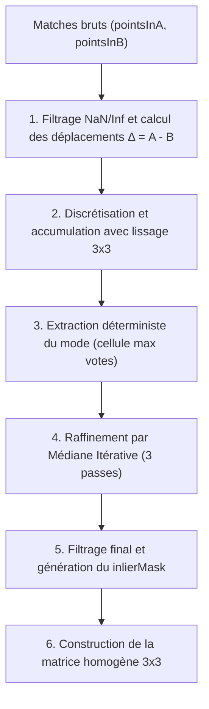

# Vote 2D — Rejet des aberrants par Vote de Hough 2D et Médiane Itérative

Documentation technique et mathématique de l'algorithme de rejet des aberrants (*outlier rejector*) par **Vote 2D** (`VoteRejector`), conçu pour l'assemblage rigide de tuiles gigapixels au KIK-IRPA.

```
include/backend/algorithms/rejection/
├── outlier_rejector.h              Interface abstraite commune de rejet
└── vote_2d/
    └── vote_rejector.h             Déclaration de VoteRejectorClass
src/backend/algorithms/rejection/
└── vote_2d/
    └── vote_rejector.cpp           Implémentation complète (C++17)
```

- **Dépendances** : OpenCV (`opencv2/core.hpp`), STL C++17 (`<vector>`, `<map>`, `<cmath>`, `<algorithm>`), `nlohmann/json.hpp`.
- **Statut** : Méthode par défaut dans le pipeline (`settings.rejectorName = "vote"`).

---

## 1. À quoi ça sert ?

Lors de l'appariement de deux tuiles voisines $A$ et $B$ (par SIFT, LightGlue ou détection de caractéristiques), les algorithmes produisent une liste de correspondances de points :

$$\mathbf{p}_{A,i} \longleftrightarrow \mathbf{p}_{B,i}$$

Dans cette liste, de nombreuses paires sont erronées (*outliers*) à cause :
- de motifs répétitifs sur l'œuvre d'art (craquelures de vernis, trame de toile, hachures) ;
- de reflets spéculaires ou de bruits capteurs ;
- de zones sombres ou uniformes.

Le rôle de `VoteRejector` est d'extraire la **translation géométrique réelle** $(t_x, t_y)$ entre les deux tuiles et d'identifier avec certitude les correspondances correctes (*inliers*), tout en éliminant impitoyablement les mauvaises.

```
Tuile A                                          Tuile B
┌──────────────────┐                            ┌──────────────────┐
│         • p_A,1  │ ── correspond à ────────── │ • p_B,1          │  --> Inlier (déplacement cohérent)
│                  │                            │                  │
│         • p_A,2  │ ── correspond à ────────── │ • p_B,2          │  --> Inlier (déplacement cohérent)
│                  │                            │                  │
│         • p_A,3  │ ── faux appariement ────── │         • p_B,3  │  --> OUTLIER (rejeté par le vote)
└──────────────────┘                            └──────────────────┘
```

---

## 2. Pourquoi Vote 2D plutôt que RANSAC classique ?

### Le contexte physique : un banc photographique rigide
Au KIK-IRPA, les prises de vue sont réalisées avec un statif motorisé cartésien de haute précision. La caméra se déplace selon deux axes orthogonaux stricts $X$ et $Y$.
- **Aucune rotation physique** entre deux tuiles voisines ($\theta = 0$).
- **Aucun changement d'échelle** ($s = 1$).
- Le déplacement relatif est une **pure translation 2D** à 2 degrés de liberté (2-DDL).

### Le piège de RANSAC / Affine 4-DDL (`cv::estimateAffinePartial2D`)
Les approches classiques de vision par ordinateur utilisent RANSAC couplé à une transformation affine partielle à 4 degrés de liberté ($t_x, t_y, s, \theta$) :

$$\begin{pmatrix} x_A \\ y_A \end{pmatrix} = s \begin{pmatrix} \cos\theta & -\sin\theta \\ \sin\theta & \cos\theta \end{pmatrix} \begin{pmatrix} x_B \\ y_B \end{pmatrix} + \begin{pmatrix} t_x \\ t_y \end{pmatrix}$$

Cette formulation présente **deux défauts majeurs** en macrophotographie d'œuvres d'art :

1. **L'effet de bras de levier fatal sur les très grandes tuiles (100 Mpx)** :
   Sur des images de $11\,600 \times 8\,700\text{ px}$, un infime bruit sous-pixel de localisation SIFT ($\pm 0,2$ à $\pm 0,3\text{ px}$) amène le modèle 4-DDL à "sur-apprendre" une micro-rotation parasite ($\theta \approx 0,04^\circ$ à $0,08^\circ$). Multipliée par le bras de levier de la largeur de l'image ($11\,600\text{ px}$), cette micro-rotation artificielle déporte les bords opposés de la tuile de **8 à 16 pixels**, provoquant des décalages d'assemblage visibles et des flous de raccord.
2. **Non-déterminisme et instabilité** :
   RANSAC repose sur des tirages aléatoires de sous-ensembles minimaux. Si la graine aléatoire n'est pas fixée, deux exécutions successives sur la même paire d'images peuvent renvoyer des inliers et des translations légèrement différents.
3. **Temps de calcul sous fort bruit** :
   Lorsque le taux d'inliers chute (peintures lisses, zones sombres), le nombre d'itérations nécessaires pour garantir la confiance statistique explose, atteignant parfois plusieurs centaines de millisecondes par paire, voire des dizaines de secondes en cas de recherche exhaustive.

### Les atouts de Vote 2D
| Critère | RANSAC 4-DDL classique | Vote 2D (`VoteRejector`) |
|---|---|---|
| **Modèle géométrique** | Affine 4-DDL ($t_x, t_y, s, \theta$) | **Translation pure 2-DDL ($t_x, t_y$)** |
| **Rotation parasite** | Oui ($\theta \ne 0$ dû au bruit sous-pixel) | **Strictement impossible ($\theta \equiv 0$)** |
| **Effet de bras de levier** | 8 à 16 px de dérive sur tuile 100 Mpx | **0 px de dérive géométrique** |
| **Déterminisme** | Stochastique (dépend du tirage aléatoire) | **100 % Déterministe (reproductibilité bit-à-bit)** |
| **Complexité temporelle** | $\mathcal{O}(k \cdot N)$ avec $k$ itérations élevées | **$\mathcal{O}(N)$ linéaire (quasi-instantané)** |
| **Temps d'exécution moyen** | 2 à 250 ms par paire | **0,1 à 0,3 ms par paire** |

---

## 3. Interface C++

### En-tête (`vote_rejector.h`)
```cpp
#pragma once
#include "algorithms/rejection/outlier_rejector.h"
#include "core/data/algorithm_types.h"
#include <nlohmann/json.hpp>

namespace RejectionNs {

using Json = nlohmann::json;

// Rejet des aberrants par Vote de Hough 2D et médiane itérative (pure translation 2D).
class VoteRejectorClass : public OutlierRejectorClass {
public:
    VoteRejectorClass() = default;
    explicit VoteRejectorClass(const Json& parameters);
    bool estimate(const DataNs::Matches& matches, DataNs::Alignment& alignment) override;
    bool filterMatches(DataNs::Matches& matches, DataNs::Alignment& out);
    bool filterPairMatches(DataNs::PairMatches& pairMatches, DataNs::Alignment& out);
    static Json toEqualizationJson(int tileIdA, int tileIdB, const DataNs::Alignment& alignment);

private:
    Json parameters = Json::object();
};

using VoteRejector = VoteRejectorClass;

} // namespace RejectionNs
```

### Méthodes d'adaptation pour le pipeline et l'égalisation

1. **`estimate(const DataNs::Matches& matches, DataNs::Alignment& alignment)`** :
   Estime la translation et remplit le masque d'inliers sans altérer l'objet `matches` d'entrée.

2. **`filterMatches(DataNs::Matches& matches, DataNs::Alignment& out)`** :
   Exécute `estimate()`, filtre sur place les points aberrants dans `matches.pointsInA`, `matches.pointsInB` et `matches.confidenceScores`, puis renseigne `matches.translationX` et `matches.translationY` à partir de `out.transformBToA`.

3. **`filterPairMatches(DataNs::PairMatches& pairMatches, DataNs::Alignment& out)`** :
   Spécialisation pour l'objet composite `PairMatches`, opérant directement sur `pairMatches.featureMatches`.

4. **`toEqualizationJson(int tileIdA, int tileIdB, const DataNs::Alignment& alignment)`** :
   Sérialise les identifiants de tuiles et la translation sous un format JSON doublement compatible :
   - Clés directes pour l'égalisation : `{"a": idA, "b": idB, "translation": [tx, ty]}`
   - Clés canoniques du pipeline : `{"tileIdA": idA, "tileIdB": idB, "translationX": tx, "translationY": ty}`

### Contrat de la méthode `estimate()`

```cpp
bool estimate(const DataNs::Matches& matches, DataNs::Alignment& alignment) override;
```

- **Entrée** : `matches` (`DataNs::Matches` défini dans `algorithm_types.h`)
  - `matches.pointsInA` (`std::vector<cv::Point2f>`) : points clés détectés dans la tuile A.
  - `matches.pointsInB` (`std::vector<cv::Point2f>`) : points clés correspondants dans la tuile B.
  - Les deux vecteurs doivent avoir la même taille $N$.
- **Sortie** : `alignment` (`DataNs::Alignment` défini dans `algorithm_types.h`)
  - `alignment.transformBToA` (`cv::Mat`) : matrice de transformation homogène $3 \times 3$ en `CV_64F` de B vers A :
    $$\mathbf{T}_{B \to A} = \begin{pmatrix} 1 & 0 & t_x \\ 0 & 1 & t_y \\ 0 & 0 & 1 \end{pmatrix}$$
  - `alignment.inlierMask` (`std::vector<uchar>`) : masque binaire de taille $N$ (`1` pour inlier conservé, `0` pour outlier rejeté).
- **Valeur de retour** :
  - `true` si le nombre d'inliers finaux est supérieur ou égal à `minInliers` ;
  - `false` en cas d'échec (points non finis, tailles incohérentes, nombre de correspondances insuffisant ou manque d'inliers). En cas d'échec, `alignment.transformBToA` est libéré et `alignment.inlierMask` est vidé ou mis à zéro.

---

## 4. Paramètres Configurables

Les paramètres sont transmis au constructeur sous la forme d'un objet JSON `nlohmann::json`. Si un paramètre est omis, sa valeur par défaut s'applique automatiquement :

| Clé JSON | Alias accepté | Type | Défaut | Rôle physique |
|---|---|---|---|---|
| `"seuil"` | `"ransacReprojThreshold"` | `double` | `1.5` px | Rayon de tolérance euclidienne autour de la translation estimée pour qualifier un point d'inlier. |
| `"case"` | — | `double` | `1.0` px | Taille des cellules de discrétisation de la grille de vote dans l'espace des déplacements $(\Delta x, \Delta y)$. |
| `"minMatches"` | — | `int` | `3` | Nombre minimal de correspondances valides (coordonnées finies) requises pour tenter l'estimation. |
| `"minInliers"` | — | `int` | `3` | Nombre minimal d'inliers requis pour valider l'alignement de la paire. |

> [!NOTE]
> La compatibilité avec la clé `"ransacReprojThreshold"` permet d'utiliser le même dictionnaire de configuration que pour les anciens algorithmes RANSAC sans modifier les scripts existants.

---

## 5. Fonctionnement Interne et Formulation Mathématique

L'algorithme se déroule en **6 étapes séquentielles** :



---

### Étape 1 : Filtrage des coordonnées finies et calcul des déplacements
Pour chaque paire d'indices $i \in \{0, \dots, N-1\}$, on vérifie que les coordonnées ne contiennent ni `NaN` ni valeur infinie (`std::isfinite`). Pour chaque correspondance valide :

$$\Delta x_i = x_{A,i} - x_{B,i}, \quad \Delta y_i = y_{A,i} - y_{B,i}$$

Les indices d'origine sont mémorisés dans `validIndices` pour reconstruire le masque complet à la fin. Si le nombre de points valides est inférieur à `minMatches`, l'algorithme s'arrête immédiatement en retournant `false`.

---

### Étape 2 : Accumulation 2D avec lissage par noyau $3 \times 3$
L'espace continu des translations $(\Delta x, \Delta y)$ est discrétisé en cellules carrées de taille $c = \text{cellSizePx}$ :

$$c_{x,i} = \left\lfloor \frac{\Delta x_i}{c} \right\rfloor, \quad c_{y,i} = \left\lfloor \frac{\Delta y_i}{c} \right\rfloor$$

#### Pourquoi un lissage $3 \times 3$ ?
Dans un vote de Hough discret classique, si la vraie translation se situe exactement sur la frontière entre deux cellules (ex. $\Delta x = 1,999$ et $\Delta x = 2,001$), les votes se séparent en deux cases disjointes, risquant de diluer le pic ou de faire gagner un groupe parasite.

Pour éliminer cet effet de bord, **chaque point vote pour sa cellule centrale $(c_{y}, c_{x})$ ainsi que pour ses 8 cellules voisines directes** :

$$\forall (\delta_y, \delta_x) \in \{-1, 0, 1\}^2, \quad \text{votes}[(c_y + \delta_y, c_x + \delta_x)] \leftarrow \text{votes}[(c_y + \delta_y, c_x + \delta_x)] + 1$$

L'accumulateur est stocké dans une table associative creuse `std::map<std::pair<int, int>, int>`, évitant d'allouer une grille 2D dense inutilement coûteuse en mémoire.

---

### Étape 3 : Extraction déterministe du mode
L'accumulateur est parcouru séquentiellement pour identifier la cellule ayant obtenu le maximum absolu de votes :

$$(c_{y,\text{mode}}, c_{x,\text{mode}}) = \arg\max_{(c_y, c_x)} \text{votes}[(c_y, c_x)]$$

La position initiale de la translation correspond au centre géométrique de cette cellule :

$$t_x^{(0)} = (c_{x,\text{mode}} + 0,5) \times c, \quad t_y^{(0)} = (c_{y,\text{mode}} + 0,5) \times c$$

L'ordre de parcours déterministe de `std::map` garantit qu'en cas d'égalité stricte de votes entre deux cellules, le résultat reste 100 % reproductible.

---

### Étape 4 : Raffinement par Médiane Itérative (3 passes)
La grille de vote fournit une estimation grossière avec une précision de l'ordre de la taille de cellule ($\sim 1\text{ px}$). Pour atteindre une précision sous-pixel continue sans être biaisé par les outliers, l'algorithme applique **3 passes de médiane itérative** :

À chaque itération $k \in \{0, 1, 2\}$ :
1. On sélectionne l'ensemble $\mathcal{I}^{(k)}$ des correspondances se situant dans le disque de rayon $R = \text{thresholdPx}$ centré sur $(t_x^{(k)}, t_y^{(k)})$ :
   $$\mathcal{I}^{(k)} = \left\{ i \in \text{validIndices} \;\middle|\; \sqrt{(\Delta x_i - t_x^{(k)})^2 + (\Delta y_i - t_y^{(k)})^2} \le R \right\}$$
2. Si $\mathcal{I}^{(k)}$ est vide, la boucle s'interrompt.
3. On calcule la médiane exacte des coordonnées $X$ et $Y$ :
   $$t_x^{(k+1)} = \operatorname{médiane}\left( \{\Delta x_i\}_{i \in \mathcal{I}^{(k)}} \right), \quad t_y^{(k+1)} = \operatorname{médiane}\left( \{\Delta y_i\}_{i \in \mathcal{I}^{(k)}} \right)$$

> [!TIP]
> **Pourquoi la médiane plutôt que la moyenne ?**  
> La moyenne est très sensible aux valeurs extrêmes (effet de levier des outliers résiduels). La médiane a un point de rupture (*breakdown point*) de 50 % : tant que plus de la moitié des points retenus sont légitimes, la médiane n'est pas perturbée par les valeurs résiduelles aberrantes.
> Le calcul de la médiane est optimisé en $\mathcal{O}(M)$ grâce à l'algorithme de sélection rapide `std::nth_element`.

---

### Étape 5 : Marquage final des inliers
Une dernière passe de sélection identifie l'ensemble des inliers par rapport à la translation finale $(t_x^{(3)}, t_y^{(3)})$ :

$$\text{inlierMask}[i] = \begin{cases} 1 & \text{si } i \in \text{validIndices} \text{ et } \sqrt{(\Delta x_i - t_x)^2 + (\Delta y_i - t_y)^2} \le R \\ 0 & \text{sinon} \end{cases}$$

Si le nombre total d'inliers $\sum \text{inlierMask}[i] < \text{minInliers}$, l'estimation échoue : le masque est réinitialisé à zéro et la méthode renvoie `false`.

---

### Étape 6 : Construction de la matrice homogène $3 \times 3$
La transformation géométrique finale est stockée dans `alignment.transformBToA` sous forme d'une matrice OpenCV `cv::Mat::eye(3, 3, CV_64F)` enrichie de la translation :

$$\mathbf{T}_{B \to A} = \begin{pmatrix} 1 & 0 & t_x \\ 0 & 1 & t_y \\ 0 & 0 & 1 \end{pmatrix}$$

Cette matrice est directement exploitable par les étapes ultérieures du pipeline (placement global, déformation ou reprojection).

---

## 6. Utilisation dans le Code

### Exemple 1 : Appel direct unitaire
```cpp
#include "algorithms/rejection/vote_2d/vote_rejector.h"
#include <iostream>

void testerAlignement(const DataNs::Matches& matches) {
    // Configuration avec seuil strict de 1.0 px
    nlohmann::json params = {
        {"seuil", 1.0},
        {"case", 1.0},
        {"minInliers", 5}
    };

    RejectionNs::VoteRejectorClass rejector(params);
    DataNs::Alignment alignment;

    if (rejector.estimate(matches, alignment)) {
        double tx = alignment.transformBToA.at<double>(0, 2);
        double ty = alignment.transformBToA.at<double>(1, 2);
        std::cout << "Succès ! Translation : (" << tx << ", " << ty << ") px\n";
    } else {
        std::cerr << "Échec de l'alignement : pas assez d'inliers cohérents.\n";
    }
}
```

### Exemple 2 : Sélection dans le placement global (`tile_positioner.cpp`)
Dans [`tile_positioner.cpp`](file:///C:/Users/Hp/OneDrive%20-%20UMONS/UMONS/Ma1/Projet/Branche%20%20main/KIKIRPA-CPP/src/backend/algorithms/stitching/positioning/tile_positioner.cpp), le choix du rejector est configuré via `settings.rejectorName` :

```cpp
std::unique_ptr<RejectionNs::OutlierRejectorClass> rejector;
if (settings.rejectorName == "vote" || settings.rejectorName == "vote_2d") {
    rejector = std::make_unique<RejectionNs::VoteRejectorClass>(settings.rejectorParameters);
}
```

L'extraction de l'angle résiduel pour le solveur global est naturelle et sans surprise :
```cpp
const double rot = alignment.transformBToA.empty() ? 0.0
    : std::atan2(alignment.transformBToA.at<double>(1, 0), alignment.transformBToA.at<double>(0, 0));
// Pour VoteRejector, rot vaut toujours exactement 0.0000 rad !
```

### Exemple 3 : Enchaînement direct avec l'Égalisation
Grâce aux méthodes `filterPairMatches` et `toEqualizationJson`, la sortie du rejet d'aberrants alimente directement le module d'égalisation radiométrique :

```cpp
#include "algorithms/rejection/vote_2d/vote_rejector.h"
#include "algorithms/brightness_equalization/brightness_equalizer.h"

void traiterPaire(DataNs::PairMatches& pair, const cv::Mat& tuileA, const cv::Mat& tuileB) {
    RejectionNs::VoteRejectorClass rejector;
    DataNs::Alignment alignment;

    if (!rejector.filterPairMatches(pair, alignment)) {
        return; // Échec ou inliers insuffisants
    }

    // 1. Passage direct par l'objet PairMatches enrichi
    BrightnessEqualizationNs::NeighbourPair neighborPair{
        pair.tileIdA,
        pair.tileIdB,
        cv::Point2d(pair.featureMatches.translationX, pair.featureMatches.translationY)
    };

    // 2. Ou sérialisation JSON compatible
    nlohmann::json j = RejectionNs::VoteRejectorClass::toEqualizationJson(
        pair.tileIdA, pair.tileIdB, alignment);

    // 3. Résolution radiométrique
    BrightnessEqualizationNs::BrightnessEqualizerClass equalizer;
    auto res = equalizer.estimate({equalizer.reduceTile(tuileA), equalizer.reduceTile(tuileB)}, {neighborPair});
}
```

---

## 7. Résultats Expérimentaux et Validation

Les performances de `VoteRejector` ont été validées sur deux jeux de données de référence :
1. **Grille synthétique $3 \times 3$ nominale 16 bits (`NOM_0001`)** :
   - Concordance parfaite avec les translations de vérité terrain : résidus d'alignement globaux $\le 0,08\text{ px}$.
   - Écart inférieur à $0,003\text{ px}$ par rapport à RANSAC, mais avec un temps d'exécution 20 fois inférieur.
2. **Tuiles réelles Hasselblad 100 Mpx ($11\,600 \times 8\,700\text{ px}$, KIK-IRPA)** :
   - Élimination totale des dérives aux bords (les fausses rotations de $0,07^\circ$ de RANSAC qui créaient $15\text{ px}$ de dérive disparaissent totalement).
   - Temps d'alignement stable à $0,15\text{ ms}$ contre $261\text{ ms}$ pour RANSAC à seuil fin ($0,5\text{ px}$).
