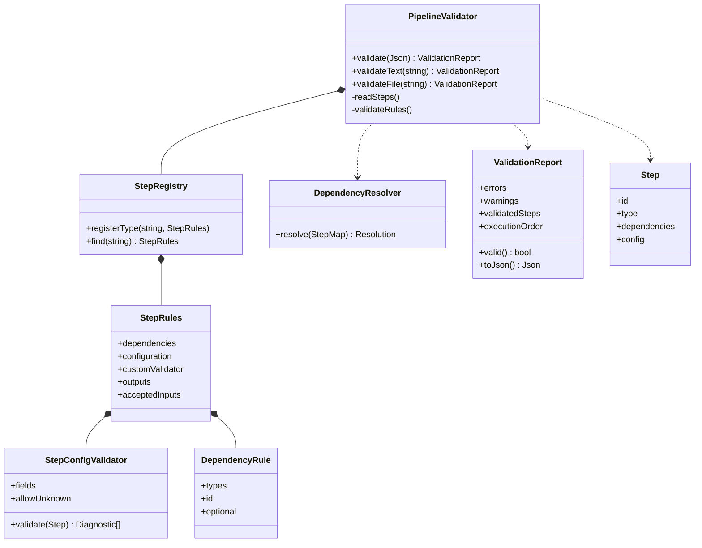

# Architecture, dépendances et extension

## UML



## Déroulement

1. Le parseur vérifie la syntaxe, refuse les clés d'objet répétées et préserve les types JSON.
2. La lecture structurelle accumule les erreurs et transforme les étapes exploitables en valeurs `Step`.
3. Le registre fournit les règles, sans instancier de traitement métier. Les configurations et contrats sont vérifiés.
4. Le résolveur construit les arêtes `étape → prérequis`, signale les références inconnues et auto-dépendances. Les arêtes répétées sont dédupliquées.
5. Un DFS **itératif** colore les sommets : blanc (non visité), gris (chemin actif), noir (terminé). Une arête vers un sommet gris permet de reconstruire un chemin circulaire fermé. Les cycles signalés sont des chemins détectés, pas l'énumération exhaustive de tous les cycles simples, qui peut être exponentielle.
6. Kahn utilise les degrés entrants et une table inverse `prérequis → utilisateurs`. Les étapes sans prérequis restant entrent dans un ensemble trié. La plus petite est extraite, puis ses utilisateurs deviennent disponibles. Ce choix lexicographique rend l'ordre indépendant du JSON.
7. Les erreurs des étapes se propagent à leurs descendants pour déterminer `validatedSteps`. L'ordre est publié uniquement si le rapport global est valide.

Les tables ordonnées et ensembles donnent une complexité `O((V + E) log V)` pour le graphe, hors taille des chemins de cycles produits et comparaison des chaînes ; mémoire `O(V + E)` hors diagnostics. Les configurations et règles coûtent en plus la taille des paramètres et le nombre de liaisons examinées par règle. L'absence de récursion dans le graphe évite un débordement de pile sur les chaînes longues. Le parseur JSON reste celui de nlohmann/json ; ce projet n'impose pas de quotas de taille aux fichiers.

## Sémantique des dépendances du format explicite

Toutes les contraintes sont définies dans le registre de confiance, jamais uniquement dans le JSON utilisateur.

```cpp
pipeline::StepRules rules;
// Une liaison directe vers une instance de Source est obligatoire.
rules.dependencies.push_back({{"Source"}, {}, false});
// Au moins une liaison vers Source OU Cache est obligatoire.
rules.dependencies.push_back({{"Source", "Cache"}, {}, false});
// Une liaison vers Metrics peut être absente.
rules.dependencies.push_back({{"Metrics"}, {}, true});
// Une liaison vers l'instance main-source de type Source est obligatoire.
rules.dependencies.push_back({{"Source"}, "main-source", false});
```

Chaque règle non optionnelle doit être satisfaite : plusieurs règles se combinent par **ET**, les types d'une même règle par **OU**. Une seule liaison peut satisfaire plusieurs règles. Si deux sources distinctes sont exigées, préciser deux IDs différents. Par défaut, au moins une instance explicitement liée du type demandé suffit, même si d'autres instances existent. Il n'y a pas de dépendance transitive implicite ni d'ajout automatique d'arêtes.

Une règle optionnelle documente une possibilité ; elle n'ajoute ni avertissement ni contrainte quand elle est absente. Une référence explicite reste soumise aux vérifications d'existence, cycle et contrat, même si son type est optionnel. Les liaisons supplémentaires sont permises : les règles ne constituent pas une liste exclusive des types autorisés. Pour interdire d'autres entrées, ajouter une politique dédiée au moteur hôte ou des contrats adaptés.

## Ajouter un type et un validateur

```cpp
pipeline::StepRegistry registry;
pipeline::StepRules source;
source.outputs = {"rows"};
registry.registerType("Source", source);

pipeline::StepRules normalize;
normalize.dependencies = {{{"Source"}, {}, false}};
normalize.acceptedInputs = {"rows"};
normalize.outputs = {"normalized_rows"};
normalize.configuration.allowUnknown = false;
normalize.configuration.fields["scale"] = {
    pipeline::ConfigField::Type::Number, true, 0.0, 10.0, {}};
normalize.configuration.fields["mode"] = {
    pipeline::ConfigField::Type::String, true, {}, {}, {"fast", "precise"}};
normalize.customValidator = [](const pipeline::Step& step) {
    std::vector<pipeline::Diagnostic> errors;
    // Ici : règles croisées spécifiques au domaine. Ne pas exécuter de tâche.
    if (step.config.value("reserved", false))
        errors.push_back({"INVALID_CONFIGURATION", "Reserved mode", step.id,
                          {{"field", "reserved"}}});
    return errors;
};
registry.registerType("Normalize", normalize);
pipeline::PipelineValidator validator(std::move(registry));
```

Un callback doit vérifier les types avant de lire ses paramètres ; les exceptions sont converties en diagnostics `INVALID_CONFIGURATION`, ce qui permet de poursuivre les autres vérifications. Les callbacks sont du code de confiance fourni par l'application : leur caractère sans effet de bord relève du contrat d'intégration. Ils ne sont jamais lus dans le fichier JSON.

Types disponibles : String, Number, Integer, Boolean, Object, Array. `Number` accepte entiers et flottants mais pas booléens. Les bornes sont inclusives. `allowed` impose une valeur parmi une liste. Les champs sont optionnels sauf `required = true`. Les configurations restent extensibles par défaut, ou strictes avec `allowUnknown = false`. Un nom de type vide ou enregistré deux fois et une règle sans type lèvent `std::invalid_argument` lors de la création du registre.

## Contrats de sortie

`outputs` et `acceptedInputs` sont des tags statiques de domaine. Si `acceptedInputs` est vide, aucun contrôle n'est demandé. Sinon, chaque producteur direct doit partager au moins un tag avec les entrées acceptées, y compris les producteurs optionnels explicitement liés. Un producteur sans tag est alors incompatible. Aucun objet réel n'est produit ou inspecté. Ces tags ne vérifient ni cardinalités de ports ni types C++ d'objets : une future validation dynamique peut appliquer ces contrats aux résultats dans le moteur d'exécution.

## Registre du stitching fourni

Ces règles sont des exemples configurables, pas une déduction de classes existantes.

| Type | Liaisons directes requises | Paramètres spécifiques |
| --- | --- | --- |
| ImportStep | Aucune | path non vide ; regex optionnelle compilable |
| StitchingStep | ImportStep | method : SIFT/Harris-NCC/LightGlue ; overlap numérique [0,1] ; direction : LeftRight/RightLeft/TopBottom/BottomTop |
| AbsolutePositioningStep | StitchingStep | Aucun imposé |
| IntensityCorrectionStep | AbsolutePositioningStep | Aucun imposé |
| SeamlineStep | AbsolutePositioningStep OU IntensityCorrectionStep | Aucun imposé |
| FusionStep | AbsolutePositioningStep OU IntensityCorrectionStep ; SeamlineStep optionnelle | Aucun imposé |
| ExportStep | AbsolutePositioningStep OU IntensityCorrectionStep OU FusionStep | output non vide |

Les chemins sont validés comme paramètres, sans contrôle du système de fichiers. Adapter les bornes, directions, alternatives et tags dans `src/stitching.cpp` selon le pipeline réel, ou composer un autre `StepRegistry`. Aucune modification des algorithmes de graphe n'est requise.

## Intégration dans un autre projet

1. Ajouter ce dossier avec `add_subdirectory(...)` et lier la cible `pipeline_validation`.
2. Enregistrer les types reconnus par vos exécuteurs dans un registre indépendant.
3. Convertir la configuration existante en enveloppe documentée, ou produire cette enveloppe depuis vos objets existants.
4. Conserver un snapshot immuable et appeler `requireValid` à l'entrée de l'exécution. Toute modification nécessite une nouvelle validation.
5. Mapper les IDs de l'ordre calculé vers vos instances `Step`. Le moteur de validation ne connaît ni leurs constructeurs ni leurs algorithmes.

L'exemple `examples/integration.cpp` compile cette intégration pour deux étapes ETL sans lancer de travail réel. Un registre possédé par le validateur isole ses règles des mutations ultérieures du registre d'origine. Des callbacks capturant un état externe mutable nécessitent la synchronisation et les garanties de l'application hôte.

## Organisation des fichiers

Les déclarations publiques sont séparées dans `include/pipeline/` selon leur responsabilité. Les implémentations correspondantes sont dans `src/`. La validation du pipeline distingue la lecture de sa structure (`pipeline_schema.cpp`), les règles métier (`pipeline_rules.cpp`), les entrées fichier/texte (`pipeline_io.cpp`) et l’orchestration (`pipeline_validator.cpp`).

L’en-tête commun `pipeline/validator.hpp` reste utilisable par les applications existantes. Une application peut aussi inclure uniquement `pipeline/pipeline_validator.hpp` et, si nécessaire, `pipeline/stitching_registry.hpp`. Les algorithmes et le format des rapports restent identiques.

## Adaptation du format métier name/options

`ordered_json.cpp` convertit les noms uniques en identifiants internes. Il relie chaque étape à celle qui la précède pour conserver l’ordre de la liste, puis ajoute les prérequis métier présents parmi les étapes précédentes. Les étapes situées après l’utilisateur ne peuvent pas satisfaire sa règle. Le modèle interne passe ensuite par les mêmes vérifications génériques. Aucun traitement n’est exécuté par cette conversion.

`ordered_options.cpp` vérifie les déclarations `string`, `int`, `float`, `bool`, refuse les clés répétées et construit l’objet de configuration. `ordered_stitching.cpp` définit les noms et les champs du JSON métier, séparément des règles du format explicite. Les options supplémentaires restent acceptées par défaut, à condition que leur déclaration de type soit correcte.

Dans ce format séquentiel, les noms répétés sont refusés : il ne permet pas de distinguer plusieurs instances portant le même nom. La validation conserve l’ordre de la liste et ne le réorganise pas pour corriger une dépendance placée trop tard. Les règles optionnelles n’exigent pas leur étape ; les règles alternatives acceptent au moins une des étapes antérieures correspondantes. Les anciennes règles de stitching décrites plus haut concernent uniquement le format explicite.
