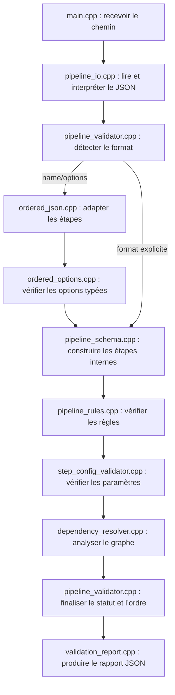

# Rapport : responsabilité de chaque fichier

Ce projet vérifie un pipeline JSON sans exécuter les traitements d’images. Il accepte le format métier `name/options` et le format explicite `id/type/depends_on/config`.

Les chemins ci-dessous sont relatifs à la racine du projet. Les fichiers `.hpp` déclarent les modèles et interfaces utilisables ; les fichiers `.cpp` contiennent leur implémentation.

## 1. Code source : src/

| Fichier | Responsabilité | Exemple de question traitée |
| --- | --- | --- |
| `main.cpp` | Point d’entrée de la commande. Vérifie les arguments, crée le registre du stitching, demande la validation et affiche le rapport JSON | Quel fichier faut-il valider et quel code de sortie renvoyer ? |
| `pipeline_io.cpp` | Lit un fichier ou un texte JSON. Signale les erreurs de lecture, la syntaxe incorrecte et les clés d’objet répétées. | Le fichier est-il accessible et son JSON est-il lisible ? |
| `pipeline_validator.cpp` | Coordonne toutes les vérifications. Détecte le format, appelle son adaptation si nécessaire, rassemble les erreurs, propage l’invalidité aux descendants et publie l’ordre uniquement si tout est valide. Contient aussi la garde `requireValid`. | Le pipeline complet est-il valide ? |
| `ordered_json.cpp` | Adapte le format métier `name/options` au modèle interne. Vérifie les noms uniques et crée des liaisons vers l’étape précédente et les prérequis métier déjà présents. | `import` apparaît-elle avant `stitching` ? |
| `ordered_options.cpp` | Vérifie chaque option `type/key/value`, les types déclarés et les clés répétées. Transforme les options en objet de configuration. | Une option déclarée `int` contient-elle bien un entier ? |
| `ordered_stitching.cpp` | Définit les types et règles métier du format `name/options` : noms reconnus, prérequis, paramètres obligatoires, valeurs autorisées et bornes. | Quels paramètres sont autorisés pour `stitching` ? |
| `pipeline_schema.cpp` | Vérifie l’enveloppe du modèle explicite ou normalisé, ses métadonnées, la liste des étapes et les champs `id/type/depends_on/config`. Construit la table des étapes. | Une étape possède-t-elle une configuration objet et un identifiant unique ? |
| `pipeline_rules.cpp` | Vérifie les types enregistrés, les configurations, les callbacks spécifiques, les dépendances obligatoires et les contrats statiques des sorties. | Chaque règle obligatoire possède-t-elle une liaison vers un type accepté ? |
| `step_config_validator.cpp` | Applique les contraintes déclaratives des paramètres : présence, type, bornes inclusives, valeurs autorisées et champs inconnus en mode strict. | `ratio` respecte-t-il les bornes configurées ? |
| `step_registry.cpp` | Enregistre les types et retrouve leurs règles. Refuse un nom vide, un enregistrement en double ou une règle sans type accepté. | Ce type d’étape est-il reconnu ? |
| `dependency_resolver.cpp` | Analyse le graphe. Détecte les références inconnues, les auto-dépendances et les cycles, puis calcule un ordre topologique déterministe. | Existe-t-il un cycle empêchant l’exécution ? |
| `validation_report.cpp` | Transforme les diagnostics et le rapport final en JSON : validité, erreurs, avertissements, étapes validées et ordre. | Comment afficher un résultat exploitable par une application ? |
| `stitching.cpp` | Définit les règles du stitching pour l’ancien format explicite et ajoute les types métier du nouveau format via `registerOrderedTypes`. | Quelles règles appliquer à `StitchingStep` dans le format explicite ? |
| `diagnostic_utils.hpp` | Petit outil interne pour construire les diagnostics sans répéter leur initialisation. | Comment créer une erreur avec code, message et contexte ? |
| `ordered_json.hpp` | Déclare les fonctions internes d’adaptation du format métier, de lecture des options et d’enregistrement des types. | Comment les fichiers d’adaptation communiquent-ils ? |

### Distinction importante : adapter et vérifier

`ordered_json.cpp` sélectionne uniquement les prérequis situés **avant** l’utilisateur. `pipeline_rules.cpp` vérifie ensuite que les liaisons produites satisfont réellement les règles obligatoires. Ainsi, si `import` manque ou arrive après `stitching`, aucune liaison admissible ne satisfait la règle et le rapport contient `MISSING_DEPENDENCY`.

Dans le format explicite, les liaisons proviennent directement de `depends_on`. Dans le format métier, l’ordre de la liste est conservé grâce à la liaison vers l’étape précédente. Une étape requise peut être antérieure sans être immédiatement adjacente.

## 2. Interfaces publiques : include/pipeline/

| Fichier | Responsabilité |
| --- | --- |
| `validator.hpp` | En-tête commun de compatibilité qui inclut le validateur, le résolveur et le registre du stitching. |
| `pipeline_validator.hpp` | Déclare `PipelineValidator`, ses méthodes `validate`, `validateText`, `validateFile` et la garde `requireValid`. |
| `validation_report.hpp` | Déclare le type JSON partagé, `Diagnostic` et `ValidationReport`. |
| `step.hpp` | Déclare `Step` : identifiant, type, dépendances et configuration. Il décrit une étape sans la lancer. |
| `step_config_validator.hpp` | Déclare `ConfigField` et `StepConfigValidator`, utilisés pour définir et vérifier les paramètres. |
| `step_registry.hpp` | Déclare les règles de dépendance, les règles d’un type et le registre des types. |
| `dependency_resolver.hpp` | Déclare le résultat de résolution et l’interface d’analyse du graphe. |
| `stitching_registry.hpp` | Déclare `stitchingRegistry()`, qui construit le registre de démonstration métier. |

## 3. Construction et tests

| Fichier | Responsabilité |
| --- | --- |
| `CMakeLists.txt` | Configure C++17, les fichiers de la bibliothèque, les exécutables, les avertissements du compilateur et l’activation des tests. |
| `tests/CMakeLists.txt` | Construit les programmes de test, déclare les tests CTest et découvre les fichiers JSON numérotés. |
| `tests/validator_tests.cpp` | Contient 32 scénarios unitaires du moteur générique : dépendances, cycles, types personnalisés, configurations, propagation des erreurs et grande chaîne d’étapes. |
| `tests/json_scenarios.cpp` | Compare un rapport produit par la vraie commande aux attentes du manifeste : code de sortie, validité, codes d’erreur/avertissement et ordre. |
| `tests/check_json.cmake` | Lance la commande sur un JSON, sauvegarde le rapport et appelle le programme qui vérifie son contenu. |
| `tests/json/manifest.json` | Liste les résultats attendus pour les 24 scénarios métier. Ce fichier n’est pas un pipeline. |
| `tests/README.md` | Explique les scénarios, présente leurs résultats conservés et donne les commandes pour les relancer. |

## 4. Les 24 JSON de test et leurs rapports

Chaque fichier de `tests/json/` fournit l’entrée d’un scénario. Le fichier portant le même nom dans `tests/reports/` conserve le résultat observé. Ces rapports sont des copies d’une exécution ; les rapports frais sont produits dans `build/reports/` à chaque passage des tests JSON.

| Fichier dans tests/json/ | Responsabilité du scénario | Attendu |
| --- | --- | --- |
| `01_import_seul.json` | Tester une importation indépendante. | Accepté |
| `02_pipeline_complet.json` | Tester les sept étapes et les options de l’exemple métier fourni. | Accepté |
| `03_pipeline_minimal.json` | Tester importation, stitching, positionnement et export. | Accepté |
| `04_optionnelle_absente.json` | Tester une fusion sans étape de couture optionnelle. | Accepté |
| `05_alternative_correction.json` | Tester une correction d’intensité comme prérequis alternatif de la fusion. | Accepté |
| `06_export_apres_fusion.json` | Tester l’export du résultat de fusion. | Accepté |
| `07_seamline_sans_correction.json` | Tester la couture à partir du positionnement sans correction d’intensité. | Accepté |
| `08_import_absent.json` | Tester un stitching sans importation. | Refusé |
| `09_import_apres_stitching.json` | Tester un prérequis existant mais placé trop tard. | Refusé |
| `10_stitching_absent.json` | Tester un positionnement sans stitching. | Refusé |
| `11_positioning_absent.json` | Tester une correction sans positionnement absolu. | Refusé |
| `12_type_inconnu.json` | Tester un nom d’étape non enregistré. | Refusé |
| `13_nom_duplique.json` | Tester deux étapes portant le même nom. | Refusé |
| `14_configuration_invalide.json` | Tester des valeurs métier interdites ou hors limites. | Refusé |
| `15_type_option_incorrect.json` | Tester une chaîne à la place d’une valeur déclarée entière. | Refusé |
| `16_type_option_inconnu.json` | Tester un type d’option non reconnu. | Refusé |
| `17_cle_option_dupliquee.json` | Tester une clé répétée dans les options d’une étape. | Refusé |
| `18_options_non_tableau.json` | Tester un objet à la place de la liste d’options. | Refusé |
| `19_option_incomplete.json` | Tester une option sans valeur. | Refusé |
| `20_vide.json` | Tester un pipeline sans étape. | Refusé |
| `21_regex_invalide.json` | Tester une expression régulière d’importation incorrecte. | Refusé |
| `22_plusieurs_erreurs.json` | Tester l’accumulation de plusieurs erreurs dans un rapport. | Refusé |
| `23_nom_absent.json` | Tester une étape sans nom. | Refusé |
| `24_json_malforme.json` | Tester un texte qui ne respecte pas la syntaxe JSON. | Refusé |

Les 24 fichiers de `tests/reports/` ont donc tous la même responsabilité : conserver les diagnostics du scénario de même nom, sans contenir de logique de validation.

## 5. Exemples : examples/

| Fichier | Responsabilité |
| --- | --- |
| `valid.json` | Exemple métier complet au format `name/options`, prêt à passer à la commande. |
| `missing-dependency.json` | Exemple de stitching sans importation. |
| `unknown-dependency.json` | Actuellement, autre copie du cas d’importation absente dans le format métier. Malgré son nom historique, il ne contient plus de référence explicite inconnue. |
| `invalid-config.json` | Exemple d’options métier incorrectes. |
| `cycle.json` | Exemple de cycle dans l’ancien format explicite, car le format séquentiel ne permet pas de déclarer ce cycle. |
| `validation-report.json` | Rapport conservé de la validation de `missing-dependency.json`. |
| `integration.cpp` | Exemple compilable d’un registre ETL personnalisé et de la garde avant exécution, avec le format explicite. Affiche uniquement l’ordre ; ne lance aucun traitement. |

## 6. Documentation et bibliothèque tierce

| Fichier | Responsabilité |
| --- | --- |
| `README.md` | Point d’entrée : présentation, formats, commandes et codes de diagnostic. |
| `docs/architecture.md` | Détaille les composants, le diagramme UML, les algorithmes, les règles et les possibilités d’extension. |
| `docs/responsabilites-fichiers.md` | Le présent rapport, qui explique où se trouve chaque responsabilité. |
| `third_party/nlohmann/json.hpp` | Bibliothèque externe nlohmann/json 3.11.3 pour interpréter et produire du JSON. Son volume ne provient pas du moteur du projet. |
| `third_party/nlohmann/LICENSE.MIT` | Licence de cette bibliothèque externe. |
| `.gitignore` | Exclut les dossiers de build, fichiers objets et métadonnées macOS du suivi Git. |

## 7. Dossier build/ : fichiers générés

`build/` contient les exécutables, la bibliothèque compilée, les objets intermédiaires, les fichiers internes de CMake/CTest et les rapports frais. Leur liste varie selon la plateforme et le générateur choisi. Ils sont produits par la construction et ne constituent pas les sources à modifier.

Les principaux éléments sont `pipeline-validator`, `integration-example`, les programmes de tests, la bibliothèque `pipeline_validation` et `reports/`. La configuration des tests étant maintenant dans un sous-dossier, leurs exécutables sont normalement construits dans `build/tests/`. La commande `ctest --test-dir build` les retrouve automatiquement.

## 8. Parcours d’une validation

Le registre fournit les règles à l’adaptation et à la validation. `ordered_stitching.cpp` et `stitching.cpp` définissent ces règles métier ; `step_registry.cpp` les stocke et les retrouve.

## 9. Quel fichier modifier selon le besoin ?

| Besoin | Fichier principal |
| --- | --- |
| Changer les prérequis de `stitching` dans votre JSON | `src/ordered_stitching.cpp` |
| Ajouter une option métier ou changer une limite | `src/ordered_stitching.cpp` |
| Modifier la lecture de `type/key/value` | `src/ordered_options.cpp` |
| Modifier la manière de retrouver les étapes précédentes | `src/ordered_json.cpp` |
| Modifier les contrôles génériques des paramètres | `src/step_config_validator.cpp` |
| Modifier la détection des cycles ou le tri | `src/dependency_resolver.cpp` |
| Modifier la structure du rapport | `include/pipeline/validation_report.hpp` et `src/validation_report.cpp` |
| Ajouter un scénario JSON | `tests/json/` et `tests/json/manifest.json` |
| Relier le validateur à un moteur d’exécution existant | S’inspirer de `examples/integration.cpp` et utiliser `requireValid` |
