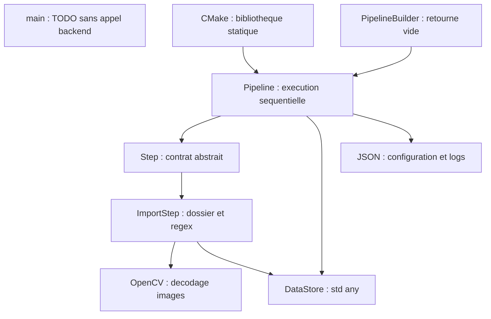
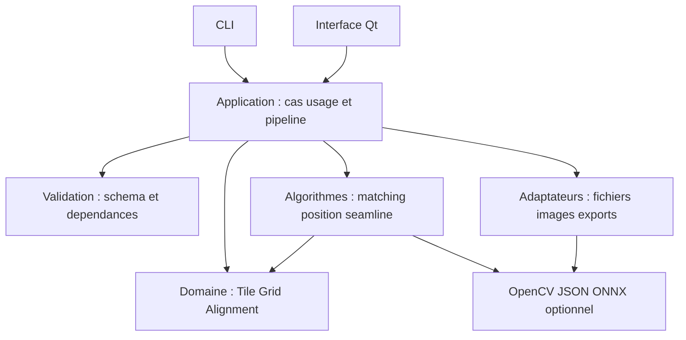

# KIKIRPA-CPP / Stitching

Rapport d’audit technique, architectural et Git

Date : 15 octobre 2026 (Europe/Brussels)

Référence : 2c3df51638fc92aa88ad069d07871677eef27b12 — branche main

Statut : diagnostic avant intégration et mise en production. Diffusion interne.

Source de référence : ARCHITECTURE_AUDIT_REPORT.md. Le PDF est généré depuis cette même source ; les diagrammes simples sont convertis localement en dessins vectoriels.

Aucun code, configuration, donnée, branche, index ou historique modifié. Seuls les deux rapports sont créés.

## Table des matières

1. Résumé exécutif
2. Objectifs et périmètre
3. Méthodologie et limitations
4. Présentation fonctionnelle
5. Stack technologique
6. Architecture actuelle
7. Diagramme de l’architecture actuelle
8. Analyse détaillée des dossiers
9. Analyse des fichiers
10. Fichiers inutiles et candidats à suppression
11. Duplications et dette technique
12. Audit des dépendances
13. Audit de sécurité
14. Audit des performances
15. Qualité et maintenabilité
16. Tests et fiabilité
17. Inventaire des branches Git
18. Comparaison des branches
19. Possibilités de merge
20. Branches obsolètes
21. Stratégie Git recommandée
22. Architecture cible
23. Diagramme de l’architecture cible
24. Nouvelle arborescence
25. Comparaison avant/après
26. Plan de nettoyage
27. Plan de refactorisation
28. Plan de migration Git
29. Évaluation chiffrée
30. Risques et précautions
31. Recommandations finales
32. Annexes techniques
33. Synthèse décisionnelle

## 1. Résumé exécutif

Le projet vise l’assemblage d’images en mosaïque : import de tuiles, appariement, rejet des faux correspondants, positionnement, calcul de coutures, fusion et export. La branche principale est toutefois un squelette de 17 fichiers suivis (dont .gitignore), non un logiciel utilisable. Le compilateur confirme un blocage du point d’entrée ; Step::option est non définie et le builder ne construit aucune étape.

Les références disponibles contiennent de vrais développements : corrélation de phase, seamlines Dijkstra/DP, SIFT/RANSAC, GraphCut, LightGlue/ONNX, parseur JSON et validateur. Leur présence ne prouve pas leur intégration ni leur compilation. Deux historiques indépendants et plusieurs contrats divergents interdisent de traiter une fusion sans conflit comme une validation fonctionnelle.

Décision : ne pas mettre main en production. Stabiliser un parcours CLI vérifiable, puis intégrer progressivement les modules en conservant les tests synthétiques. Architecture cible : monolithe C++ modulaire, sans microservices.

Bilan : 25 constats uniques ; 5 candidats au nettoyage dans main et les branches (dont un groupe de six métadonnées) ; 12 branches logiques analysées, soit main et 11 branches de travail distantes, origin/main étant le miroir de main. Un seul merge global est recommandé sous conditions : fe/pipeline-json-parser vers main. Les autres apports demandent adaptation ciblée. Note pondérée : calcul et justification en section 29.

## 2. Objectifs et périmètre

Périmètre : tous les fichiers suivis de main, les sous-dossiers accessibles hors .git/objects, les manifestes CMake, les références locales et distantes déjà présentes, leurs différences et les fichiers texte de branches. Le dossier applicatif porte le nom KIKIRPA-CPP ; CMake déclare project(Stitching CXX).

Il ne s’agit pas d’un audit web : aucun backend HTTP, base de données, migration, Docker, Supabase ou manifeste JavaScript n’est présent dans main. Le terme Backend désigne une bibliothèque C++ locale. Les branches restent des preuves historiques locales, pas une vue vérifiée du serveur GitHub.

## 3. Méthodologie et limitations

Lecture complète des 17 fichiers suivis de main ; indexation de 285 blobs texte distincts des références distantes, hors bibliothèque tierce volumineuse ; examen approfondi des contrats, points d’entrée, constructions, imports, traitements et tests pertinents. Les ressources PNG ne sont pas analysées pixel par pixel. La lecture automatisée de tous les blobs ne constitue pas une preuve formelle de correction des algorithmes.

Contrôles : git status, branch, remote, log, ls-tree, show, diff, rev-list, merge-base, cherry et merge-tree à trois arbres. Ce dernier mode ne crée pas d’arbre Git ni ne modifie l’index ; il indique des conflits textuels et modifications/suppressions mais ne reproduit pas toutes les résolutions de renommage du moteur ort. Les résultats sont donc conservateurs et ne certifient aucun merge.

Aucun fetch/pull, checkout/switch, build générant des fichiers, installation ou migration. Le test clang++ utilise -fsyntax-only et ne crée pas d’objet. Configuration et build CMake non lancés pour respecter l’autorisation limitée aux documents et éviter le téléchargement FetchContent. Les deux chemins usuels Homebrew OpenCV et nlohmann ont été vérifiés absents ; cela ne prouve pas leur absence sur tous les chemins.

Aucune mesure de mémoire, temps d’exécution, charge, couverture ou analyse CVE en ligne. Aucune version n’est qualifiée de vulnérable ou obsolète sans vérification. Les modèles ONNX et leurs licences/provenance ne sont pas certifiés. Aucun secret trouvé dans l’inventaire courant ; ce constat ne constitue pas une analyse exhaustive de tout l’historique. Aucun .env présent à la racine.

Légende : confirmé = preuve code/Git ou commande ; risque potentiel = scénario non reproduit ; recommandation = choix de conception ; non vérifié = aucune preuve d’exécution. Gravité critique : compromission/perte majeure démontrée ; élevée : fonction essentielle bloquée ; moyenne : robustesse/intégration ; faible : hygiène. P0 bloque le socle, P1 avant livraison, P2 amélioration structurante, P3 opportunité. Aucune vulnérabilité critique exploitable n’a été confirmée.

## 4. Présentation fonctionnelle

| Fonction / parcours | Fichiers et référence | État et règle métier |
| --- | --- | --- |
| Lancer un traitement | main:src/main.cpp:1-7 | Non fonctionnel ; aucun argument ni appel backend |
| Importer une grille | main:src/Backend/steps/ImportStep.cpp:20-72 | Dossier local ; regex captures colonne/ligne ; tri row puis col ; imread conserve la profondeur |
| Configurer / exporter | main:src/Backend/core/Pipeline.cpp:8-20 ; Config.h | Configuration positionnelle ; pas de checkpoint |
| Orchestrer | main:PipelineBuilder.cpp:5-6 ; Pipeline.cpp:23-36 | Builder vide ; exécution séquentielle, arrêt sur false |
| Modèle pyramidal | main:Tuile.h ; Tuile.cpp | Structure propriétaire ; niveaux non calculés, voisins sans setters |
| Script JSON | origin/fe/pipeline-json-parser:PipelineBuilder.cpp:23-65 ; src/main_test.cpp | Registry et dépendances déclarées ; étapes métier encore TODO |
| Valider un graphe | origin/pipeline_validator:src/pipeline_schema.cpp, pipeline_rules.cpp, dependency_resolver.cpp | Bibliothèque autonome ; schéma différent à adapter |
| Corrélation de phase | origin/ccl-nde/phase-dijkstrat:src/algorithms/matching/correlation_phase/* | Préparation, calcul, sortie et diagnostics ; tests présents |
| Coutures Dijkstra / DP | origin/ccl-nde/phase-dijkstrat:src/algorithms/seamline/* | Cartes de coût, jonctions, chemins et overlay ; corrections mémoire présentes |
| SIFT / RANSAC | origin/fe/Sift:src/algorithms/matching/SiftMatcherAlgorithm.cpp ; src/algorithms/rejection/* | Implémentation et tests ; contrat Matches divergent |
| SIFT vers GraphCut | origin/Sift/GraphCut:src/main_graphcut.cpp ; src/positioning/TilePositioner.cpp | CLI de démonstration, mosaïque et territoires ; export à vérifier |
| LightGlue | origin/fe/LightGlue:src/algorithms/matching/LightGlueMatcher.cpp | Inférence ONNX externe ; modèle requis ; session réutilisée |
| Interface Qt | branches algorithmiques:gui/MainWindow.cpp:25-118 | Sélection paramètres et tâche QtConcurrent ; absente de main |

Profils : opérateur local traitant des images et développeur configurant/validant les algorithmes ; aucune gestion de comptes ni rôle logiciel implémenté. Parcours attendu : sélectionner dossier et paramètres, importer, aligner, positionner, calculer coutures, fusionner, exporter. Seul l’import est substantiel dans main, mais non accessible via le programme actuel. Les communications sont des appels C++ et échanges mémoire, pas des API réseau. Le traitement automatique est déclenché manuellement ; aucun ordonnanceur. Pas d’opération de base de données détectée. La finalité patrimoniale est suggérée par le nom du dépôt, mais aucun cahier des charges métier ne la prouve.

## 5. Stack technologique

| Technologie | Preuve | Usage / limite |
| --- | --- | --- |
| C++17 / CMake >=3.16 | CMakeLists.txt:1-4 | Bibliothèque statique stitching_backend et exécutable stitching |
| OpenCV | CMakeLists.txt:6,21 ; Types.h ; ImportStep.cpp | Images, géométrie ; version réelle non établie |
| nlohmann/json | CMakeLists.txt:7-11 ; Config.h | Sérialisation ; version système 3 ou fallback 3.11.3 |
| Qt6 Widgets / Concurrent | CMakeLists.txt:28-35 | Optionnel, mais aucune source frontend active dans main |
| ONNX Runtime / CoreML | origin/fe/LightGlue:CMakeLists.txt ; LightGlueMatcher.cpp | Uniquement branche ; modèle externe |
| CTest / Python | branches ccl et Correlation ; tests/comparer_python.py | Tests présents hors main ; non exécutés |
| Git | refs locales disponibles | Dépôt non shallow ; pas de synchronisation réseau |

## 6. Architecture actuelle

Style actuel : squelette de pipeline séquentiel avec classe abstraite Step, conteneur d’étapes possédées par unique_ptr, état partagé DataStore et configurations JSON. Ce n’est pas une architecture client/serveur. La séparation Frontend/Backend est nominale : Frontend n’a pas d’implémentation et main n’appelle pas la bibliothèque.

Les dépendances vont de Pipeline vers Step/DataStore, de ImportStep vers Step/Config/OpenCV/filesystem/regex, et de PipelineBuilder vers Pipeline/Tuile. Types.h rassemble JSON, images et structures métier : cette commodité expose OpenCV et JSON à la plupart des couches. Aucun cycle d’includes locaux n’est détecté dans main ; les liens réciproques Tuile/Pyramide/Niveau sont des relations d’objets à pointeurs, pas un cycle d’inclusion.

Les erreurs combinent bool, JSON, stderr, callback et exceptions ; les logs peuvent contenir les chemins locaux. L’état n’est pas isolé par exécution. Il n’existe ni session utilisateur, authentification ni autorisation ; les accès fichiers héritent des permissions du processus. Cette absence est cohérente pour une application de bureau mono-utilisateur, mais ne permettrait pas d’exposer tel quel un service distant.

## 7. Diagramme de l’architecture actuelle

Le nœud main est volontairement isolé : aucun appel vers le backend n’existe. Qt n’apparaît pas comme interface fonctionnelle.



## 8. Analyse détaillée des dossiers

| Chemin exact relatif à la racine | Rôle et fichiers | Dépendances / complexité | Décision motivée |
| --- | --- | --- | --- |
| include/Backend/core/ | Config, DataStore, Pipeline, Builder, Step, Tuile, Types | JSON/OpenCV/STL ; faible volume, contrat fragile | Conserver puis répartir application/domain ; F09-F14 |
| src/Backend/core/ | Pipeline.cpp, PipelineBuilder.cpp, Step.cpp, Tuile.cpp | Interfaces core ; faible complexité algorithmique | Implémenter builder/option avant déplacement ; F02-F03 |
| include/Backend/steps/ | ImportStep.h, entrées et sorties | Step, Tiles ; faible | Conserver contrat, typer validation |
| src/Backend/steps/ | ImportStep.cpp : découverte, parsing, décodage, publication | filesystem/regex/OpenCV ; moyenne par responsabilités | Conserver puis extraire découverte et image I/O ; F05-F08 |
| include/Frontend/ | stub.cpp vide | Aucune dépendance ; nulle | Suppression probablement sûre ; .cpp mal placé |
| src/Frontend/ | ToDelete.cpp, commentaire seul | Exclu explicitement de CMake ; nulle | Suppression probablement sûre |
| racine/ | CMakeLists.txt, .gitignore, src/main.cpp | Build et point d’entrée ; faible | Conserver et corriger ; README et presets à prévoir |
| .git/ | Historique et références | Git ; divergence élevée | Conserver intégralement ; aucune opération de nettoyage |
| branches:src/algorithms/ | Matching, rejection, seamline | OpenCV ; moyenne à élevée | Importer par sous-module métier dans le monolithe, pas par service réseau |
| branches:gui/ | MainWindow et QtConcurrent | Application et Qt ; moyenne | Adapter après stabilisation CLI ; tester fermeture pendant traitement |
| branche pipeline_validator:include/pipeline et src/ | Validation schéma, règles, graphe, diagnostics | JSON embarqué ; moyenne | Adapter comme bibliothèque de validation ; ne pas remplacer CMake racine |
| branches:tests et docs | Cas synthétiques, données et documentation | Algorithmes, CTest/Python ; moyenne | Conserver et intégrer avec les fonctions ; rapports de tests à vérifier |

Racine absolue de tous les chemins main : /Users/Apple/Desktop/KIKIRPA-CPP/. Les préfixes origin/... désignent des versions Git, pas des fichiers du working tree. Le fichier principal actuel le plus long fait 75 lignes ; aucun composant géant dans main. Le problème principal est l’incomplétude et les contrats, pas la taille.

## 9. Analyse des fichiers

Chaque fichier suivi est couvert par l’inventaire ci-dessous. Les lignes des constats renvoient au contenu lu à cette révision.

| Fichier main | Lignes | Responsabilité / conclusion |
| --- | --- | --- |
| .gitignore | 4 | Exclusions IDE/build ; nécessaire |
| CMakeLists.txt | 41 | Build ; F15-F17, F25 |
| include/Backend/core/Config.h | 47 | Contrat public ; voir sections architecture et constats |
| include/Backend/core/DataStore.h | 28 | Contrat public ; voir sections architecture et constats |
| include/Backend/core/Pipeline.h | 27 | Contrat public ; voir sections architecture et constats |
| include/Backend/core/PipelineBuilder.h | 23 | Contrat public ; voir sections architecture et constats |
| include/Backend/core/Step.h | 28 | Contrat public ; voir sections architecture et constats |
| include/Backend/core/Tuile.h | 45 | Contrat public ; voir sections architecture et constats |
| include/Backend/core/Types.h | 38 | Contrat public ; voir sections architecture et constats |
| include/Backend/steps/ImportStep.h | 32 | Contrat public ; voir sections architecture et constats |
| include/Frontend/stub.cpp | 0 | Placeholder vide |
| src/Backend/core/Pipeline.cpp | 39 | Configuration, orchestration, logs ; F03/F05/F08-F10 |
| src/Backend/core/PipelineBuilder.cpp | 9 | Stub ; F03 |
| src/Backend/core/Step.cpp | 0 | Vide mais définition nécessaire ; F02 |
| src/Backend/core/Tuile.cpp | 15 | Accès première sous-tuile ; F13 |
| src/Backend/steps/ImportStep.cpp | 75 | Import ; F05-F08 |
| src/Frontend/ToDelete.cpp | 3 | Commentaire seul, exclu |
| src/main.cpp | 7 | Entrée vide et non compilable ; F01/F04 |

### Registre traçable des 25 constats

### F01 — Point d’entrée non compilable

Statut : Confirmé par compilateur. Gravité : Élevée. Priorité : P0. Confiance : Élevée.

Fichier(s) : src/main.cpp. Lignes : 1-7.

Preuve : using namespace stitching sans déclaration de cet espace ; clang++ -std=c++17 -fsyntax-only src/main.cpp retourne 1 : expected namespace name.

Impact : La cible stitching ne peut pas être construite.

Recommandation : Définir un vrai point d’entrée incluant les interfaces nécessaires, puis vérifier son code de sortie.

### F02 — Méthode Step::option sans définition

Statut : Confirmé statiquement. Gravité : Élevée. Priorité : P0. Confiance : Élevée.

Fichier(s) : include/Backend/core/Step.h ; src/Backend/core/Step.cpp ; src/Backend/steps/ImportStep.cpp. Lignes : 16 ; fichier vide ; 22.

Preuve : Déclaration non inline, unité Step.cpp vide, appel dans ImportStep ; aucune définition dans les 17 fichiers suivis. Une implémentation existe dans origin/fe/pipeline-json-parser:src/Backend/core/Step.cpp:8-14.

Impact : Symbole manquant à l’édition de liens dès qu’un exécutable utilise ImportStep ; non mesuré par un lien complet.

Recommandation : Intégrer l’implémentation revue avec ses validations ; ajouter un test qui instancie et exécute ImportStep.

### F03 — Builder vide et succès trompeur

Statut : Confirmé statiquement. Gravité : Élevée. Priorité : P0. Confiance : Élevée.

Fichier(s) : src/Backend/core/PipelineBuilder.cpp ; src/Backend/core/Pipeline.cpp. Lignes : 5-6 ; 23-36.

Preuve : buildPipeline ignore ses trois paramètres et retourne {} ; run() retourne true sur zéro étape.

Impact : Une demande de traitement pourrait être annoncée réussie sans image ni résultat.

Recommandation : Construire les étapes attendues ; rejeter un pipeline vide pour un travail de mosaïque.

### F04 — Aucun parcours utilisateur actif

Statut : Confirmé statiquement. Gravité : Élevée. Priorité : P1. Confiance : Élevée.

Fichier(s) : src/main.cpp ; CMakeLists.txt. Lignes : 5-7 ; 27-40.

Preuve : main contient seulement un TODO ; le seul .cpp frontend est explicitement exclu ; stub.cpp est dans include/.

Impact : Ni CLI utile ni interface Qt dans main. Les GUI des branches ne sont pas intégrées.

Recommandation : Choisir un parcours CLI minimal complet avant de brancher l’interface.

### F05 — Exceptions d’import hors contrat booléen

Statut : Confirmé statiquement. Gravité : Élevée. Priorité : P1. Confiance : Élevée.

Fichier(s) : src/Backend/steps/ImportStep.cpp ; src/Backend/core/Pipeline.cpp. Lignes : 22-25,44-48,62 ; 28.

Preuve : Seule regex_error est interceptée ; get<string>, filesystem, stoi et imread peuvent lever ; Pipeline::run ne les intercepte pas.

Impact : Erreur JSON, permissions ou coordonnées hors plage échappent à la gestion d’échec prévue.

Recommandation : Transformer les erreurs attendues en résultat structuré au bord de chaque étape ; conserver le contexte fichier et étape.

### F06 — Coordonnées et géométrie non validées

Statut : Confirmé statiquement. Gravité : Moyenne. Priorité : P1. Confiance : Élevée.

Fichier(s) : src/Backend/steps/ImportStep.cpp. Lignes : 37-48,56-67.

Preuve : Deux groupes de capture sont exigés, mais ni leur nature numérique, ni unicité (row,col), ni homogénéité dimensions/profondeur/canaux ne sont contrôlées.

Impact : Import ambigu ou images incompatibles transmis aux futurs algorithmes.

Recommandation : Valider captures, bornes, doublons et caractéristiques ; décider explicitement du support des grilles lacunaires.

### F07 — Budget de ressources absent

Statut : Risque potentiel. Gravité : Moyenne. Priorité : P1. Confiance : Élevée.

Fichier(s) : src/Backend/steps/ImportStep.cpp. Lignes : 30-48,61-71.

Preuve : Regex configurable et toutes les images décodées conservées simultanément sans plafond de nombre ou de volume.

Impact : Blocage CPU sur regex pathologique ou épuisement RAM avec entrées volumineuses ; aucune mesure réalisée.

Recommandation : Limiter les ressources, permettre annulation et chargement par blocs ; contraindre les motifs acceptés.

### F08 — État d’exécution conservé après échec

Statut : Confirmé statiquement. Gravité : Moyenne. Priorité : P1. Confiance : Élevée.

Fichier(s) : src/Backend/steps/ImportStep.cpp ; include/Backend/core/Pipeline.h. Lignes : 25-72 ; 12-13.

Preuve : outputData et output ne sont pas remis à zéro ; une erreur ne retire pas la précédente clé tiles du DataStore.

Impact : Après relance, une sortie antérieure et un diagnostic error peuvent coexister avec un succès.

Recommandation : Créer un contexte par run et publier les résultats atomiquement ; tester succès-échec-succès.

### F09 — Reprise annoncée mais non implémentée

Statut : Confirmé statiquement. Gravité : Moyenne. Priorité : P2. Confiance : Élevée.

Fichier(s) : src/Backend/core/Pipeline.cpp ; include/Backend/core/Pipeline.h. Lignes : 16-20,32 ; 20.

Preuve : exportConfig sérialise les paramètres, sans images, index d’étape, résultat ou checkpoint.

Impact : La configuration exportée ne garantit pas une reprise après interruption.

Recommandation : Renommer en export de configuration ; définir séparément un vrai protocole de checkpoint si nécessaire.

### F10 — Contrats de configuration trop permissifs

Statut : Confirmé statiquement. Gravité : Moyenne. Priorité : P1. Confiance : Élevée.

Fichier(s) : src/Backend/core/Pipeline.cpp ; include/Backend/core/Step.h. Lignes : 8-13 ; 22.

Preuve : Même nombre d’étapes uniquement ; importConfig remplace le JSON sans vérifier nom, types ou signature.

Impact : Un fichier bien formé peut configurer une étape avec une signature ou un nom incohérents.

Recommandation : Valider schéma, noms et dépendances avant toute mutation ; reconfiguration transactionnelle.

### F11 — Conteneur hétérogène sans contrat typé

Statut : Recommandation architecturale. Gravité : Moyenne. Priorité : P2. Confiance : Élevée.

Fichier(s) : include/Backend/core/DataStore.h ; include/Backend/core/Config.h. Lignes : 12-22 ; 19-33.

Preuve : std::any et clés string ; les types JSON sont des chaînes indépendantes des types C++.

Impact : Erreurs de couplage à l’exécution ; testabilité et navigation plus difficiles.

Recommandation : Introduire quelques clés typées ou un contexte de résultats explicite ; éviter un framework générique complexe.

### F12 — Pointeurs d’étapes fragiles

Statut : Confirmé statiquement. Gravité : Moyenne. Priorité : P2. Confiance : Élevée.

Fichier(s) : include/Backend/core/Pipeline.h ; include/Backend/core/Step.h. Lignes : 22 ; 13,25.

Preuve : add accepte unique_ptr nul ; run le déréférence. Step conserve l’adresse du DataStore appartenant au Pipeline.

Impact : Crash sur entrée nulle ; durée de vie délicate si une étape est réutilisée après déplacement du pipeline.

Recommandation : Rejeter nullptr ; passer le contexte à execute plutôt que stocker son adresse.

### F13 — Deux modèles de tuile non reliés

Statut : Confirmé statiquement. Gravité : Moyenne. Priorité : P2. Confiance : Élevée.

Fichier(s) : include/Backend/core/Types.h ; include/Backend/core/Tuile.h ; src/Backend/core/Tuile.cpp. Lignes : 19-25 ; 29-42 ; 9-12.

Preuve : Import produit Tiles/TileImage ; Tuile attend Pyramide.original. Aucun adaptateur ; image() retourne seulement la première sous-tuile.

Impact : Algorithmes orientés Tuile non alimentés par l’import ; ambiguïté métier.

Recommandation : Unifier TileId, coordonnées et accès image ; adapter progressivement les algorithmes existants.

### F14 — Back-pointers incompatibles avec déplacement implicite

Statut : Risque potentiel. Gravité : Moyenne. Priorité : P2. Confiance : Élevée.

Fichier(s) : include/Backend/core/Tuile.h ; src/Backend/core/Tuile.cpp. Lignes : 25,29-38 ; 5-6.

Preuve : Tuile peut être déplacée via unique_ptr ; Pyramide.parent est initialisé à this et ne suit pas automatiquement le nouvel objet.

Impact : Pointeur parent obsolète si déplacement ; aucun usage déclencheur observé dans main.

Recommandation : Interdire temporairement le déplacement ou mettre à jour les liens dans les opérations move ; tester leur validité.

### F15 — Construction non reproductible et téléchargement non vérifié

Statut : Confirmé statiquement. Gravité : Moyenne. Priorité : P1. Confiance : Élevée.

Fichier(s) : CMakeLists.txt. Lignes : 6-11,28.

Preuve : OpenCV et Qt sans version ; nlohmann_json accepte une version 3 système ; fallback 3.11.3 par URL sans URL_HASH. Aucun lockfile ou preset.

Impact : Variation d’API entre machines et contrôle d’intégrité de l’archive absent. Aucune compromission démontrée.

Recommandation : Fixer une matrice de versions supportées, ajouter hash et presets, prévoir une source hors ligne contrôlée.

### F16 — Chemins OpenCV non explicités

Statut : Risque potentiel. Gravité : Moyenne. Priorité : P1. Confiance : Élevée.

Fichier(s) : CMakeLists.txt. Lignes : 18-21.

Preuve : target_include_directories ne contient pas OpenCV_INCLUDE_DIRS ; liaison via OpenCV_LIBS.

Impact : Échec possible selon la forme des cibles exportées par la distribution OpenCV ; non vérifié localement.

Recommandation : Lier les cibles importées adaptées et leurs includes ; valider sur environnement propre.

### F17 — Aucune validation automatisée dans main

Statut : Confirmé statiquement. Gravité : Élevée. Priorité : P1. Confiance : Élevée.

Fichier(s) : CMakeLists.txt ; arbre main. Lignes : 1-41 ; inventaire complet.

Preuve : Pas de tests/, enable_testing, add_test, configuration CI, lint ou analyse statique dans main. Des tests existent dans plusieurs branches.

Impact : Les blocages F01-F03 ne sont pas arrêtés avant intégration.

Recommandation : Importer les tests utiles ; CI compilation, CTest et analyse statique avec jeux synthétiques.

### F18 — Documentation opérationnelle absente de main

Statut : Confirmé statiquement. Gravité : Moyenne. Priorité : P2. Confiance : Élevée.

Fichier(s) : arbre main ; include/Backend/core/PipelineBuilder.h. Lignes : inventaire ; 19-20.

Preuve : Ni README ni instructions de construction ; commentaire promettant une exception de builder non implémentée.

Impact : Installation et état fonctionnel difficiles à établir ; contrat trompeur.

Recommandation : Documenter les prérequis, scénarios supportés et limites réelles ; vérifier les exemples.

### F19 — Étapes TODO renvoyant true dans les branches

Statut : Confirmé statiquement. Gravité : Élevée. Priorité : P1. Confiance : Élevée.

Fichier(s) : origin/fe/pipeline-json-parser:src/Backend/steps/StitchingStep.cpp, FusionStep.cpp, ExportStep.cpp ; origin/ccl-nde/phase-dijkstrat:src/steps/ImportStep.cpp, FusionStep.cpp, ExportStep.cpp. Lignes : 19-21 ; 15-17 ; 19-21 ; 8 ; 5 ; 5.

Preuve : Traitements vides et return true ; les tests de chaîne sur paire sont hors pipeline (CMake ccl:40-44).

Impact : Tests algorithmiques réussis ne prouveraient pas un parcours applicatif complet.

Recommandation : Chaque étape non implémentée doit produire un échec explicite ; ajouter un test CLI de bout en bout.

### F20 — Fast-forward tuil destructeur fonctionnellement

Statut : Confirmé par Git. Gravité : Élevée. Priorité : P0. Confiance : Élevée.

Fichier(s) : origin/tuil ; CMakeLists.txt. Lignes : diff main..origin/tuil ; 15-17.

Preuve : main est ancêtre de tuil ; la branche supprime les cinq .cpp backend, conserve le GLOB vers src/Backend et ajoute Tuile.hpp hors de cette structure.

Impact : Une fusion sans conflit peut retirer le backend et casser la bibliothèque sans source.

Recommandation : Ne pas fusionner cette branche en bloc ; transposer le modèle utile après adaptation et tests.

### F21 — Branches autonomes et divergence structurelle

Statut : Confirmé par Git. Gravité : Élevée. Priorité : P1. Confiance : Élevée.

Fichier(s) : origin/Sift/GraphCut ; origin/pipeline_validator ; autres refs. Lignes : merge-base et merge-tree ; annexes.

Preuve : Aucun ancêtre commun avec main pour ces deux branches ; les branches d’algorithmes modifient des fichiers supprimés par la restructuration de main.

Impact : Merge automatique non fiable ; risque de perdre import/config et contrats même sans marqueurs textuels.

Recommandation : Définir une branche d’intégration ultérieure et importer des modules revus ; interdire les fusions globales de racines indépendantes.

### F22 — Découverte ONNX et packaging spécifiques à macOS

Statut : Confirmé statiquement. Gravité : Moyenne. Priorité : P1. Confiance : Élevée.

Fichier(s) : origin/fe/LightGlue:CMakeLists.txt. Lignes : 9-10,27-30,37,44-52.

Preuve : find_path/find_library sans option de fonctionnalité ; copie libqcocoa.dylib non protégée par APPLE.

Impact : LightGlue peut bloquer une construction sans ONNX ; packaging Qt non portable.

Recommandation : Option BUILD_LIGHTGLUE explicite et dépendance REQUIRED conditionnelle ; packaging par plateforme.

### F23 — Module LightGlue concentre plusieurs responsabilités

Statut : Recommandation architecturale. Gravité : Moyenne. Priorité : P2. Confiance : Élevée.

Fichier(s) : origin/fe/LightGlue:src/algorithms/matching/LightGlueMatcher.cpp. Lignes : 35-118,120-576.

Preuve : 576 lignes : recherche modèle, réglage hardware, préparation image, deux protocoles de tenseurs, validation, décodage et logs.

Impact : Évolution difficile et tests de contrats ONNX coûteux.

Recommandation : Extraire résolution de modèle et adaptateurs de sorties ; conserver une interface matcher commune, session réutilisée.

### F24 — Exports de démonstration non vérifiés

Statut : Confirmé statiquement. Gravité : Moyenne. Priorité : P1. Confiance : Élevée.

Fichier(s) : origin/Sift/GraphCut:src/main_graphcut.cpp. Lignes : 128-132.

Preuve : Trois appels imwrite à chemins fixes, valeur de retour ignorée.

Impact : Succès possible malgré absence de fichiers ; écrasement des précédentes sorties. JPEG ne constitue pas un export de conservation 16 bits.

Recommandation : Vérifier chaque écriture, choisir répertoire explicite et politique d’écrasement ; tester aller-retour TIFF 16 bits et métadonnées.

### F25 — Hygiène des fichiers et sources automatiques

Statut : Confirmé par contenu et références. Gravité : Faible. Priorité : P3. Confiance : Élevée.

Fichier(s) : include/Frontend/stub.cpp ; src/Frontend/ToDelete.cpp ; CMakeLists.txt ; origin/fe/Sift:src/algorithms/matching/BOnALgo13_10.txt. Lignes : vide ; 1-3 ; 15-16,30-32 ; blob a38c787c.

Preuve : Deux placeholders main ; BOnALgo13_10.txt est identique octet par octet à SiftMatcherAlgorithm.cpp ; GraphCut contient six fichiers Zone.Identifier.

Impact : Bruit dans les revues et sources involontaires possibles par GLOB.

Recommandation : Nettoyage séparé et revu ; conserver Step.cpp qui doit recevoir F02 ; expliciter les sources CMake.

## 10. Fichiers inutiles et candidats à suppression

Cinq candidats sont comptés comme unités de décision : deux fichiers main, une copie source de branche, un groupe de six métadonnées et un dossier de 24 rapports. Cela représente 33 fichiers potentiels, dont 9 en catégorie A et 24 à vérifier ; seulement 2 sont présents dans main. Aucun fichier n’est supprimé. Un usage externe non visible reste toujours possible.

| Classe | Fichier | Fonction actuelle | Preuve | Problème | Recommandation | Risque | Confiance |
| --- | --- | --- | --- | --- | --- | --- | --- |
| A | include/Frontend/stub.cpp | Vide ; aucune fonction ni symbole | Non inclus par les GLOB actifs ; aucune référence texte à stub.cpp | Placeholder dans include | Supprimer ultérieurement | Faible | Élevée |
| A | src/Frontend/ToDelete.cpp | Commentaire seulement | CMakeLists.txt:32 l’exclut explicitement | Bruit | Supprimer et retirer ensuite son exclusion devenue inutile | Faible | Élevée |
| A | origin/fe/Sift:src/algorithms/matching/BOnALgo13_10.txt | Copie source | Même blob a38c787c que SiftMatcherAlgorithm.cpp ; .txt non compilé | Duplication exacte | Vérifier références hors dépôt puis supprimer la copie | Faible | Élevée |
| A | origin/Sift/GraphCut:include/algorithms/rejection/*:Zone.Identifier (6) | Métadonnées de zone Windows | Suffixe non inclus dans sources CMake ; aucun code applicatif | Métadonnées parasites | Retirer après accord et contrôle archive externe | Faible | Élevée |
| B | origin/pipeline_validator:tests/reports/ (24 JSON) | Résultats sérialisés | Présence dans tests ; statut golden ou généré à contractualiser | Potentiellement régénérable | Vérifier tests/check_json.cmake et usages externes avant décision | Moyen | Moyenne |
| C | src/Backend/core/Step.cpp | Réceptacle de l’implémentation manquante | Déclaration Step::option et appel ImportStep | Vide ne signifie pas inutile | Conserver et implémenter F02 | Élevé | Élevée |
| C | include/Backend/core/* ; .gitignore ; CMakeLists.txt | Contrats/build | Références d’includes, conventions et cibles | Fonction incomplète ≠ fichier inutile | Conserver | Élevé | Élevée |
| C | branches:tests/data/*, docs/*, third_party/nlohmann/LICENSE.MIT | Fixtures, documentation, licence | Conventions tests et dépendance embarquée | Pas de suppression au seul motif non importé | Conserver | Élevé | Élevée |

## 11. Duplications et dette technique

| Fichiers | Logique / preuve | Solution, gain et risque |
| --- | --- | --- |
| PipelineSettings.format et ImportInput.format | Même regex par défaut ; PipelineBuilder.h:11 et ImportStep.h:12 | Une définition partagée des defaults d’import ; évite divergence ; ne pas généraliser tous les paramètres |
| origin/fe/Sift:BOnALgo13_10.txt et SiftMatcherAlgorithm.cpp | Même identifiant de blob, duplication exacte 210 lignes | Conserver le .cpp ; gain 210 lignes de bruit ; vérifier usage externe du texte |
| origin/ccl…:src/steps/FusionStep.cpp et ExportStep.cpp | execute renvoie true sans travail | Contrat explicite NotImplemented, pas abstraction pour mutualiser des stubs |
| origin/fe/Sift et origin/Sift/GraphCut:rejection/* | Même RansacRejector et RansacAlgorithm observés ; branches divergentes | Choisir une version canonique après comparaison ; préserver le contrat transform 3x3 et inliers |
| origin/amo/DIJKSTRA:seamlib et origin/ccl…:algorithms/seamline | Familles équivalentes, corrections supplémentaires dans ccl ; pas de preuve patch-identique (git cherry +) | Privilégier le module ccl avec tests ; comparer fonctions avant retrait de amo |
| CMake des branches | Fallback JSON répété ; cibles et chemins diffèrent | Un module CMake de dépendances seulement après intégration ; éviter une surcouche de build |

Aucune requête SQL, route API ou contrôle d’autorisation dupliqué n’est présent dans main. Les variantes SIFT, corrélation et LightGlue sont des stratégies différentes et ne doivent pas être fusionnées artificiellement. Dette majeure : promesses de succès et reprise dépassant l’implémentation réelle.

## 12. Audit des dépendances

Aucun gestionnaire de paquets ni lockfile n’est suivi. CMake est le manifeste de fait. OpenCV est utilisé et nécessaire ; nlohmann/json est utilisé par les contrats et sérialisations ; Qt6 est déclaré mais sans frontend actif dans main. QtConcurrent ne rend service que dans les branches GUI. Ne désinstaller aucun paquet : garder Qt optionnel est raisonnable si l’interface est prévue.

Le fallback JSON pointe sur 3.11.3 et le validateur embarque un header affichant cette même version. Cette concordance n’établit ni compatibilité exhaustive ni sécurité actuelle. Les versions installées et les CVE n’ont pas été vérifiées ; aucun inventaire de vulnérabilités certifié ne peut être déduit. Ajouter ultérieurement SBOM, licences, versions et contrôle d’intégrité, sans imposer de mise à jour aveugle.

Les modules OpenCV réellement nécessaires varient : imgcodecs/core dans main ; features2d/calib3d/stitching pour SIFT/GraphCut, dnn pour LightGlue. Réduire les composants requis par cible une fois le périmètre fonctionnel fixé. ONNX doit rester une option isolée ; ne pas rendre toute l’application dépendante d’un modèle externe.

## 13. Audit de sécurité

| Surface | Constat | Gravité / certitude | Action |
| --- | --- | --- | --- |
| Auth, sessions et rôles | Non implémentés, application locale ; pas de comptes | Non applicable au périmètre desktop | Définir le modèle de menace avant tout accès distant |
| SQL, RLS, CSRF, routes HTTP | Aucune surface correspondante dans main | Non applicable ; pas de vulnérabilité web inventée | Réévaluer uniquement si service ajouté |
| Entrées JSON et noms de fichiers | F05/F06/F10 : validation partielle et exceptions | Moyenne à élevée pour disponibilité ; confirmé statiquement | Validation avant traitement et erreurs structurées |
| Regex et images non fiables | F07 : consommation non bornée ; décodeurs OpenCV | Moyenne ; risque potentiel non exploité | Budgets, limites et dépendances suivies |
| Supply chain | F15 : archive sans URL_HASH et versions variables | Moyenne ; absence de contrôle confirmée | Hash vérifié et dépendances reproductibles |
| Confidentialité des logs | ImportStep:26,34,52,64 et Pipeline:29-34 exposent les chemins | Faible ; sortie locale observée dans le code | Limiter les chemins dans rapports partagés, niveau de log configurable |
| Écriture de fichiers de branche | F24 : chemins fixes et retours ignorés | Moyenne ; défaut confirmé, pas une exécution malveillante démontrée | Destination et écrasement explicites |
| Secrets | Pas de .env racine ni valeur de secret identifiée dans main | Aucun secret confirmé ; historique non certifié | Contrôle dédié avant publication, ne jamais afficher les valeurs |

## 14. Audit des performances

Aucun benchmark n’a été exécuté ; les constats suivants décrivent des mécanismes et des risques, pas des gains mesurés.

| Mécanisme / preuve | Impact plausible | Recommandation et validation |
| --- | --- | --- |
| ImportStep.cpp:61-71 charge et conserve toutes les images | RAM proportionnelle à la somme des pixels décodés ; 100 tuiles 4096² RGB 16 bits ≈9,4 Gio avant surcoûts, exemple théorique | Budget RAM et pipeline par blocs ; mesurer RSS pic sur corpus représentatif |
| ImportStep.cpp:57 tri puis décodage séquentiel | O(n log n) pour tri ; I/O et décodage synchrones | Conserver d’abord ; parallélisme borné seulement après profilage |
| DataStore.set copie Tiles ; cv::Mat partage son buffer | Copie du vecteur et chemins, pas copie complète des pixels ; état mutable partagé | Ne pas annoncer un doublement RAM ; fixer ownership et immutabilité |
| Step.option recherche JSON, exportData/dump pour les logs | Coût de parsing/recherche et sérialisation répétés ; faible taille actuelle | Configuration typée après validation ; mesurer avant optimisation |
| LightGlueMatcher.cpp:35-118 conserve une session ONNX | Initialisation amortie ; réglage threads jusqu’à 16 | Tester temps d’inférence et réactivité ; conserver session par modèle |
| ccl:commits fe5aec9 et 67e0286 | Corrections mémoire des cartes et jonctions annoncées et modules présents | Intégrer cette version avec tests ; ne pas prétendre mesurer une réduction |
| Sift/GraphCut:main_graphcut.cpp:128-132 | Sorties démonstratives JPEG et PNG, pas chaîne de conservation validée | Vérifier profondeur/couleurs, coûts de mosaïque et tailles maximales |

N+1 SQL, re-renders React, cache HTTP et pagination : non applicables. Aucune fuite mémoire démontrée ; RAII/unique_ptr/cv::Mat sont présents, mais ne prouvent pas la validité des back-pointers (F14).

## 15. Qualité et maintenabilité

| Principe | Évaluation étayée | Correction proportionnée |
| --- | --- | --- |
| SRP / séparation des responsabilités | ImportStep.cpp:20-72 mélange recherche, parsing, décodage et publication ; F23 LightGlue 576 lignes | Extraire deux adaptateurs I/O et préparation de modèle, garder orchestration lisible |
| OCP / inversion de dépendances | Step abstraite est utile ; Builder main ne réalise aucune injection ; DataStore repose sur string/any | Registry local contrôlé, interfaces étroites pour matcher et accès images |
| LSP / contrats | execute bool n’englobe pas exceptions et des stubs retournent true | Résultat explicite et postconditions : sortie produite ou erreur |
| ISP | Step est petite ; pas de violation importante démontrée | Éviter de lui ajouter toute la configuration de chaque algorithme |
| DRY | Regex répétée et copie exacte SIFT ; section 11 | Partager defaults et retirer copie après validation |
| KISS / YAGNI | Squelette court mais reprise/pyramides multi-niveaux non réalisées | Livrer un flux minimal ; ne pas construire un moteur DAG complexe sans besoin confirmé |
| Cohésion / modularité | Backend/core rassemble domaine, JSON et orchestration | Frontières application/domain/adapters adaptées à un petit monolithe |
| Clean Code / nommage | Tuile/TileImage, format/pattern et Direction divergent entre branches | Glossaire court, types et unités explicités |
| Testabilité / fiabilité | Pas de tests main ; I/O concrète dans execute | Fixtures synthétiques, répertoires éphémères dans future CI, contrats testables sans GUI |

Les références exactes et solutions sont regroupées dans F01-F25. Le code actuel n’est pas excessivement volumineux. Les modules à suivre après intégration sont LightGlue (576 lignes), tests de chaîne sur paire (494), corrélation Algorithme (261), coût seamline (251). Leur taille seule ne constitue pas une violation ; leurs responsabilités et chemins d’erreur motivent les tests.

## 16. Tests et fiabilité

| Commande réellement exécutée | Résultat | Portée |
| --- | --- | --- |
| clang++ -std=c++17 -fsyntax-only src/main.cpp | Échec, code 1 : expected namespace name à 3:17 | Confirme F01 ; aucun objet créé |
| cmake --version | 4.4.4 disponible | Outil seulement ; pas de configuration/build |
| git status --short | Vide initialement | Working tree initial propre |
| git branch -a -vv ; remote -v ; log --all --graph | 1 branche locale, 12 refs distantes non symboliques dont origin/main | Inventaire sans réseau |
| git rev-parse --is-shallow-repository | false | Pas de limitation shallow signalée |
| git ls-files / ls-tree / show / diff / rev-list | Fichiers et différences examinés | Analyse statique ; pas de parcours exécuté |
| git merge-base / cherry / merge-tree <base> <cible> <source> | Résultats sections 17-20 et annexes | Simulation à trois arbres, pas de merge réel |
| Vérification chemins Homebrew usuels | OpenCV core.hpp et nlohmann/json.hpp absents aux deux chemins essayés | Pas de preuve d’absence globale ; pas d’installation |
| Build, CTest, E2E, sanitizers, couverture | Non exécutés | Restrictions d’écriture et dépendances non établies |

Stratégie recommandée : 1) test de construction/link du CLI avec ImportStep ; 2) tests unitaires configuration, coordonnées, doublons, erreurs et relances ; 3) tests synthétiques sur translations connues, textures pauvres, images 8/16 bits, gris/RGB et seamlines impossibles ; 4) comparaison SIFT/phase/LightGlue sur un jeu référencé, tolérances explicites ; 5) intégration CLI dossier → mosaïque → export relu ; 6) tests de conservation de profondeur, dimensions, trous et recouvrements ; 7) budgets RAM/temps ; 8) test GUI fermeture/annulation pendant calcul. Les tests ccl sont utiles mais sa chaîne paire est hors pipeline, et le test positioning de GraphCut n’est pas enregistré avec add_test.

## 17. Inventaire des branches Git

| Branche | Type inféré | Dernier commit / date déclarée | Fonctionnalités | État / recommandation |
| --- | --- | --- | --- | --- |
| main | principale | 2c3df51 2026-10-13T16:11:09+02:00 | Squelette C++ restructuré | Active, suit origin/main ; stabiliser |
| origin/Correlation-de-phase | fonctionnalité | 9788409 2026-10-13T14:55:57+02:00 | Corrélation de phase, documentation et tests | Ancêtre de ccl ; conserver jusqu’à validation ccl |
| origin/Sift/GraphCut | intégration expérimentale | 4978f1a 2026-10-14T21:09:28+02:00 | Positionnement SIFT/RANSAC puis GraphCut | Historique indépendant ; conserver et transposer modules |
| origin/amo/DIJKSTRA | algorithme | 3ca71ae 2026-10-13T14:22:25+02:00 | Seamlib : coûts, solveurs, jonctions | Un commit propre ; équivalence partielle ccl à vérifier |
| origin/ccl-nde/phase-dijkstrat | intégration | 9d17561 2026-10-14T11:09:50+02:00 | Corrélation + coutures + tests + corrections mémoire | Candidat source de modules, pas remplacement de main |
| origin/fe/LightGlue | fonctionnalité | 748de82 2026-10-13T17:38:52+02:00 | Inférence ONNX et adaptations macOS | Conserver ; modèle/contrats et packaging à valider |
| origin/fe/Sift | fonctionnalité | 516398a 2026-10-13T17:34:46+02:00 | SIFT, prétraitement RANSAC, tests images | Conserver ; source canonique à comparer avec GraphCut |
| origin/fe/import-step-pipeline-config | infrastructure | aa87fa7 2026-10-08T09:54:13+02:00 | Import réel et contrats JSON | Déjà ancêtre de main ; candidate à suppression après accord |
| origin/fe/pipeline-json-parser | infrastructure | 852c6f8 2026-10-13T16:41:51+02:00 | Registry, parser, runner et étapes squelettes | Merge global conditionnel recommandé |
| origin/nde/seamline | algorithme | d750ef4 2026-10-08T12:31:47+02:00 | Prétraitement GraphCut et polygones | Conserver ; ni ancêtre ni patch équivalent prouvé |
| origin/pipeline_validator | bibliothèque autonome | 9a80757 2026-10-13T16:48:52+02:00 | Schéma, dépendances, diagnostics, tests JSON | Historique indépendant ; adapter bibliothèque |
| origin/tuil | expérimentation modèle | 942b271 2026-10-13T15:26:10Z | Nouveaux Tuile/Pyramide/Niveau et voisins | Fast-forward dangereux ; transposer sélectivement |

main est la branche active et principale (origin/HEAD → origin/main) ; main et origin/main pointent sur 2c3df51. Aucun rôle développement/hotfix explicite n’est défini. Les types sont inférés des contenus, pas imposés par les noms. Les dates de commits vont du 8 au 14 octobre 2026 ; fraîcheur réelle des refs distante inconnue : aucun reflog origin/main disponible et aucun fetch autorisé. Une branche récente ne vaut pas validation de son code. Aucune branche ne peut être déclarée abandonnée avec cette seule preuve.

## 18. Comparaison des branches

| Branche vs main | Commits main/source uniques | Ancêtre commun | Fichiers delta final | Lignes delta final | Binaires |
| --- | --- | --- | --- | --- | --- |
| origin/Correlation-de-phase | 4/9 | 3fda16b025 | 67 | +2352 / -278 | 0 |
| origin/Sift/GraphCut | 5/3 | aucun | 79 | +2502 / -301 | 6 |
| origin/amo/DIJKSTRA | 4/1 | 3fda16b025 | 33 | +1596 / -461 | 0 |
| origin/ccl-nde/phase-dijkstrat | 4/18 | 3fda16b025 | 86 | +4906 / -278 | 0 |
| origin/fe/LightGlue | 4/10 | 3fda16b025 | 58 | +1425 / -275 | 2 |
| origin/fe/Sift | 4/11 | 3fda16b025 | 72 | +2198 / -275 | 6 |
| origin/fe/import-step-pipeline-config | 3/0 | aa87fa7c89 | 53 | +700 / -32 | 0 |
| origin/fe/pipeline-json-parser | 1/2 | 8636aa04f9 | 22 | +484 / -20 | 0 |
| origin/nde/seamline | 4/11 | 3fda16b025 | 58 | +922 / -274 | 0 |
| origin/pipeline_validator | 5/1 | aucun | 106 | +28364 / -452 | 0 |
| origin/tuil | 0/1 | 2c3df51638 | 11 | +681 / -143 | 0 |

Le delta final compare les deux sommets ; il inclut les déplacements et suppressions dus à la restructuration de main. Ce n’est pas la seule contribution depuis l’ancêtre. L’annexe contient séparément les commits uniques et le statut de chaque fichier.

Versions à privilégier selon fonctionnalité : ccl pour phase/DP/Dijkstra et ses corrections/tests ; parser pour registry et Step::option ; fe/Sift et Sift/GraphCut à comparer pour SIFT/RANSAC ; GraphCut pour démonstration de mosaïque multi-tuile ; LightGlue pour ONNX ; validateur pour validation autonome. Aucune branche ne constitue seule une version complète de toute l’application.

Aucune migration de données détectée dans ces références. Les incompatibilités portent sur chemins include/Backend vs include/core, Direction, Matches, constructeur ImportStep, signature buildPipeline, transport DataStore vs références Tuile et schémas JSON. Importer les anciennes API sans adaptateur perdrait les apports de main.

## 19. Possibilités de merge

| Source | Cible | Merge technique | Conflits / fichiers à examiner | Risque | Décision |
| --- | --- | --- | --- | --- | --- |
| origin/Correlation-de-phase | main | 3 arbres : adaptation | gui/MainWindow.cpp, include/algorithms/matching/FeatureMatcher.h, include/app/PipelineBuilder.h, include/core/Types.h, src/algorithms/Factory.cpp, src/steps/StitchingStep.cpp | Élevé | Importer modules adaptés |
| origin/Sift/GraphCut | main | Racines indépendantes | Non simulable normalement | Élevé | Importer modules adaptés |
| origin/amo/DIJKSTRA | main | 3 arbres : adaptation | Aucun marqueur textuel ; limites ci-dessous | Élevé | Importer modules adaptés |
| origin/ccl-nde/phase-dijkstrat | main | 3 arbres : adaptation | gui/MainWindow.cpp, include/algorithms/matching/FeatureMatcher.h, include/app/PipelineBuilder.h, include/core/Types.h, src/algorithms/Factory.cpp, src/steps/StitchingStep.cpp | Élevé | Importer modules adaptés |
| origin/fe/LightGlue | main | 3 arbres : adaptation | CMakeLists.txt, gui/MainWindow.cpp, gui/MainWindow.h, include/algorithms/matching/LightGlueMatcher.h, include/app/PipelineBuilder.h, include/core/Types.h, include/steps/ImportStep.h, src/algorithms/matching/LightGlueMatcher.cpp, src/app/PipelineBuilder.cpp, src/steps/ImportStep.cpp | Élevé | Importer modules adaptés |
| origin/fe/Sift | main | 3 arbres : adaptation | include/core/Types.h, src/algorithms/matching/SiftMatcher.cpp, src/algorithms/rejection/RansacRejector.cpp, src/steps/StitchingStep.cpp | Élevé | Importer modules adaptés |
| origin/fe/import-step-pipeline-config | main | Déjà inclus | Aucun marqueur textuel ; limites ci-dessous | Faible | Aucune fusion nécessaire |
| origin/fe/pipeline-json-parser | main | 3 arbres : adaptation | Aucun marqueur textuel ; limites ci-dessous | Élevé | Merge conditionnel après F01 et tests |
| origin/nde/seamline | main | 3 arbres : adaptation | include/algorithms/seamline/GraphCutSeamFinder.h, src/algorithms/seamline/GraphCutSeamFinder.cpp | Élevé | Importer modules adaptés |
| origin/pipeline_validator | main | Racines indépendantes | Non simulable normalement | Élevé | Importer modules adaptés |
| origin/tuil | main | Fast-forward | Aucun marqueur textuel ; limites ci-dessous | Élevé | Refuser merge global ; transposer |
| origin/Correlation-de-phase | origin/ccl-nde/phase-dijkstrat | Déjà inclus | Aucun marqueur textuel ; limites ci-dessous | Faible | Aucune fusion nécessaire |
| origin/fe/Sift | origin/ccl-nde/phase-dijkstrat | 3 arbres : adaptation | CMakeLists.txt, include/core/Types.h | Élevé | Importer modules adaptés |
| origin/fe/LightGlue | origin/ccl-nde/phase-dijkstrat | 3 arbres : adaptation | include/core/Types.h | Élevé | Importer modules adaptés |

La liste inclut les conflits textuels et les fichiers supprimés côté cible mais modifiés côté source ; les suppressions simples, comme celles de tuil, peuvent être techniquement propres mais fonctionnellement désastreuses. Les marqueurs textuels de LightGlue→main concernent CMakeLists.txt ; SIFT→ccl et LightGlue→ccl présentent des divergences de contrats. Aucun résultat ne constitue une garantie de compilation.

Tests avant toute intégration : construction/link, import réel et config ronde-trip pour parser ; vérité de translations et contrat Matches/Alignment pour matching ; gris/RGB et fallback DP/Dijkstra pour seamlines ; RAM et export relu pour mosaïque ; disponibilité ONNX, types/formes de tenseurs et plateformes pour LightGlue. Dépendance commune : choix d’un modèle de tuiles et de signatures d’étapes avant import des algorithmes.

## 20. Branches obsolètes

| Classe | Branches | Justification |
| --- | --- | --- |
| À conserver | main ; ccl-nde/phase-dijkstrat ; fe/LightGlue ; fe/Sift ; Sift/GraphCut ; pipeline_validator | Socle ou fonctionnalités uniques non intégrées |
| À fusionner sous conditions | fe/pipeline-json-parser | Complément cohérent avec structure Backend ; aucun conflit textuel détecté contre main actuel ; stubs à traiter |
| À examiner / transposer | tuil ; amo/DIJKSTRA ; nde/seamline | Apports utiles possibles mais suppressions, restructurations ou équivalence non prouvée |
| Candidate à suppression | fe/import-step-pipeline-config | Ancêtre de main ; aucun commit unique contre main |
| Candidate après validation aval | Correlation-de-phase | Ancêtre de ccl, mais pas de main ; conserver tant que ccl n’est pas sauvegardée et validée |

git cherry contre ccl ne trouve aucun commit à récupérer pour Correlation-de-phase, mais marque + pour amo/DIJKSTRA, nde/seamline et fe/Sift : leur travail n’est pas prouvé préservé par équivalence de patch. Une réimplémentation fonctionnellement similaire ne suffit pas pour recommander leur suppression.

## 21. Stratégie Git recommandée

| Approche | Cas recommandé | Compromis |
| --- | --- | --- |
| Merge classique --no-ff | Parser vers future branche d’intégration puis main après CI | Conserve traçabilité de contribution ; nécessite résolution et validation avant fusion réelle |
| Squash merge | Futurs petits lots autonomes revus, après alignement des contrats | Historique lisible ; perd la relation d’ascendance et rend cherry moins probant |
| Rebase | Futures branches privées courtes uniquement | Ne pas réécrire ces historiques partagés durant consolidation |
| Cherry-pick / portage ciblé | Corrections indépendantes ou modules issus des branches anciennes | Vérifier dépendances de commits ; racines indépendantes appellent un import revu plutôt qu’un pick massif |

Politique proposée : main protégée, chaque lot intégrable avec build et test de parcours ; branches courtes par fonctionnalité ; une matrice algorithme/jeu de données/plateforme. Ne pas commencer par supprimer les branches. La suppression de fe/import-step-pipeline-config reste une décision humaine après sauvegarde et vérification de références externes (PR, documentation, scripts).

## 22. Architecture cible

Choix : monolithe modulaire orienté fonctionnalités de traitement, avec couches légères domain/application/adapters et algorithmes interchangeables. La bibliothèque reste locale ; CLI et Qt invoquent les mêmes cas d’usage. Conserver OpenCV comme type d’image pragmatique à la frontière des algorithmes est acceptable ; ne pas créer une abstraction d’image universelle.

Layered Architecture seule : lisible mais risque de dossiers core fourre-tout ; feature-based pour matching, positioning et seamline : utile ; Clean/hexagonal : appliquer seulement aux ports I/O et cas d’usage, sans multiplication de DTOs ; DDD : vocabulaire Tile/Grid/Alignment pertinent, agrégats complexes non justifiés ; microservices : coût réseau, transfert d’images, déploiement et cohérence disproportionnés.

Priorité de design : contrat de traitement vérifiable, résultats typés et validation avant exécution. Un DAG générique n’est pas nécessaire tant que le parcours reste séquentiel ; exploiter le validateur pour les dépendances métier sans coupler son schéma externe au runtime. Coût relatif : moyen pour aligner les API de branches, faible pour corriger les premiers blocages ; aucune estimation calendaire fiable sans équipe et corpus.

## 23. Diagramme de l’architecture cible

Les flèches représentent les dépendances autorisées. Les résultats sont retournés par l’application aux interfaces ; les algorithmes ne connaissent ni Qt ni chemins de sortie imposés.



## 24. Nouvelle arborescence

```text
KIKIRPA-CPP/
  CMakeLists.txt
  CMakePresets.json
  README.md
  cmake/Dependencies.cmake
  include/stitching/
    domain/Tile.h Grid.h Alignment.h Mosaic.h
    application/Pipeline.h Step.h RunRequest.h RunResult.h
    validation/PipelineValidator.h
    algorithms/Matcher.h Rejector.h SeamFinder.h
    ports/ImageReader.h MosaicWriter.h Progress.h
  src/
    domain/Tile.cpp Grid.cpp
    application/Pipeline.cpp PipelineBuilder.cpp
    validation/ConfigParser.cpp PipelineValidator.cpp
    algorithms/
      matching/phase/ sift/ lightglue/
      rejection/ransac/
      positioning/
      seamline/dijkstra/ graphcut/
      blending/
    adapters/opencv/ json/ filesystem/
  apps/cli/main.cpp
  apps/qt/MainWindow.cpp MainWindow.h main.cpp
  tests/unit/ integration/ algorithms/ e2e/ fixtures/
  docs/architecture.md configuration.md algorithms/
  .github/workflows/ci.yml
  reports/architecture-audit/
```

| Dossier cible | Responsabilité / fichiers attendus | Dépendances autorisées et mapping |
| --- | --- | --- |
| domain | Tile/Grid/Alignment et invariants géométriques | STL, image OpenCV si assumée ; Types.h et Tuile.h actuels |
| application | Pipeline, requête, résultat, orchestration et annulation | domain, interfaces algorithmes et ports ; Pipeline/Builder/Step actuels |
| validation | Parsing contrôlé, schéma et compatibilité des étapes | domain et JSON à frontière ; Config.h, parser et validateur adaptés |
| algorithms | Phase, SIFT, ONNX, RANSAC, positionnement, seamlines, fusion | domain, OpenCV et ONNX optionnel ; modules des branches |
| ports et adapters | Lecture images, écriture mosaïque, progression | Ports stables, implémentations OpenCV/filesystem/JSON ; extractions ImportStep |
| apps/cli et apps/qt | Arguments, vues et présentation erreurs | application ; Qt seulement dans apps/qt ; main et GUI branches |
| tests | Tests unitaires, intégration et contrats inter-modules | API publiques ; fixtures synthétiques et jeux versionnés |
| cmake, docs, CI | Versions, instructions et garanties de construction | Aucun couplage métier ; remplace les divergences des manifestes |

## 25. Comparaison avant/après

| Critère | Actuelle | Recommandée | Bénéfice attendu |
| --- | --- | --- | --- |
| Parcours | Entrée TODO, builder vide | CLI complet avec contrat de résultat | Succès vérifiable |
| Données | TileImage / Tuile non reliés | Modèle de grille et références image explicites | Moins d’adaptations contradictoires |
| État | std::any et clés string persistantes | Contexte typé par run | Reprise/relance fiables |
| Erreurs | bool + exceptions + JSON + stderr | Résultat avec code, étape et contexte | Diagnostic et tests reproductibles |
| Configuration | Positionnelle et permissive | Validation avant mutation | Rejet précoce des incohérences |
| Algorithmes | Fragmentés par branches | Modules interchangeables testés | Comparaison et évolution plus sûres |
| Build | Versions flottantes et GLOB | Versions supportées, sources explicites et CI | Reproductibilité |
| Performance | Chargement global sans budget | Accès borné et profilage | Maîtrise RAM à prouver |
| Sécurité | Permissions locales implicites | Entrées/budgets/supply chain cadrés | Disponibilité et provenance renforcées |

Compromis : l’unification demande des adaptateurs temporaires, des tests de non-régression et une période où deux modèles coexistent. Ne pas déplacer tous les fichiers avant de rendre le flux fonctionnel. Chaque lot doit rester réversible via un commit futur séparé, sans réécriture de l’historique partagé.

## 26. Plan de nettoyage

Phase 1 — nettoyage : inventaire et décision seulement tant que F01-F03 bloquent.

| Phase | Priorité | Fichiers | Action | Dépendances | Risque | Tests | Acceptation | Retour arrière |
| --- | --- | --- | --- | --- | --- | --- | --- | --- |
| 1 | P3 | stub.cpp, ToDelete.cpp, copie SIFT, Zone.Identifier | Valider les 5 unités de nettoyage ; retirer uniquement A après accord | Aucune, inventaire conservé | Usage externe inconnu | Comparer références et build | Aucun fichier fonctionnel perdu | Commit de nettoyage isolé réversible |
| 2 | P2 | Types.h, Tuile.h, dossiers include/src | Fixer modèle de grille et conventions, déplacer par module progressivement | Flux CLI et contrats caractérisés | Rupture includes/API | Compile chaque cible, tests contrats | Un seul modèle canonique documenté | Adaptateurs et petits commits |

Les phases demandées sont conservées comme lots de gouvernance, mais les blocages P0 et les contrôles de sécurité nécessaires doivent précéder tout nettoyage structurel. Supprimer des placeholders n’est pas une amélioration de production prioritaire.

## 27. Plan de refactorisation

| Phase | Priorité | Fichiers | Action | Dépendances | Risque | Tests | Acceptation | Retour arrière |
| --- | --- | --- | --- | --- | --- | --- | --- | --- |
| 3 | P0 | main.cpp, Step.cpp, PipelineBuilder.cpp, Pipeline.cpp | Corriger F01-F03 puis intégrer parser revu et implémenter une vraie chaîne | Figer Step/config minimal | Faux succès des stubs | CLI importe et produit résultat relu ; pipeline vide échoue | Build/link et E2E minimal verts | Revenir au lot précédent, garder fixtures |
| 3 | P2 | ImportStep, LightGlueMatcher, DataStore | Séparer I/O et calcul ; contexte par run, erreurs typées | Contrats et tests de relance | Sémantique d’ownership | Unitaires et ASan/UBSan en future CI | Succès-échec-succès sans état périmé | Adaptateur ancien contrat |
| 4 | P1 | ImportStep, Config, CMakeLists, exports | Valider entrées, bornes, ressources, hash dépendances et destinations | Schéma canonique | Rejet de configurations historiques | JSON adverses, captures hors plage, permissions, export raté | Échec contrôlé avant traitement ou publication | Versionner schéma, compatibilité limitée |
| 5 | P2 | ImportStep, seamline/cost_map, junctions, ONNX | Mesurer puis limiter RAM, introduire blocs si nécessaire | Pipeline correct et jeu représentatif | Écarts numériques et concurrence | RSS/temps avec référence, gris/RGB/16 bits | Budget convenu respecté et qualité identique | Mode séquentiel conservé |
| 6 | P1 | tests, CMake, CI, docs, packaging | Valider toutes les fonctionnalités intégrées et préparer livraison | Phases précédentes et ports de branches | Plateformes et modèles absents | CTest/E2E/exports/sanitizers et smoke GUI | Aucun P0, résultats traçables, versions supportées | Artefact de version précédente et données sources conservées |

Chaque futur lot requiert une autorisation explicite distincte de cet audit. Les critères sont vérifiables ; aucun bénéfice de performance ou de qualité numérique n’est promis sans mesure. Pas de réécriture globale.

## 28. Plan de migration Git

| Ordre | Source → cible future | Opération proposée | Dépendances et validation |
| --- | --- | --- | --- |
| 0 | main | Corrections minimales F01-F03 sur future branche dédiée | Aucune branche créée pendant l’audit ; compilation et test import |
| 1 | fe/pipeline-json-parser → branche intégration basée sur main | Unique merge global recommandé, conditionnel ; main ensuite par revue | Rejeter étapes TODO ou les implémenter ; tester config et liens |
| 2 | pipeline_validator → validation/ | Portage ciblé, pas fusion d’historiques | Adapter schéma aux contrats parser ; importer tests unitaires et JSON |
| 3 | ccl → matching/phase et seamline/ | Portage de modules et tests, sans écraser core | Modèle Tuile/TileImage aligné, cas paire et grayscale validés |
| 4 | fe/Sift et Sift/GraphCut → matching/rejection/positioning/graphcut | Comparer puis porter une version canonique | Tests SIFT/RANSAC et mosaïque, conservation 16 bits |
| 5 | fe/LightGlue → module optionnel | Portage adapté ONNX, packaging par plateforme | Modèle disponible/provenance et tests protocoles de tenseurs |
| 6 | tuil / amo / nde | Récupérer seulement les apports non préservés | Comparaison fonctionnelle, tests, aucun retrait de backend |
| 7 | anciennes branches | Archiver références puis envisager suppression autorisée | Prouver ascendance/patch ou équivalence fonctionnelle et usages externes |

## 29. Évaluation chiffrée

| Critère | Note /10 | Poids % | Justification |
| --- | --- | --- | --- |
| Architecture globale | 3 | 12 | Pipeline identifiable mais builder vide et données non reliées |
| Organisation des dossiers | 4 | 6 | Séparation nominale, placeholders, divergence des branches |
| Qualité du code | 4 | 10 | Lisible et court, mais plusieurs contrats mensongers |
| Modularité | 4 | 8 | Step et unique_ptr utiles ; JSON/any et modèles concurrents |
| Maintenabilité | 3 | 10 | Absence tests/docs main et intégrations complexes |
| Sécurité | 4 | 10 | Surface locale réduite ; validation et supply chain insuffisantes |
| Performance | 4 | 6 | Séquentiel simple ; ressources non bornées, sans benchmark |
| Scalabilité | 3 | 5 | Mémoire globale ; grands jeux non validés |
| Tests | 1 | 12 | Zéro test main ; tests de branches non exécutés |
| Documentation | 2 | 5 | Absente main ; documentation de branches utile |
| Gestion des branches Git | 2 | 6 | Apports fragmentés, deux racines indépendantes |
| Préparation à la production | 1 | 10 | Point d’entrée non compilable, aucun flux de livraison |

Calcul : somme(note × poids / 10) = 28.5/100 ; poids totaux = 100 %. Note de maturité du livrable main à cette révision, éclairée par les branches ; ce n’est ni une mesure de compétence de l’équipe ni une certification de sécurité. Les notes performance, sécurité et scalabilité sont provisoires, faute d’exécution et de corpus. Les tests présents dans les branches sont crédités qualitativement, sans prétendre qu’ils passent.

## 30. Risques et précautions

Risque principal : perdre les apports de l’import/config en important une ancienne arborescence complète. Garder une matrice fonctionnalité → version → contrat → tests avant les futures fusions. Deuxième risque : confondre succès algorithmique isolé et application complète ; exiger un résultat exporté puis relu. Troisième risque : corruption qualitative des images (profondeur, couleurs, ICC, géométrie) non couverte par les démonstrations JPEG. Quatrième risque : épuisement RAM sur corpus patrimonial volumineux ; fixer les limites avec de vrais fichiers. Cinquième risque : livraison non reproductible selon OpenCV/Qt/ONNX.

Préserver les images sources ; les futures écritures doivent cibler un espace de sortie explicite. Les tests et corrections ne devront pas être exécutés sur des données de production sans politique appropriée. L’audit n’a écrit aucune image ni résultat métier et n’a lancé aucun algorithme du projet.

## 31. Recommandations finales

Décision recommandée : bloquer la mise en production et les merges globaux non revus ; autoriser ultérieurement un premier lot limité à un CLI compilable, Step::option et builder, avec tests de vérité et erreurs. Ensuite intégrer parser et validation, puis modules algorithmiques avec leurs tests. Garder le monolithe et éviter les microservices. Ne pas supprimer les branches d’algorithmes sur la seule présence d’une démo plus récente.

La priorité économique est de rendre les contrats et le parcours fiables, pas de renommer tous les dossiers. L’interface graphique vient après le backend accessible et testé. Le rapport n’autorise ni ne déclenche ces changements.

## 32. Annexes techniques

### A. Références, ancêtres et simulation

| Source | Cible | Ancêtre complet | FF cible→source | Source déjà ancêtre |
| --- | --- | --- | --- | --- |
| origin/Correlation-de-phase | main | 3fda16b025eac3fa51511a0de220b1479dbddf31 | False | False |
| origin/Sift/GraphCut | main | aucun | False | False |
| origin/amo/DIJKSTRA | main | 3fda16b025eac3fa51511a0de220b1479dbddf31 | False | False |
| origin/ccl-nde/phase-dijkstrat | main | 3fda16b025eac3fa51511a0de220b1479dbddf31 | False | False |
| origin/fe/LightGlue | main | 3fda16b025eac3fa51511a0de220b1479dbddf31 | False | False |
| origin/fe/Sift | main | 3fda16b025eac3fa51511a0de220b1479dbddf31 | False | False |
| origin/fe/import-step-pipeline-config | main | aa87fa7c89ec80cc77bc2d1024670ea95290b971 | False | True |
| origin/fe/pipeline-json-parser | main | 8636aa04f9bc848288c2722fca3784e2b1f59d0a | False | False |
| origin/nde/seamline | main | 3fda16b025eac3fa51511a0de220b1479dbddf31 | False | False |
| origin/pipeline_validator | main | aucun | False | False |
| origin/tuil | main | 2c3df51638fc92aa88ad069d07871677eef27b12 | True | False |
| origin/Correlation-de-phase | origin/ccl-nde/phase-dijkstrat | 9788409c999e795f8a64cce4b337d4581e70d0e2 | False | True |
| origin/fe/Sift | origin/ccl-nde/phase-dijkstrat | 3fda16b025eac3fa51511a0de220b1479dbddf31 | False | False |
| origin/fe/LightGlue | origin/ccl-nde/phase-dijkstrat | 3fda16b025eac3fa51511a0de220b1479dbddf31 | False | False |

### B. Inventaire détaillé des changements par branche

Les statuts ci-dessous sont ceux du delta final main → branche. R signifie renommage détecté avec pourcentage de similarité ; A ajout, D suppression, M modification. Un statut D n’est pas une recommandation de suppression. Les listes de commits sont les commits absents de main, pas nécessairement des patchs uniques face à toutes les autres branches.

### origin/Correlation-de-phase — commits et fichiers

```text
9788409 Refactor `CorrelationPhase` to use a structured parameter object instead of JSON input. Replace `Preparation::lireParametres` with `Preparation::verifierParametres` for validation. Update factory creation, documentation, and test cases accordingly.
63d8cce Merge branch 'Correlation-de-phase' of https://github.com/KIKIRPAProjet/KIKIRPA-CPP into Correlation-de-phase
991c9c7 Add unit and integration tests for `CorrelationPhase` with synthetic pairs, edge cases, and Python parity comparison. Configure CMake for UTF-8 and ctest support.
bedeb2e Document compilation status
640aca1 Merge branch 'Correlation-de-phase' of https://github.com/KIKIRPAProjet/KIKIRPA-CPP into Correlation-de-phase
26cbb12 Définition de paramètres supplémentaires pour la corrélation de phase (fraction minimale de pixels exploitables, marge, précision sous-pixel) et amélioration de la fiabilité des calculs relatifs au pic
91e3e28 optical distortion section in CorrelationPhase.md
a73b7b4 Rework de l'organisation du code pour correlation de phase
f3a60eb Implémentation de la méthode Correlation de phase en CPP avec documentation
```

```text
M	.gitignore
M	CMakeLists.txt
A	README.md
A	docs/CorrelationPhase.md
A	gui/MainWindow.cpp
A	gui/MainWindow.h
A	gui/main.cpp
D	include/Backend/core/Config.h
D	include/Backend/core/DataStore.h
D	include/Backend/core/Step.h
D	include/Backend/steps/ImportStep.h
D	include/Frontend/stub.cpp
A	include/algorithms/Factory.h
A	include/algorithms/matching/CorrelationPhase.h
A	include/algorithms/matching/FeatureMatcher.h
A	include/algorithms/matching/LightGlueMatcher.h
A	include/algorithms/matching/SiftMatcher.h
A	include/algorithms/matching/correlation_phase/Algorithme.h
A	include/algorithms/matching/correlation_phase/Preparation.h
A	include/algorithms/matching/correlation_phase/Sortie.h
A	include/algorithms/matching/correlation_phase/Types.h
A	include/algorithms/rejection/MagsacRejector.h
A	include/algorithms/rejection/OutlierRejector.h
A	include/algorithms/rejection/RansacRejector.h
A	include/algorithms/seamline/DynProgSeamFinder.h
A	include/algorithms/seamline/GraphCutSeamFinder.h
A	include/algorithms/seamline/SeamFinder.h
R073	include/Backend/core/PipelineBuilder.h	include/app/PipelineBuilder.h
R059	include/Backend/core/Pipeline.h	include/core/Pipeline.h
A	include/core/Step.h
R100	include/Backend/core/Tuile.h	include/core/Tuile.h
R058	include/Backend/core/Types.h	include/core/Types.h
A	include/steps/AbsolutePositioningStep.h
A	include/steps/ExportStep.h
A	include/steps/FusionStep.h
A	include/steps/ImportStep.h
A	include/steps/IntensityCorrectionStep.h
A	include/steps/SeamlineStep.h
A	include/steps/StitchingStep.h
D	src/Backend/core/PipelineBuilder.cpp
D	src/Backend/core/Step.cpp
D	src/Backend/steps/ImportStep.cpp
D	src/Frontend/ToDelete.cpp
A	src/algorithms/Factory.cpp
A	src/algorithms/matching/CorrelationPhase.cpp
A	src/algorithms/matching/LightGlueMatcher.cpp
A	src/algorithms/matching/SiftMatcher.cpp
A	src/algorithms/matching/correlation_phase/Algorithme.cpp
A	src/algorithms/matching/correlation_phase/Preparation.cpp
A	src/algorithms/matching/correlation_phase/Sortie.cpp
A	src/algorithms/rejection/MagsacRejector.cpp
A	src/algorithms/rejection/RansacRejector.cpp
A	src/algorithms/seamline/DynProgSeamFinder.cpp
A	src/algorithms/seamline/GraphCutSeamFinder.cpp
A	src/app/PipelineBuilder.cpp
R050	src/Backend/core/Pipeline.cpp	src/core/Pipeline.cpp
R090	src/Backend/core/Tuile.cpp	src/core/Tuile.cpp
M	src/main.cpp
A	src/steps/AbsolutePositioningStep.cpp
A	src/steps/ExportStep.cpp
A	src/steps/FusionStep.cpp
A	src/steps/ImportStep.cpp
A	src/steps/IntensityCorrectionStep.cpp
A	src/steps/SeamlineStep.cpp
A	src/steps/StitchingStep.cpp
A	tests/comparer_python.py
A	tests/test_correlation_phase.cpp
```

### origin/Sift/GraphCut — commits et fichiers

```text
4978f1a Add usage example and parameter descriptions to README
7caf57a Delete README.md
a89b153 Fusing of Sift and GrapHCut algorithms
```

```text
M	.gitignore
M	CMakeLists.txt
A	README.md
A	gui/MainWindow.cpp
A	gui/MainWindow.h
A	gui/main.cpp
D	include/Backend/core/Config.h
D	include/Backend/core/DataStore.h
D	include/Backend/core/Step.h
D	include/Backend/steps/ImportStep.h
D	include/Frontend/stub.cpp
A	include/algorithms/Factory.h
A	include/algorithms/matching/FeatureMatcher.h
A	include/algorithms/matching/HarrisNccMatcher.h
A	include/algorithms/matching/LightGlueMatcher.h
A	include/algorithms/matching/SiftMatcher.h
A	include/algorithms/matching/SiftMatcherAlgorithm.h
A	include/algorithms/rejection/MagsacRejector.h
A	include/algorithms/rejection/MagsacRejector.h:Zone.Identifier
A	include/algorithms/rejection/OutlierRejector.h
A	include/algorithms/rejection/OutlierRejector.h:Zone.Identifier
A	include/algorithms/rejection/RansacAlgorithm.h
A	include/algorithms/rejection/RansacAlgorithm.h:Zone.Identifier
A	include/algorithms/rejection/RansacPreprocessor.h
A	include/algorithms/rejection/RansacPreprocessor.h:Zone.Identifier
A	include/algorithms/rejection/RansacRejector.h
A	include/algorithms/rejection/RansacRejector.h:Zone.Identifier
A	include/algorithms/rejection/RansacTypes.h
A	include/algorithms/rejection/RansacTypes.h:Zone.Identifier
A	include/algorithms/seamline/DynProgSeamFinder.h
A	include/algorithms/seamline/GraphCutPairSeamFinder.h
A	include/algorithms/seamline/GraphCutSeamFinder.h
A	include/algorithms/seamline/SeamFinder.h
R080	include/Backend/core/PipelineBuilder.h	include/app/PipelineBuilder.h
R059	include/Backend/core/Pipeline.h	include/core/Pipeline.h
A	include/core/Step.h
R100	include/Backend/core/Tuile.h	include/core/Tuile.h
R066	include/Backend/core/Types.h	include/core/Types.h
A	include/positioning/TilePositioner.h
A	include/pretreatment_seamline/ImagePretreatment.h
A	include/steps/AbsolutePositioningStep.h
A	include/steps/ExportStep.h
A	include/steps/FusionStep.h
A	include/steps/ImportStep.h
A	include/steps/IntensityCorrectionStep.h
A	include/steps/SeamlineStep.h
A	include/steps/StitchingStep.h
D	src/Backend/core/Pipeline.cpp
D	src/Backend/core/PipelineBuilder.cpp
D	src/Backend/core/Step.cpp
D	src/Backend/steps/ImportStep.cpp
D	src/Frontend/ToDelete.cpp
A	src/algorithms/Factory.cpp
A	src/algorithms/matching/HarrisNccMatcher.cpp
A	src/algorithms/matching/LightGlueMatcher.cpp
A	src/algorithms/matching/SiftMatcher.cpp
A	src/algorithms/matching/SiftMatcherAlgorithm.cpp
A	src/algorithms/rejection/MagsacRejector.cpp
A	src/algorithms/rejection/RansacAlgorithm.cpp
A	src/algorithms/rejection/RansacPreprocessor.cpp
A	src/algorithms/rejection/RansacRejector.cpp
A	src/algorithms/seamline/DynProgSeamFinder.cpp
A	src/algorithms/seamline/GraphCutPairSeamFinder.cpp
A	src/algorithms/seamline/GraphCutSeamFinder.cpp
A	src/app/PipelineBuilder.cpp
A	src/core/Pipeline.cpp
R090	src/Backend/core/Tuile.cpp	src/core/Tuile.cpp
M	src/main.cpp
A	src/main_graphcut.cpp
A	src/positioning/TilePositioner.cpp
A	src/pretreatment_seamline/ImagePretreatment.cpp
A	src/steps/AbsolutePositioningStep.cpp
A	src/steps/ExportStep.cpp
A	src/steps/FusionStep.cpp
A	src/steps/ImportStep.cpp
A	src/steps/IntensityCorrectionStep.cpp
A	src/steps/SeamlineStep.cpp
A	src/steps/StitchingStep.cpp
A	tests/PositioningTest.cpp
```

### origin/amo/DIJKSTRA — commits et fichiers

```text
3ca71ae feat: add algos
```

```text
D	.gitignore
D	CMakeLists.txt
D	include/Backend/core/Config.h
D	include/Backend/core/DataStore.h
D	include/Backend/core/Pipeline.h
D	include/Backend/core/PipelineBuilder.h
D	include/Backend/core/Step.h
D	include/Backend/core/Tuile.h
D	include/Backend/core/Types.h
D	include/Backend/steps/ImportStep.h
D	include/Frontend/stub.cpp
A	include/seamlib/cost_catalog.hpp
A	include/seamlib/cost_map.hpp
A	include/seamlib/dijkstra.hpp
A	include/seamlib/dynamic_programming.hpp
A	include/seamlib/export.hpp
A	include/seamlib/junctions.hpp
A	include/seamlib/seam_finder.hpp
A	include/seamlib/solver.hpp
D	src/Backend/core/Pipeline.cpp
D	src/Backend/core/PipelineBuilder.cpp
D	src/Backend/core/Step.cpp
D	src/Backend/core/Tuile.cpp
D	src/Backend/steps/ImportStep.cpp
D	src/Frontend/ToDelete.cpp
A	src/cost_catalog.cpp
A	src/cost_map.cpp
A	src/dijkstra.cpp
A	src/dynamic_programming.cpp
A	src/junctions.cpp
D	src/main.cpp
A	src/seam_finder.cpp
A	src/solver.cpp
```

### origin/ccl-nde/phase-dijkstrat — commits et fichiers

```text
9d17561 feat(seamline): draw_seam_network, illustration de la mosaïque avec seamlines et jonctions
670555a Add comprehensive tests for tile alignment and mosaic generation pipelines, ensuring seamline correctness across edge cases and overlap scenarios. Extend CorrelationPhase diagnostics with detailed failure reasoning. Refactor spectral processing for clarity and modularity.
67e0286 perf(seamline): libère les cartes de distances après chaque bloc de jonctions
695d6e4 Fix include statement syntax in cost_map.cpp
fe5aec9 Optimise la mémoire de compute_cost_maps et corrige l'include de cost_map.cpp
5a931a9 Add seamline tests for grayscale images and constrained DP. Update seamline algorithms to support single-channel inputs, improve color handling, and refine cost normalization. Update CMake for test integration.
930e3bf fix(seamline): repli sur Dijkstra-8 quand la DP contrainte est infaisable
0f782fb Refactor: Update `seamlib` headers to new `algorithms/seamline` directory structure. Adjust all include paths accordingly.
921bc83 feat: add our work (nico, amo, nde)
9788409 Refactor `CorrelationPhase` to use a structured parameter object instead of JSON input. Replace `Preparation::lireParametres` with `Preparation::verifierParametres` for validation. Update factory creation, documentation, and test cases accordingly.
63d8cce Merge branch 'Correlation-de-phase' of https://github.com/KIKIRPAProjet/KIKIRPA-CPP into Correlation-de-phase
991c9c7 Add unit and integration tests for `CorrelationPhase` with synthetic pairs, edge cases, and Python parity comparison. Configure CMake for UTF-8 and ctest support.
bedeb2e Document compilation status
640aca1 Merge branch 'Correlation-de-phase' of https://github.com/KIKIRPAProjet/KIKIRPA-CPP into Correlation-de-phase
26cbb12 Définition de paramètres supplémentaires pour la corrélation de phase (fraction minimale de pixels exploitables, marge, précision sous-pixel) et amélioration de la fiabilité des calculs relatifs au pic
91e3e28 optical distortion section in CorrelationPhase.md
a73b7b4 Rework de l'organisation du code pour correlation de phase
f3a60eb Implémentation de la méthode Correlation de phase en CPP avec documentation
```

```text
M	.gitignore
M	CMakeLists.txt
A	README.md
A	docs/CorrelationPhase.md
A	gui/MainWindow.cpp
A	gui/MainWindow.h
A	gui/main.cpp
D	include/Backend/core/Config.h
D	include/Backend/core/DataStore.h
D	include/Backend/core/Step.h
D	include/Backend/steps/ImportStep.h
D	include/Frontend/stub.cpp
A	include/algorithms/Factory.h
A	include/algorithms/matching/CorrelationPhase.h
A	include/algorithms/matching/FeatureMatcher.h
A	include/algorithms/matching/LightGlueMatcher.h
A	include/algorithms/matching/SiftMatcher.h
A	include/algorithms/matching/correlation_phase/Algorithme.h
A	include/algorithms/matching/correlation_phase/Preparation.h
A	include/algorithms/matching/correlation_phase/Sortie.h
A	include/algorithms/matching/correlation_phase/Types.h
A	include/algorithms/rejection/MagsacRejector.h
A	include/algorithms/rejection/OutlierRejector.h
A	include/algorithms/rejection/RansacRejector.h
A	include/algorithms/seamline/DynProgSeamFinder.h
A	include/algorithms/seamline/GraphCutSeamFinder.h
A	include/algorithms/seamline/SeamFinder.h
A	include/algorithms/seamline/cost_catalog.hpp
A	include/algorithms/seamline/cost_map.hpp
A	include/algorithms/seamline/dijkstra.hpp
A	include/algorithms/seamline/dynamic_programming.hpp
A	include/algorithms/seamline/export.hpp
A	include/algorithms/seamline/junctions.hpp
A	include/algorithms/seamline/overlay.hpp
A	include/algorithms/seamline/seam_finder.hpp
A	include/algorithms/seamline/solver.hpp
R073	include/Backend/core/PipelineBuilder.h	include/app/PipelineBuilder.h
R059	include/Backend/core/Pipeline.h	include/core/Pipeline.h
A	include/core/Step.h
R100	include/Backend/core/Tuile.h	include/core/Tuile.h
R058	include/Backend/core/Types.h	include/core/Types.h
A	include/steps/AbsolutePositioningStep.h
A	include/steps/ExportStep.h
A	include/steps/FusionStep.h
A	include/steps/ImportStep.h
A	include/steps/IntensityCorrectionStep.h
A	include/steps/SeamlineStep.h
A	include/steps/StitchingStep.h
D	src/Backend/core/PipelineBuilder.cpp
D	src/Backend/core/Step.cpp
D	src/Backend/steps/ImportStep.cpp
D	src/Frontend/ToDelete.cpp
A	src/algorithms/Factory.cpp
A	src/algorithms/matching/CorrelationPhase.cpp
A	src/algorithms/matching/LightGlueMatcher.cpp
A	src/algorithms/matching/SiftMatcher.cpp
A	src/algorithms/matching/correlation_phase/Algorithme.cpp
A	src/algorithms/matching/correlation_phase/Preparation.cpp
A	src/algorithms/matching/correlation_phase/Sortie.cpp
A	src/algorithms/rejection/MagsacRejector.cpp
A	src/algorithms/rejection/RansacRejector.cpp
A	src/algorithms/seamline/DynProgSeamFinder.cpp
A	src/algorithms/seamline/GraphCutSeamFinder.cpp
A	src/algorithms/seamline/cost_catalog.cpp
A	src/algorithms/seamline/cost_map.cpp
A	src/algorithms/seamline/dijkstra.cpp
A	src/algorithms/seamline/dynamic_programming.cpp
A	src/algorithms/seamline/junctions.cpp
A	src/algorithms/seamline/overlay.cpp
A	src/algorithms/seamline/seam_finder.cpp
A	src/algorithms/seamline/solver.cpp
A	src/app/PipelineBuilder.cpp
R050	src/Backend/core/Pipeline.cpp	src/core/Pipeline.cpp
R090	src/Backend/core/Tuile.cpp	src/core/Tuile.cpp
M	src/main.cpp
A	src/steps/AbsolutePositioningStep.cpp
A	src/steps/ExportStep.cpp
A	src/steps/FusionStep.cpp
A	src/steps/ImportStep.cpp
A	src/steps/IntensityCorrectionStep.cpp
A	src/steps/SeamlineStep.cpp
A	src/steps/StitchingStep.cpp
A	tests/comparer_python.py
A	tests/test_chaine_paire.cpp
A	tests/test_correlation_phase.cpp
A	tests/test_seamline.cpp
```

### origin/fe/LightGlue — commits et fichiers

```text
748de82 update for reduce time
404fd1c updates for improving time
ef72fdc added filtering by confidence score
51dd158 adding cross platform and fixing dx/dy logic
81283ae separating code and fixing some bugs
6eff3bd some updates
b2864cd some updates
3129024 updates
8fb4f2f Update LightGlueMatcher.cpp
60b42d8 init
```

```text
M	.gitignore
M	CMakeLists.txt
A	gui/MainWindow.cpp
A	gui/MainWindow.h
A	gui/main.cpp
A	images/img_1.png
A	images/img_2.png
D	include/Backend/core/Config.h
D	include/Backend/core/DataStore.h
D	include/Backend/core/Step.h
D	include/Backend/steps/ImportStep.h
D	include/Frontend/stub.cpp
A	include/algorithms/Factory.h
A	include/algorithms/matching/FeatureMatcher.h
A	include/algorithms/matching/HarrisNccMatcher.h
A	include/algorithms/matching/LightGlueMatcher.h
A	include/algorithms/matching/SiftMatcher.h
A	include/algorithms/rejection/MagsacRejector.h
A	include/algorithms/rejection/OutlierRejector.h
A	include/algorithms/rejection/RansacRejector.h
A	include/algorithms/seamline/DynProgSeamFinder.h
A	include/algorithms/seamline/GraphCutSeamFinder.h
A	include/algorithms/seamline/SeamFinder.h
R055	include/Backend/core/PipelineBuilder.h	include/app/PipelineBuilder.h
R059	include/Backend/core/Pipeline.h	include/core/Pipeline.h
A	include/core/Step.h
R100	include/Backend/core/Tuile.h	include/core/Tuile.h
R072	include/Backend/core/Types.h	include/core/Types.h
A	include/steps/AbsolutePositioningStep.h
A	include/steps/ExportStep.h
A	include/steps/FusionStep.h
A	include/steps/ImportStep.h
A	include/steps/IntensityCorrectionStep.h
A	include/steps/SeamlineStep.h
A	include/steps/StitchingStep.h
D	src/Backend/core/PipelineBuilder.cpp
D	src/Backend/core/Step.cpp
D	src/Backend/steps/ImportStep.cpp
D	src/Frontend/ToDelete.cpp
A	src/algorithms/Factory.cpp
A	src/algorithms/matching/HarrisNccMatcher.cpp
A	src/algorithms/matching/LightGlueMatcher.cpp
A	src/algorithms/matching/SiftMatcher.cpp
A	src/algorithms/rejection/MagsacRejector.cpp
A	src/algorithms/rejection/RansacRejector.cpp
A	src/algorithms/seamline/DynProgSeamFinder.cpp
A	src/algorithms/seamline/GraphCutSeamFinder.cpp
A	src/app/PipelineBuilder.cpp
R050	src/Backend/core/Pipeline.cpp	src/core/Pipeline.cpp
R090	src/Backend/core/Tuile.cpp	src/core/Tuile.cpp
M	src/main.cpp
A	src/steps/AbsolutePositioningStep.cpp
A	src/steps/ExportStep.cpp
A	src/steps/FusionStep.cpp
A	src/steps/ImportStep.cpp
A	src/steps/IntensityCorrectionStep.cpp
A	src/steps/SeamlineStep.cpp
A	src/steps/StitchingStep.cpp
```

### origin/fe/Sift — commits et fichiers

```text
516398a Code pour test avec ludovic
775cdc6 mise au bon endroit des fichiers
57b92f8 Update SiftMatcherAlgorithm.cpp
0f54d37 refactor(ransac): séparation de prétraitement, algorithme et structures de données
2cb0774 test
31f2684 séparation des algo et appels aux fonctions + test de sift
d953933 changement de branche
2ee3ffd Update .gitignore
c4009ed Create RansacRejector cpp
feb6573 Premiere implementation de Sift
de33701 Create sift.cpp
```

```text
M	.gitignore
M	CMakeLists.txt
A	gui/MainWindow.cpp
A	gui/MainWindow.h
A	gui/main.cpp
D	include/Backend/core/Config.h
D	include/Backend/core/DataStore.h
D	include/Backend/core/Step.h
D	include/Backend/steps/ImportStep.h
D	include/Frontend/stub.cpp
A	include/algorithms/Factory.h
A	include/algorithms/matching/FeatureMatcher.h
A	include/algorithms/matching/HarrisNccMatcher.h
A	include/algorithms/matching/LightGlueMatcher.h
A	include/algorithms/matching/SiftMatcher.h
A	include/algorithms/matching/SiftMatcherAlgorithm.h
A	include/algorithms/rejection/MagsacRejector.h
A	include/algorithms/rejection/OutlierRejector.h
A	include/algorithms/rejection/RansacAlgorithm.h
A	include/algorithms/rejection/RansacPreprocessor.h
A	include/algorithms/rejection/RansacRejector.h
A	include/algorithms/rejection/RansacTypes.h
A	include/algorithms/seamline/DynProgSeamFinder.h
A	include/algorithms/seamline/GraphCutSeamFinder.h
A	include/algorithms/seamline/SeamFinder.h
R080	include/Backend/core/PipelineBuilder.h	include/app/PipelineBuilder.h
R059	include/Backend/core/Pipeline.h	include/core/Pipeline.h
A	include/core/Step.h
R100	include/Backend/core/Tuile.h	include/core/Tuile.h
R066	include/Backend/core/Types.h	include/core/Types.h
A	include/steps/AbsolutePositioningStep.h
A	include/steps/ExportStep.h
A	include/steps/FusionStep.h
A	include/steps/ImportStep.h
A	include/steps/IntensityCorrectionStep.h
A	include/steps/SeamlineStep.h
A	include/steps/StitchingStep.h
D	src/Backend/core/PipelineBuilder.cpp
D	src/Backend/core/Step.cpp
D	src/Backend/steps/ImportStep.cpp
D	src/Frontend/ToDelete.cpp
A	src/algorithms/Factory.cpp
A	src/algorithms/matching/BOnALgo13_10.txt
A	src/algorithms/matching/HarrisNccMatcher.cpp
A	src/algorithms/matching/LightGlueMatcher.cpp
A	src/algorithms/matching/SiftMatcher.cpp
A	src/algorithms/matching/SiftMatcherAlgorithm.cpp
A	src/algorithms/rejection/MagsacRejector.cpp
A	src/algorithms/rejection/RansacAlgorithm.cpp
A	src/algorithms/rejection/RansacPreprocessor.cpp
A	src/algorithms/rejection/RansacRejector.cpp
A	src/algorithms/seamline/DynProgSeamFinder.cpp
A	src/algorithms/seamline/GraphCutSeamFinder.cpp
A	src/app/PipelineBuilder.cpp
R050	src/Backend/core/Pipeline.cpp	src/core/Pipeline.cpp
R090	src/Backend/core/Tuile.cpp	src/core/Tuile.cpp
M	src/main.cpp
A	src/steps/AbsolutePositioningStep.cpp
A	src/steps/ExportStep.cpp
A	src/steps/FusionStep.cpp
A	src/steps/ImportStep.cpp
A	src/steps/IntensityCorrectionStep.cpp
A	src/steps/SeamlineStep.cpp
A	src/steps/StitchingStep.cpp
A	tests/SiftMatcherTest.cpp
A	tests/data/sift/NOM_r00_c00.png
A	tests/data/sift/NOM_r00_c01.png
A	tests/data/sift/NOM_r01_c00.png
A	tests/data/sift/NOM_r01_c01.png
A	tests/data/sift/README.md
A	tests/data/sift/image_a.png
A	tests/data/sift/image_b.png
```

### origin/fe/import-step-pipeline-config — commits et fichiers

```text
Aucun commit absent de main.
```

```text
M	CMakeLists.txt
A	gui/MainWindow.cpp
A	gui/MainWindow.h
A	gui/main.cpp
D	include/Frontend/stub.cpp
A	include/algorithms/Factory.h
A	include/algorithms/matching/FeatureMatcher.h
A	include/algorithms/matching/HarrisNccMatcher.h
A	include/algorithms/matching/LightGlueMatcher.h
A	include/algorithms/matching/SiftMatcher.h
A	include/algorithms/rejection/MagsacRejector.h
A	include/algorithms/rejection/OutlierRejector.h
A	include/algorithms/rejection/RansacRejector.h
A	include/algorithms/seamline/DynProgSeamFinder.h
A	include/algorithms/seamline/GraphCutSeamFinder.h
A	include/algorithms/seamline/SeamFinder.h
R100	include/Backend/core/PipelineBuilder.h	include/app/PipelineBuilder.h
R100	include/Backend/core/Config.h	include/core/Config.h
R100	include/Backend/core/DataStore.h	include/core/DataStore.h
R100	include/Backend/core/Pipeline.h	include/core/Pipeline.h
R100	include/Backend/core/Step.h	include/core/Step.h
R100	include/Backend/core/Tuile.h	include/core/Tuile.h
R100	include/Backend/core/Types.h	include/core/Types.h
A	include/steps/AbsolutePositioningStep.h
A	include/steps/ExportStep.h
A	include/steps/FusionStep.h
R100	include/Backend/steps/ImportStep.h	include/steps/ImportStep.h
A	include/steps/IntensityCorrectionStep.h
A	include/steps/SeamlineStep.h
A	include/steps/StitchingStep.h
D	src/Backend/core/PipelineBuilder.cpp
D	src/Backend/core/Step.cpp
D	src/Frontend/ToDelete.cpp
A	src/algorithms/Factory.cpp
A	src/algorithms/matching/HarrisNccMatcher.cpp
A	src/algorithms/matching/LightGlueMatcher.cpp
A	src/algorithms/matching/SiftMatcher.cpp
A	src/algorithms/rejection/MagsacRejector.cpp
A	src/algorithms/rejection/RansacRejector.cpp
A	src/algorithms/seamline/DynProgSeamFinder.cpp
A	src/algorithms/seamline/GraphCutSeamFinder.cpp
A	src/app/PipelineBuilder.cpp
R100	src/Backend/core/Pipeline.cpp	src/core/Pipeline.cpp
A	src/core/Step.cpp
R090	src/Backend/core/Tuile.cpp	src/core/Tuile.cpp
M	src/main.cpp
A	src/steps/AbsolutePositioningStep.cpp
A	src/steps/ExportStep.cpp
A	src/steps/FusionStep.cpp
R100	src/Backend/steps/ImportStep.cpp	src/steps/ImportStep.cpp
A	src/steps/IntensityCorrectionStep.cpp
A	src/steps/SeamlineStep.cpp
A	src/steps/StitchingStep.cpp
```

### origin/fe/pipeline-json-parser — commits et fichiers

```text
852c6f8 Move pipeline script runner to main_test and leave main.cpp for the frontend
036e537 Add JSON pipeline parser with step registry and step skeletons
```

```text
M	.gitignore
M	CMakeLists.txt
M	include/Backend/core/Pipeline.h
M	include/Backend/core/PipelineBuilder.h
M	include/Backend/core/Step.h
A	include/Backend/steps/AbsolutePositioningStep.h
A	include/Backend/steps/ExportStep.h
A	include/Backend/steps/FusionStep.h
A	include/Backend/steps/IntensityCorrectionStep.h
A	include/Backend/steps/SeamlineStep.h
A	include/Backend/steps/StitchingStep.h
A	pipeline.json
M	src/Backend/core/PipelineBuilder.cpp
M	src/Backend/core/Step.cpp
A	src/Backend/steps/AbsolutePositioningStep.cpp
A	src/Backend/steps/ExportStep.cpp
A	src/Backend/steps/FusionStep.cpp
A	src/Backend/steps/IntensityCorrectionStep.cpp
A	src/Backend/steps/SeamlineStep.cpp
A	src/Backend/steps/StitchingStep.cpp
M	src/main.cpp
A	src/main_test.cpp
```

### origin/nde/seamline — commits et fichiers

```text
d750ef4 Fix function signature for processImages method
ee44b1f Rename class imagePretreatment to ImagePretreatment
95d8fc1 Rename ImagePretreatment class to imagePretreatment
e78b093 Fix function signature for processImages method
ebf3743 Add usage instructions to ReadMe.md
f1acdbc Refactor ImagePretreatment class to include GraphCut method
674b319 Introduce GraphCut class and TileTerritory structure
a079ab5 Create ImagePretreatment class for image processing
f967620 Implement seamline computation and polygon extraction
0af3544 Update include path for ImagePretreatment.h
16dcf36 Implement image processing in PreTreatment.cpp
```

```text
M	CMakeLists.txt
A	docs/ReadMe.md
A	gui/MainWindow.cpp
A	gui/MainWindow.h
A	gui/main.cpp
D	include/Backend/core/Config.h
D	include/Backend/core/DataStore.h
D	include/Backend/core/Step.h
D	include/Backend/steps/ImportStep.h
D	include/Frontend/stub.cpp
A	include/algorithms/Factory.h
A	include/algorithms/matching/FeatureMatcher.h
A	include/algorithms/matching/HarrisNccMatcher.h
A	include/algorithms/matching/LightGlueMatcher.h
A	include/algorithms/matching/SiftMatcher.h
A	include/algorithms/rejection/MagsacRejector.h
A	include/algorithms/rejection/OutlierRejector.h
A	include/algorithms/rejection/RansacRejector.h
A	include/algorithms/seamline/DynProgSeamFinder.h
A	include/algorithms/seamline/GraphCutSeamFinder.h
A	include/algorithms/seamline/SeamFinder.h
R080	include/Backend/core/PipelineBuilder.h	include/app/PipelineBuilder.h
R059	include/Backend/core/Pipeline.h	include/core/Pipeline.h
A	include/core/Step.h
R100	include/Backend/core/Tuile.h	include/core/Tuile.h
R072	include/Backend/core/Types.h	include/core/Types.h
A	include/pretreatment_seamline/ImagePretreatment.h
A	include/steps/AbsolutePositioningStep.h
A	include/steps/ExportStep.h
A	include/steps/FusionStep.h
A	include/steps/ImportStep.h
A	include/steps/IntensityCorrectionStep.h
A	include/steps/SeamlineStep.h
A	include/steps/StitchingStep.h
D	src/Backend/core/PipelineBuilder.cpp
D	src/Backend/core/Step.cpp
D	src/Backend/steps/ImportStep.cpp
D	src/Frontend/ToDelete.cpp
A	src/algorithms/Factory.cpp
A	src/algorithms/matching/HarrisNccMatcher.cpp
A	src/algorithms/matching/LightGlueMatcher.cpp
A	src/algorithms/matching/SiftMatcher.cpp
A	src/algorithms/rejection/MagsacRejector.cpp
A	src/algorithms/rejection/RansacRejector.cpp
A	src/algorithms/seamline/DynProgSeamFinder.cpp
A	src/algorithms/seamline/GraphCutSeamFinder.cpp
A	src/app/PipelineBuilder.cpp
R050	src/Backend/core/Pipeline.cpp	src/core/Pipeline.cpp
R090	src/Backend/core/Tuile.cpp	src/core/Tuile.cpp
M	src/main.cpp
A	src/pretreatment_seamline/PreTreatment.cpp
A	src/steps/AbsolutePositioningStep.cpp
A	src/steps/ExportStep.cpp
A	src/steps/FusionStep.cpp
A	src/steps/ImportStep.cpp
A	src/steps/IntensityCorrectionStep.cpp
A	src/steps/SeamlineStep.cpp
A	src/steps/StitchingStep.cpp
```

### origin/pipeline_validator — commits et fichiers

```text
9a80757 pipeline_validator
```

```text
M	.gitignore
M	CMakeLists.txt
A	README.md
A	docs/architecture.md
A	docs/responsabilites-fichiers.md
A	examples/cycle.json
A	examples/integration.cpp
A	examples/invalid-config.json
A	examples/missing-dependency.json
A	examples/unknown-dependency.json
A	examples/valid.json
A	examples/validation-report.json
D	include/Backend/core/Config.h
D	include/Backend/core/DataStore.h
D	include/Backend/core/Pipeline.h
D	include/Backend/core/PipelineBuilder.h
D	include/Backend/core/Step.h
D	include/Backend/core/Tuile.h
D	include/Backend/core/Types.h
D	include/Backend/steps/ImportStep.h
D	include/Frontend/stub.cpp
A	include/pipeline/dependency_resolver.hpp
A	include/pipeline/pipeline_validator.hpp
A	include/pipeline/step.hpp
A	include/pipeline/step_config_validator.hpp
A	include/pipeline/step_registry.hpp
A	include/pipeline/stitching_registry.hpp
A	include/pipeline/validation_report.hpp
A	include/pipeline/validator.hpp
D	src/Backend/core/Pipeline.cpp
D	src/Backend/core/PipelineBuilder.cpp
D	src/Backend/core/Step.cpp
D	src/Backend/core/Tuile.cpp
D	src/Backend/steps/ImportStep.cpp
D	src/Frontend/ToDelete.cpp
A	src/dependency_resolver.cpp
A	src/diagnostic_utils.hpp
M	src/main.cpp
A	src/ordered_json.cpp
A	src/ordered_json.hpp
A	src/ordered_options.cpp
A	src/ordered_stitching.cpp
A	src/pipeline_io.cpp
A	src/pipeline_rules.cpp
A	src/pipeline_schema.cpp
A	src/pipeline_validator.cpp
A	src/step_config_validator.cpp
A	src/step_registry.cpp
A	src/stitching.cpp
A	src/validation_report.cpp
A	tests/CMakeLists.txt
A	tests/README.md
A	tests/check_json.cmake
A	tests/json/01_import_seul.json
A	tests/json/02_pipeline_complet.json
A	tests/json/03_pipeline_minimal.json
A	tests/json/04_optionnelle_absente.json
A	tests/json/05_alternative_correction.json
A	tests/json/06_export_apres_fusion.json
A	tests/json/07_seamline_sans_correction.json
A	tests/json/08_import_absent.json
A	tests/json/09_import_apres_stitching.json
A	tests/json/10_stitching_absent.json
A	tests/json/11_positioning_absent.json
A	tests/json/12_type_inconnu.json
A	tests/json/13_nom_duplique.json
A	tests/json/14_configuration_invalide.json
A	tests/json/15_type_option_incorrect.json
A	tests/json/16_type_option_inconnu.json
A	tests/json/17_cle_option_dupliquee.json
A	tests/json/18_options_non_tableau.json
A	tests/json/19_option_incomplete.json
A	tests/json/20_vide.json
A	tests/json/21_regex_invalide.json
A	tests/json/22_plusieurs_erreurs.json
A	tests/json/23_nom_absent.json
A	tests/json/24_json_malforme.json
A	tests/json/manifest.json
A	tests/json_scenarios.cpp
A	tests/reports/01_import_seul.json
A	tests/reports/02_pipeline_complet.json
A	tests/reports/03_pipeline_minimal.json
A	tests/reports/04_optionnelle_absente.json
A	tests/reports/05_alternative_correction.json
A	tests/reports/06_export_apres_fusion.json
A	tests/reports/07_seamline_sans_correction.json
A	tests/reports/08_import_absent.json
A	tests/reports/09_import_apres_stitching.json
A	tests/reports/10_stitching_absent.json
A	tests/reports/11_positioning_absent.json
A	tests/reports/12_type_inconnu.json
A	tests/reports/13_nom_duplique.json
A	tests/reports/14_configuration_invalide.json
A	tests/reports/15_type_option_incorrect.json
A	tests/reports/16_type_option_inconnu.json
A	tests/reports/17_cle_option_dupliquee.json
A	tests/reports/18_options_non_tableau.json
A	tests/reports/19_option_incomplete.json
A	tests/reports/20_vide.json
A	tests/reports/21_regex_invalide.json
A	tests/reports/22_plusieurs_erreurs.json
A	tests/reports/23_nom_absent.json
A	tests/reports/24_json_malforme.json
A	tests/validator_tests.cpp
A	third_party/nlohmann/LICENSE.MIT
A	third_party/nlohmann/json.hpp
```

### origin/tuil — commits et fichiers

```text
942b271 tuil
```

```text
D	src/Backend/core/Pipeline.cpp
D	src/Backend/core/PipelineBuilder.cpp
D	src/Backend/core/Step.cpp
D	src/Backend/core/Tuile.cpp
D	src/Backend/steps/ImportStep.cpp
D	src/Frontend/ToDelete.cpp
A	src/Niveau.hpp
A	src/Pyramide.hpp
A	src/Tuile.cpp
A	src/Tuile.hpp
M	src/main.cpp
```

### C. Empreintes et couverture de lecture

HEAD audité : 2c3df51638fc92aa88ad069d07871677eef27b12. main et origin/main identiques. Dépôt non shallow. 17 fichiers main, 285 blobs texte distincts indexés hors tiers. Aucun contenu généré, objet Git brut ou node_modules parcouru. Aucun fetch. Les fichiers tiers embarqués du validateur ont seulement été contrôlés pour version et licence.

| Référence | Fichiers texte indexés | Fichiers totaux au sommet |
| --- | --- | --- |
| origin/Correlation-de-phase | 57 | 58 |
| origin/Sift/GraphCut | 62 | 69 |
| origin/amo/DIJKSTRA | 15 | 15 |
| origin/ccl-nde/phase-dijkstrat | 76 | 77 |
| origin/fe/LightGlue | 46 | 49 |
| origin/fe/Sift | 56 | 63 |
| origin/fe/import-step-pipeline-config | 49 | 50 |
| origin/fe/pipeline-json-parser | 31 | 32 |
| origin/main | 17 | 18 |
| origin/nde/seamline | 49 | 50 |
| origin/pipeline_validator | 88 | 91 |
| origin/tuil | 15 | 16 |

### D. Détection de références et duplications

Les includes locaux, les GLOB CMake, les conventions de tests et les références textuelles ont été utilisés pour classer les candidats. Les blobs identiques sont une preuve exacte de duplication de contenu, pas une preuve suffisante d’interchangeabilité de modules. Aucun cycle d’inclusion n’est établi dans main ; des relations d’objets à pointeurs ont été examinées séparément. Aucun appel HTTP, table SQL, migration ou service de sessions n’existe dans les fichiers main lus.

Les sorties de merge-tree ont été décodées avec remplacement des octets non UTF-8 : les données de test PNG rendent certaines sorties binaires. Une première lecture globale a été interrompue sur un historique indépendant puis relancée pour toutes les branches ; une première simulation s’est arrêtée sur un PNG puis a été relancée sans hypothèse UTF-8. Les résultats finaux couvrent toutes les paires listées. Cela ne change aucun fichier.

### E. Matrice de tests à créer après autorisation

| Famille | Cas prioritaires | Résultat attendu |
| --- | --- | --- |
| Compilation et lien | CLI, ImportStep, chaque option de dépendance | Aucune référence manquante ; ONNX absent accepté si option désactivée |
| Configuration | Mauvais nom/type, option absente, dépendance inconnue, cycle | Rejet avant exécution ; diagnostic stable |
| Import | Dossier absent, regex invalide, groupes non numériques, dépassement int, doublons | Échec contrôlé ; aucune sortie périmée |
| État | Succès puis erreur puis succès, pipeline vide, étape nulle | Aucune donnée ancienne ni faux succès |
| Alignement | Translations connues, rotation supportée, faible texture, gris/RGB/16 bits | Tolérances géométriques documentées et diagnostics |
| Seamline | DP impossible, Dijkstra fallback, jonctions et trous | Chemins valides, couverture et absence de chevauchement |
| Export | Destination non écrivable, fichier existant, 16 bits et métadonnées | Échec explicite ou aller-retour fidèle |
| GUI et ressources | Fermeture/annulation, corpus maximal, ONNX absent | Pas d’accès à objet détruit ; budget RAM/temps défini |

## 33. Synthèse décisionnelle

### TOP 10 — Problèmes les plus importants

Le terme « critiques » demandé désigne ici les priorités décisionnelles : aucune vulnérabilité de gravité critique n’a été démontrée.

1. Point d’entrée non compilable (F01).
2. Méthode Step::option sans définition (F02).
3. Builder vide et succès trompeur (F03).
4. Fast-forward tuil destructeur fonctionnellement (F20).
5. Branches autonomes et divergence structurelle (F21).
6. Étapes TODO renvoyant true dans les branches (F19).
7. Aucune validation automatisée dans main (F17).
8. Exceptions d’import hors contrat booléen (F05).
9. Aucun parcours utilisateur actif (F04).
10. Construction non reproductible et téléchargement non vérifié (F15).

### TOP 10 — Améliorations prioritaires

1. Rendre le point d’entrée compilable et utile.
2. Fournir Step::option et vérifier le lien avec ImportStep.
3. Construire un pipeline réel et interdire les faux succès.
4. Installer une barrière build/CTest/E2E dans une future CI.
5. Intégrer le parser sans effacer les contrats actuels.
6. Valider configuration et dépendances avant exécution.
7. Unifier le modèle de tuiles et ses invariants.
8. Importer les algorithmes avec leurs tests synthétiques.
9. Borner import/RAM et vérifier les exports.
10. Fixer dépendances, provenance et instructions de construction.

### Fichiers à nettoyer

Deux placeholders main probablement sûrs ; copie BOnALgo13_10.txt et six Zone.Identifier dans les branches ; tests/reports du validateur à vérifier comme éventuels golden files. Total : 5 unités, 33 fichiers potentiels, dont 24 incertains. Garder Step.cpp, fixtures, licences, historique et tous les modules fonctionnels. Aucune suppression réalisée.

### Branches à fusionner

Un seul merge global conditionnel recommandé : fe/pipeline-json-parser vers une future branche d’intégration basée sur main, puis main après revue et CI. Ni tuil ni les racines indépendantes ne doivent être fusionnées en bloc. Les autres contributions sont des portages ciblés, pas des merges globaux recommandés.

### Branches à conserver

main et toutes les branches contenant des contributions non intégrées : ccl, phase, SIFT, LightGlue, GraphCut, validateur, tuil, amo, nde et parser. Garder Correlation-de-phase tant que la préservation dans ccl n’a pas été validée en exécution.

### Branches candidates à suppression

fe/import-step-pipeline-config uniquement à ce stade : ancêtre de main et zéro commit unique. Correlation-de-phase pourrait le devenir après validation et conservation de ccl. Les autres ne satisfont pas la preuve de préservation requise. Aucun changement Git réalisé.

### Architecture finale recommandée

Monolithe C++17 modulaire : domaine de grille commun, cas d’usage et pipeline, validation, stratégies algorithmiques et adaptateurs I/O ; CLI et Qt partagent la même application. ONNX optionnel. Pas de microservices ni moteur générique complexe imposé.

### Plan d’action immédiat

1. Décider du premier lot correctif F01-F03 et de ses critères d’acceptation.
2. Créer après autorisation un test CLI qui importe et vérifie ses résultats.
3. Définir les contrats Tile/Grid, configuration et erreurs.
4. Valider le merge conditionnel parser puis le portage du validateur.
5. Intégrer phase/seamlines et SIFT/GraphCut avec tests et export fidèle.

Cet audit est terminé au stade documentaire. Toute correction, suppression, refactorisation, création de branche ou fusion attend une autorisation explicite.
